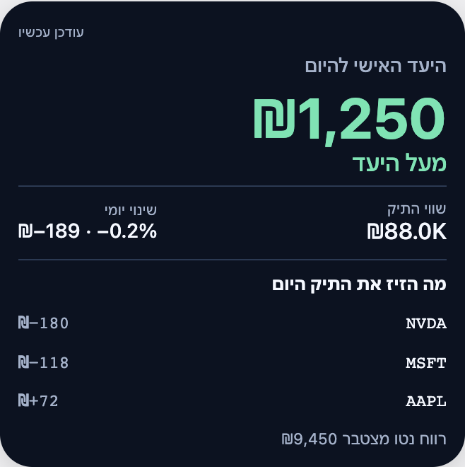

# LiveStocks


אייקון המותג האחיד הוא גרף עולה בגוון כחול בתוך ריבוע מעוגל. מקור העיצוב הוא `public/brand/livestocks.svg`, המשמש בסרגל הצד, בכותרת בנייד ובדפדפן. קובצי PNG בגודל 32 ו־180 פיקסלים באותה תיקייה הם גרסאות של אותו סמל לדפדפנים ולמסך הבית ב־Apple; יש לייצר אותם מחדש מה־SVG בכל שינוי בעיצוב.

אפליקציית ווב לניהול ומעקב תיק מניות, עם תמיכה בעברית/אנגלית (RTL/LTR), ארבעה מסכי עבודה מרכזיים ותשתית נתונים מבוססת Supabase.

## מה הפרויקט כולל
- סקירה עם שווי ההחזקות, רווח/הפסד, יעד תשואה אישי, גרף ביצועים משותף למסך הביצועים וגרף מחיר קטן לכל מניה, שינוי יומי ותשואה מאז הקנייה באחוזים
- פעילות: ניהול פוזיציות, עסקאות BUY/SELL, lots, עמלות ומיקום תיק
- ביצועים: היסטוריה, השוואה ליעד אישי ורווח ממומש באותו מסך
- Watchlist עם קבוצות, כרטיסי מניות, היסטוריית מחירים וגרירה למיון
- חלונית ייצוא לניתוח חיצוני, כפרומפט מחקר או JSON מצומצם
- הצעות קומפקטיות לסגירה מלאה של זוג פוזיציות כשהרווח באחת מכסה את ההפסד בשנייה
- Scriptable iOS widget מקומי שמציג סטטוס תיק מתוך אותו API
- המרות USD/ILS ושערים היסטוריים, לפי זמינות הספקים
- API פנימי ב-Next.js לציטוטים, נרות ופורטפוליו

## Stack טכנולוגי
- `Next.js 16` (App Router)
- `React 18` + `TypeScript`
- `Tailwind CSS` + `Radix UI`
- `Supabase` (Postgres + RLS)
- `Vitest` + `Testing Library`
- ספקי נתונים:
  - `Finnhub` למחירי מניות
  - `Yahoo Finance chart API` לנתוני נרות/היסטוריה
  - `open.er-api.com` לשערי מטבע

## מבנה תיקיות
```text
app/
  api/                          # API routes פנימיים
  ai-prompts/                   # הפניה לחלונית הייצוא בסקירה
  insights/                     # הפניה להיסטוריית הביצועים
  exceptions/                   # הפניה ללשונית היעד האישי
  portfolio/                    # היסטוריה, יעדים ורווח ממומש
  positions/                    # עסקאות, החזקות והיסטוריית lots
  realized/                     # הפניה ללשונית הרווח הממומש
  settings/                     # הגדרות שפה/מטבע/Token
  stock/[symbol]/               # דף מניה
  watchlist/                    # רשימות מעקב

components/
  dashboard/ portfolio/ watchlist/ charts/ ui/

hooks/
  use-portfolio-data.ts         # טעינת נתוני תיק וחישובי ציר זמן
  use-watchlist.ts              # לוגיקת watchlist

lib/
  calculations.ts               # חישובים פיננסיים
  context.tsx                   # AppProvider: שפה, הגדרות ורענון משותף
  plans.ts                      # מנוע תוכניות; אינו מופעל אוטומטית בממשק
  services/                     # Finnhub, exchange-rate, historical-fx
  supabase.ts                   # יצירת Supabase client וטייפים

supabase/
  migrations/                   # כל המיגרציות
  seed.sql                      # seed מקומי
  config.toml                   # קונפיגורציית Supabase CLI

```

## מסכים מרכזיים באפליקציה
ארבעת המסכים הראשיים הם:

- `/` **סקירה**: שווי ההחזקות הפעילות, רווח/הפסד, יעד אישי להיום, פער מהיעד, גרף ביצועים והחזקות עם חיפוש, סינון וגרף מחיר קטן לכל מניה, שינוי יומי ותשואה מאז הקנייה באחוזים
- `/positions` **פעילות**: עסקאות, החזקות והיסטוריית lots במסך אחד, ללא לשוניות. `?action=add` פותח בחירה בין הוספת פוזיציה חדשה לבין עסקת BUY/SELL בפוזיציה קיימת
  בחירת פוזיציה מציגה כרטיס עם לוגו, שם חברה, כמות וחשבון. בפוזיציה חדשה מספיק להקליד סימול או לבחור תוצאת חיפוש: שם החברה והלוגו מתמלאים מההחזקות הקיימות או מ־Finnhub. עריכה ידנית זמינה במקרה הצורך; חיפוש מקוון דורש Finnhub token מוגדר. מתגי העמלות תומכים בעברית ובאנגלית עם אזור מגע בגודל 44 פיקסלים.
  **מניעת כפילויות:** סימול מנורמל (ללא רווחי קצה וללא תלות באותיות גדולות) + חשבון מזהים פוזיציה אחת, גם לאחר סגירה מלאה. טופס פוזיציה חדשה עובר למצב הוספת קנייה או פתיחה מחדש, מציג את הכמות והמחיר הממוצע הנוכחיים, ומשתמש בשדות מחיר/כמות/תאריך של הקנייה החדשה במקום שדות רכישה ראשונה. הוא מוסיף קניית BUY לאותה פוזיציה ושומר את העסקאות והרווח הממומש; אותו סימול בחשבון אחר נשאר נפרד. השמירה אטומית דרך `record_position_purchase`, עם מפתח בקשה למניעת עסקה כפולה בניסיון חוזר. אינדקס ייחודי חוסם כפילויות גם בעריכה ובלקוחות ישנים. יש להחיל `20261110130000_reuse_position_identity.sql` לפני הפעלת הקוד; המיגרציה עוצרת לבדיקה אם כבר קיימות כפילויות ואינה ממזגת או מוחקת היסטוריה.

- `/portfolio` **ביצועים**: לשוניות היסטוריה (`?view=history`), יעד אישי (`?view=targets`) ורווח ממומש (`?view=realized`), עם פירוט מטבעות ואומדן מס לפי הצורך
- `/watchlist` **מעקב**: רשימת השוואה קומפקטית עם מחיר, שינוי יומי, שינוי בטווח וגרף קטן לכל מניה


בסקירה, **התיק במספרים** מציג שווי של ההחזקות הפתוחות, רווח/הפסד מצטבר (ממומש ולא ממומש), יעד רווח אישי להיום והסכום שחסר ליעד או נמצא מעליו. ברירת המחדל היא כותרת קצרה וסכום לכל נתון; הפסד וחוסר ליעד מסומנים במפורש. פירוט המשמעות ובסיס החישוב זמינים בפתיחת ״מה כלול?״, וסימון קצר של ניכוי העמלות ואומדן המס מסונכרן עם אפשרויות החישוב בגרף.

כרטיסי ההחזקות וטבלת הסקירה מציגים את לוגו החברה מתוך נתוני המניה, עם מקורות חלופיים במקרה של כשל טעינה והתאמת הלוגו למסגרת לבנה ללא חיתוך, הצללה מלאכותית או יצירת תמונת אותיות. עבור CAPR נעשה שימוש בסמל המרובע מאתר החברה כדי להימנע מהקטנת לוגו מילולי בתוך אייקון. מקור: [האתר הרשמי של Capricor](https://www.capricor.com/) ו־[קובץ הסמל המקורי](https://d1io3yog0oux5.cloudfront.net/_b0d022e4c7dfa1af06d98e16045a450c/capricor/files/theme/images/favicons/apple-touch-icon.png).

בתצוגת כרטיסי ההחזקות (בנייד ובמחשב ברוחב קטן מ־1280px), גם כרטיס מכווץ מציג את מחיר המניה כעת ואת מחיר המכירה הדרוש ליעד האישי, שניהם בדולרים, את העלייה הנדרשת באחוזים (או כמה המחיר מעל היעד) ואת שווי ההחזקה במטבע התיק. גם בטבלה הרחבה מחירי השוק והמכירה ליעד מופיעים לצד המרחק מהיעד. מחיר המכירה הוא `requiredExitPrice`, המחושב לכל יתרת המניות של הסימול בכל החשבונות: עלות היתרה + הרווח הנדרש לפי היעד על המניות הפתוחות והנמכרות − הרווח שכבר מומש, חלקי כמות המניות שנותרו. כך הפסד במכירה חלקית מעלה את מחיר המכירה הנדרש ליתרה, ורווח קודם מפחית אותו. עמלות שנרשמו נכללות, לפני מס וללא עמלת מכירה עתידית. המחיר מעוגל מעלה לסנט והמרחק באחוזים מחושב מול המחיר המוצג. היעד מחושב להיום ואינו תחזית. כשחסר יעד מלא אין החלפה ביעד של המניות הפתוחות בלבד. הסינון והמיון לפי יעד משתמשים באותו מחיר מכירה. פתיחת הכרטיס רציפה ומציגה עלות, שינוי יומי, רווח פתוח, גרף רווח מצטבר, כמות, משקל בתיק ותאריך כניסה. הסבר החישוב נפתח לפי בחירה.

בכרטיסי ההחזקות משמש אותו גרף **רווח מצטבר בדולרים** גם כרקע מכווץ וגם כגרף המורחב, עם מעבר רציף. הרווח כולל מימושים קודמים ואת השווי שנותר פחות העלות שנותרה, בכל חשבונות הסימול; כך גם צבע הרקע והתג האחרון משתמשים באותו בסיס. מחיר המניה ומחיר המכירה ליעד נשארים בכותרת הכרטיס. קו האיזון הוא 0 רווח אמיתי וקבוע, ויעד הרווח המצטבר מחושב לכל יום לפי העסקאות עד סוף אותו יום ב־UTC ושיעור התשואה השנתי שמוגדר כעת. מניות שנמכרו מפסיקות לצבור יעד במועד המכירה; רווחים והפסדים ממומשים נשמרים גם לאחר סגירה ופתיחה מחדש. בכך נמנעות קפיצות מלאכותיות עקב שינוי העלות הממוצעת או חלוקת הפסד על יתרת מניות קטנה יותר. שינויי רווח אמיתיים ממחירים, ביצועים ועמלות אינם מוחלקים או מוסתרים. שיעור יעד חיובי יוצר יעד רווח שאינו שלילי; שיעור שלילי שהוגדר במפורש נשמר. קטעי הקו וההצללה צבועים יחד: אדום בהפסד, כחול ברווח שמתחת ליעד וירוק ביעד ומעלה. עסקאות עתידיות אינן משנות ימים קודמים, נתונים חסרים יוצרים פערים, ואין חיבור מלאכותי דרכם. סימוני העסקאות ממוקמים לפי תאריך ובגובה הרווח הנצפה בין ימים סמוכים; מחיר ביצוע העסקה מוצג בריחוף ואינו משמש כערך על ציר הרווח. לפני תחילת ההשקעה אין רווח מומצא. הפרטים הסגורים מוסתרים מהמיקוד ומקוראי מסך, הרקע דקורטיבי, והמעברים מכבדים הפחתת תנועה.

סרגל המעקב מפריד בין חיפוש מניה לבין טווח ההשוואה, עם בחירת תאריך התחלה נפרדת. חלונית המניה מפרידה בין מחיר נוכחי, שינוי יומי לעומת הסגירה הקודמת ושינוי בטווח הנבחר; מוצגים גם מחיר הבסיס ותאריך הבסיס. זמן רענון הנתונים אינו בהכרח זמן ציטוט השוק.

במעקב, בחירת שורה מציגה גרף מפורט אחד לצד הרשימה במחשב רחב, ובחלונית בנייד. הקבוצה, החיפוש, טווח הזמן, תאריך ההתחלה ובחירת המניה (`stock`) נשמרים בכתובת, גם בחזרה מפרטי מניה. רענון, עריכה ומחיקה זמינים בתפריט הפעולות; מצב סידור מציג ידיות גרירה ומאפשר סידור גם במקלדת. חיפוש משאיר את בחירת המניות פעילה ומשהה את שינוי הסדר.

פתיחת כרטיס החזקה וסגירתו משתמשות במעבר גובה חלק וחץ מונפש; כרטיס אחד פתוח בכל פעם.

מתחת להחזקות מופיע אזור **הצעות לסגירת שתי פוזיציות**. כל כרטיס מציג שתי מניות באותו חשבון: אחת מעל יעד התשואה האישי ואחת מתחתיו. הסכום המרכזי הוא **היתרה מעל היעד = רווח משולב בסגירה פחות יעד הרווח להיום**. במצב המכווץ מופיעים רק המניות, הבנק, היתרה מעל היעד וגרף קצר. בפתיחה מופיעים הרווח בסגירה ויעד הרווח בנפרד, הסבר החישוב ופרטי המניות. הגרף והכרטיס משנים גובה בהדרגה, והכיתובים מופיעים ונעלמים במעברי גובה ודהייה ללא קפיצות; בהעדפה להפחתת תנועה המעברים מבוטלים. היעד נצבר בריבית דריבית לפי שיעור התשואה שבהגדרות, ממועד כל קנייה על עלות יתרת המניות בשיטת FIFO, כולל עמלות הקנייה שהוזנו. הוא יעד אישי ולא תחזית שוק. החישוב מתייחס ליתרות הנוכחיות, ללא תוצאות ממכירות קודמות.

מוצגים עד שלושה זוגות שבהם גם הרווח בסגירה וגם היתרה מעל היעד הם לפחות סנט, ללא חזרה על סימול גם בין חשבונות. גם מניה רווחית שנמצאת מתחת ליעד יכולה להיכלל בצד החוסר. הבחירה מדורגת לפי החוסר המכוסה מול היעד ולאחריו היתרה מעל היעד. נתונים לא תקינים אינם משמשים להצעות. כרטיס נפתח ונסגר באופן עצמאי בלחיצה על כל התצוגה המקדימה, כולל הגרף, ותומך במקלדת ובהפחתת תנועה. בפירוט מוצגים הכמות, המחיר, הרווח, יעד הרווח והפער לכל מניה, וכן התמורה המשוערת. מספר העמודות מותאם לרוחב ולמספר ההצעות.

הגרף מציג הדמיית **הפער מהיעד האישי לאורך זמן** לפי הכמויות והעלות שנותרו היום. יעד הרווח נצבר מחדש עד לסוף כל יום UTC המוצג; קו האפס מסמן עמידה ביעד ולא רק איזון כספי. החישוב מתחיל ביום הקנייה האחרון שנכלל ביתרות ומשתמש רק בסגירות יומיות משותפות, ללא השלמת מחירים חסרים או הוספת ציטוט חי. זו אינה היסטוריית התיק בפועל; כשאין שתי נקודות משותפות מוצגת הודעה. הסגירה ההיסטורית האחרונה מסומנת בנפרד עם תאריך אם שונה מהפער במחיר העדכני.

כפתור **בדיקת AI** מעתיק מקומית רק את הזוגות המוצגים, ללא תלות במצב פתיחתם, עם כמויות, מחירים, עלות FIFO, רווח, שיעור יעד שנתי, יעד רווח ויתרה מעל היעד. הפרומפט מבקש מחקר מעמיק על שתי המניות בכל זוג והכרעה מפורשת בעד סגירת שתיהן או נגדה, עם מקורות, נימוקים וטיעון נגדי. הוא מבקש לאמת גם את הפער מהיעד ולהבדיל בין היעד האישי לתחזית שוק. אם המחקר תומך בסגירת זוג אחד או יותר, הפרומפט דורש מחקר מעמיק במניות חלופיות, בחירה במניה מועדפת אחת או עד שלוש עם הצדקה לפיזור, והשוואה להמשך החזקת המניות ולמזומן. תקציב המחקר מבוסס רק על התמורה ברוטו של הזוגות שאושרו, ולא על הרווח או היתרה מעל היעד; מס ועלויות עדיין אינם ידועים. אם אין חלופה מוצדקת, נדרשת אפשרות להישאר במזומן ללא המלצת קנייה כפויה. כאשר אין מידע עדכני נדרשת התנגדות לביצוע ללא אימות. המשתמש מדביק את הפרומפט בשירות AI לבחירתו; אין שליחה אוטומטית או ביצוע מכירה. כל הסכומים בדולרים ולפני מס ועלויות מכירה עתידיות.
קישור נפרד מוביל לדף המניה. הבחירה נשמרת בכתובת (`holding`) ומשוחזרת בחזרה לדף יחד עם החיפוש והסינון.
הכרטיסים תומכים במקלדת, מסתירים פרטים סגורים מקוראי מסך ומסדר המיקוד, ומכבדים העדפה להפחתת תנועה.

`/settings` נשאר כלי משני להגדרת שפה, מטבע, יעד תשואה שנתי ו-Finnhub token; תדירות הרענון נקבעת אוטומטית לפי שעות המסחר. `/stock/[symbol]` מציג פירוט מניה, עם חזרה לרשימה ולסינון שמהם נפתחה.

כרטיס הביצועים מציג כותרת קומפקטית, בחירת טווח בעברית, מקרא וקווי רקע עדינים. אפשרויות החישוב וההסברים נפתחים לפי בחירה. בסקירה הקישורים ליעדים ולכל הביצועים מאוחדים בתחתית הכרטיס, ללא שורת פער כפולה.

הסקירה והביצועים משתמשים באותו גרף ובאותו בסיס חישוב: רווח ממומש ולא ממומש **אחרי העמלות שהוזנו ואומדן מס על מימושים כברירת מחדל**, מול יעד התשואה האישי. אפשר לבחור נטו, ברוטו או לכלול עמלות ומס בנפרד; הגרף והסיכום משתמשים באותה בחירה. המס הוא אומדן לפי המודל הקיים, ולא רישום של מס שנגבה בפועל. היעד אינו תחזית שוק. קו הרווח צבוע באדום בהפסד, בכחול ברווח שמתחת ליעד ובירוק ברווח שביעד או מעליו; היעד מוצג בקו מקווקו. אין סיכום שבועי כפול או עמוד תובנות נפרד בניווט.

הגרף מחושב לפי ימים קלנדריים ב-UTC: מחיר הסגירה הזמין לאותו יום, וביום ללא מסחר המחיר האחרון שפורסם עד אליו. עסקאות ועמלות נכללות לפי מועד הביצוע ובשיטת FIFO. רווח בשקלים מחושב משווי ההחזקה בשער יום השווי פחות עלות הקנייה בשער יום הקנייה; תמורת מכירה מחושבת בשער יום המכירה. היעד צובר תשואה לכל מנת קנייה, על העלות כולל עמלה ובשער הקנייה, ונעצר במועד מכירתה. היום משתמש באותם כללי חישוב ובנתונים החיים הזמינים. שער היסטורי חסר אינו מוחלף בשער הנוכחי; הערך מוצג כחסר.

נתיבים ישנים נשמרו כהפניות: `/insights` אל `/portfolio?view=history`, `/exceptions` אל `/portfolio?view=targets`, ו-`/realized` אל `/portfolio?view=realized`. `/ai-prompts` מפנה אל `/?export=research`, שפותח את חלונית **ייצוא לניתוח**; אפשר לפתוח אותה גם מהסקירה וממסך הביצועים.

## API פנימי (Next.js Route Handlers)
- `GET /api/quote?symbol=...` ציטוט למניה אחת (עם cache קצר בזיכרון)
- `GET /api/quotes?symbols=AAPL,MSFT` ציטוטים מרובים
- `GET /api/candles?symbol=...&from=...&to=...&resolution=D|60|W|M` נרות מחיר
- `GET /api/exchange-rate` שער USD→ILS
- `POST /api/portfolio` חישוב summary + metrics + realized מול Supabase
- `GET /api/portfolio/combined-pnl` סיכום משולב לתיק
- `GET /api/portfolio/dashboard` נתוני המקור המשותפים למסכי התיק
- `GET /api/portfolio/ai` תמונת תיק מלאה לקריאה בלבד (מפורטת בהמשך)

## בסיס נתונים (Supabase)
טבלאות עיקריות:
- `positions` פוזיציות בסיס
- `position_lots` פעולות BUY/SELL בפועל
- `position_plans` נתוני תוכניות קיימים (pending/triggered/expired/cancelled); נשמרו לתאימות, ללא ממשק תכנון גלוי
- `settings` שורת הגדרות גלובלית (singleton)
- `watchlist_groups` קבוצות watchlist
- `watchlist_tickers` ניירות בתוך כל קבוצה

הערות חשובות:
- קיימת תמיכה בעמלות ב-`position_lots` ו-`position_plans`
- `positions.location` ו-`position_plans.location` משתמשים ב-enum `position_location`
- ב-local המיגרציות מגדירות מדיניות RLS פתוחה לפיתוח

## משתני סביבה
העתיקו:
```bash
cp .env.exemple .env.local
```

משתנים:
- `NEXT_PUBLIC_SUPABASE_URL` חובה
- `NEXT_PUBLIC_SUPABASE_ANON_KEY` חובה
- `FINNHUB_TOKEN` אופציונלי אך מומלץ מאוד
- `DEFAULT_GROWTH_RATE` אופציונלי (ברירת מחדל חישובית)
- `DEFAULT_USD_TO_ILS_RATE` אופציונלי (fallback)
- `EXCHANGE_RATE_URL` אופציונלי
- `OPENAI_API_KEY` אופציונלי (כרגע לא קריטי ל-core flow)

## התקנה והרצה מקומית
### 1) התקנת תלויות
```bash
npm install
```

### 2) העלאת Supabase מקומי
```bash
npx supabase start
```

### 3) החלת סכימה + seed
```bash
npx supabase db reset
```

### 4) הרצת האפליקציה
```bash
npm run dev
```

האפליקציה תהיה זמינה ב-`http://localhost:3000`.

## פקודות שימושיות
- `npm run dev` הרצת פיתוח
- `npm run build` בנייה לפרודקשן
- `npm run start` הרצת build
- `npm run lint` בדיקות ESLint
- `npm run typecheck` בדיקת TypeScript
- `npm test` הרצת בדיקות Vitest

## iOS widget
עותק להפצה של קוד ה-widget ל-Scriptable נמצא ב־[`output/widget/Stocks Status.js`](output/widget/Stocks%20Status.js), לצד [הוראות ובדיקות](output/widget/README.md). להתקנה יש להעתיק אותו ל־Scriptable ב־iCloud. התצוגות המקדימות משתמשות בנתוני דוגמה; הרינדור המקורי ב־iPhone לא אומת.



ה-widget קורא ל-`POST /api/portfolio` עם `includeWeightedPrice: true` ו-`targetCurrency: "ILS"`, ולכן הוא נשאר מסונכרן עם אותו חוזה API של האפליקציה.

## בדיקות
תיקיית `__tests__/` כוללת בדיקות עבור:
- חישובים (`calculations`)
- FX היסטורי
- watchlist
- plans
- נתוני תיק משותפים, בסיס רווח לפני/אחרי מס, ניווט מסכים וייצוא לניתוח

להרצה:
```bash
npm test
```

## זרימת נתונים בקצרה
1. נתונים נשמרים ב-Supabase (`positions`, `lots`, `plans`, `settings`, `watchlist`).
2. `PortfolioDataProvider` משתמש ב-`/api/portfolio/dashboard`; צרכני `usePortfolioData` חולקים טעינה, חישובים ומצב רענון אחד.
3. מסכי UI וחלונית הייצוא צורכים את הנתונים המשותפים. רענון שנכשל משאיר את הנתונים האחרונים ומציג הודעה עם ניסיון חוזר.
4. `AppProvider` מנהל שפה, הגדרות, תדירות רענון וטריגרים לרענון. הוא אינו מפעיל את `processPendingPlans`. נתוני התוכניות וה-API הקיים נשמרו, אך תכנון עתידי אינו חלק מהממשק.

## דגשים לפיתוח שוטף
- הפרויקט תלוי בהגדרת Supabase env vars; בלעדיהם ייזרק error בעלייה.
- ללא `FINNHUB_TOKEN` המערכת תעבוד חלקית (פחות נתונים חיים).
- קבצי `tmp/` ו-`output/` הם ארטיפקטים מקומיים ולא חלק מה-runtime הקריטי.
- `seed.sql` קיים אך מינימלי, מומלץ להרחיב אותו ל-onboarding מהיר.

## Troubleshooting מהיר
- `Supabase client is not configured`:
  - לבדוק `NEXT_PUBLIC_SUPABASE_URL` ו-`NEXT_PUBLIC_SUPABASE_ANON_KEY`.
- אין ציטוטים חיים:
  - לבדוק `FINNHUB_TOKEN` ב-`.env.local` ובטבלת `settings`.
- שגיאות טיפוסים/בנייה:
  - להריץ `npm run typecheck` ואז `npm run build`.

## קריאת נתונים ל-AI
חלונית **ייצוא לניתוח** בסקירה ובביצועים משתמשת באותו `usePortfolioData` של שאר מסכי התיק ואינה טוענת עותק נפרד. אפשר לבחור מניות ולעבור בין פרומפט מחקר ל-JSON לפני ההעתקה ללוח.
`lib/ai-snapshot.ts` מאחד החזקות פתוחות לפי סימול מנורמל ומייצר רשומה אחת לכל מניה.
מחיר הכניסה משוקלל לפי הכמות; ההקצאה מחושבת מול כל התיק הפתוח גם כאשר נבחרת רק קבוצת מניות.
המסמך כולל גרסת מבנה, זמן הטעינה האחרונה, מצב רענון, מטבע המחירים ובסיס ההקצאה. ערך חסר מיוצג ב-`null`.
הייצוא אינו כולל כמויות, מזהי החזקות, שווי תיק או סכומי רווח/הפסד. הפרומפט כולל את אותו JSON פעם אחת.

### תמונת תיק מלאה לניתוח AI

`GET /api/portfolio/ai` מחזיר JSON מלא לקריאה בלבד (ללא הרצת תוכניות), בשונה מהייצוא המצומצם בחלונית ייצוא לניתוח.

```bash
curl --fail http://localhost:3000/api/portfolio/ai
```

אפשר לתת לכלי AI בעל גישה לשרת את הכתובת `<your-app-url>/api/portfolio/ai`, או להעביר אליו את ה-JSON.

התמונה נשמרת במטמון Data Cache של Next.js בצד השרת ל־5 דקות, גם בין בקשות ומופעי שרת ב־Vercel. לאחר מכן בקשה יכולה לקבל את התמונה הקודמת בזמן רענון ברקע (stale-while-revalidate); `generatedAt` נשאר זמן יצירת התמונה המקורית. שינויים בתיק ובהגדרות מופיעים לאחר הרענון. פרמטרים בכתובת וכותרות בקשה אינם עוקפים את המטמון.

בקשות מקבילות באותו מופע שרת מאוחדות לטעינה אחת. כשל בטעינה גורר המתנה של 30 שניות באותו מופע לפני ניסיון נוסף; שגיאה אינה נשמרת כתמונת תיק מוצלחת. ללא תמונה זמינה מוחזר `500` עם `Retry-After: 30`; אם יש תמונה קודמת, מטמון Next.js יכול להמשיך להחזיר אותה בזמן תקלה. התשובות נשארות `private, no-store` בדפדפן וב־CDN. זהו צמצום עומס על בסיס הנתונים וספקי המידע, ולא חסימת תעבורה או מגבלת בקשות גלובלית; טעינות ראשונות במופעי שרת נפרדים עדיין עשויות לחפוף.

- `schemaVersion`, `startedAt`, `generatedAt`: גרסת החוזה וחלון איסוף הנתונים. הקריאות לבסיס הנתונים אינן טרנזקציה אטומית.
- `summary`: סיכום החזקות פתוחות יחד עם רווח ממומש ויעד; `totalValue` ו-`totalCost` הם ב-USD, `totalCurrentPnL*` כוללים ממומש ולא ממומש. `totalTaxesPaid*` הם **אומדן** מס של האפליקציה, ולא אישור מס ששולם.
- `holdings`: החזקות פתוחות, כמויות ומיקום, שווי, רווח לא ממומש, אחוז הקצאה ויעד מחיר.
- `positions`: כל הרשומות, לרבות סגורות, ועסקאות BUY/SELL עם תאריכים ועמלות.
- `goals`: יעד התשואה השנתי שנשמר בהגדרות ושיעורו באחוזים. `symbolTargets` כוללים מחיר יציאה נדרש לפי כל מחזורי ההחזקה של הסימול והמימושים. `currentGapUsd` חיובי מציין חוסר לעמידה ביעד. אלה יעדים אישיים להיום, לא תחזיות שוק.
- `plans`: כל תוכניות הקנייה והמכירה, כולל תוכניות שאינן מחוברות לפוזיציה, הסטטוס, הכמות, המחיר ותאריך היעד.
- `realizedSales`, `realized`: מכירות ממומשות, עלות, תמורה, רווח ואומדן מס במודל 25%.
- `quotes`, `currencies`, `dataQuality`, `limitations`: מקורות, זמני ציטוט, שערי מטבע, נתונים חסרים ומגבלות חישוב. שערי ILS היסטוריים משתמשים בנתוני יום זמינים ובשער נוכחי כגיבוי.

מחיר שוק חסר מוחזר כ-`null`; אין החלפה במחיר הכניסה. אם חסר מחיר להחזקה פתוחה, `summary` ואחוזי ההקצאה מוחזרים כ-`null`, כדי לא להציג תיק חלקי כתיק שלם. בהיעדר FX לא מוחזרים סכומי ILS. בהיעדר יעד אישי לא מומצא יעד ברירת מחדל. זמן יצירת התשובה אינו זמן עדכון מחיר השוק.

הנתיב פועל באותו מודל גישה משותף של ה-API הקיים, ללא מנגנון אימות חדש. התשובה כוללת מידע כספי מלא; יש להגן על הגישה לשרת אם הוא נגיש מבחוץ. מפתחות ספקים אינם כלולים בתשובה. לא נשמרים באפליקציה מזומן, התחייבויות, הפקדות/משיכות, דיבידנדים, אופק השקעה או סיבולת סיכון; אין להסיק שהם אפס.
