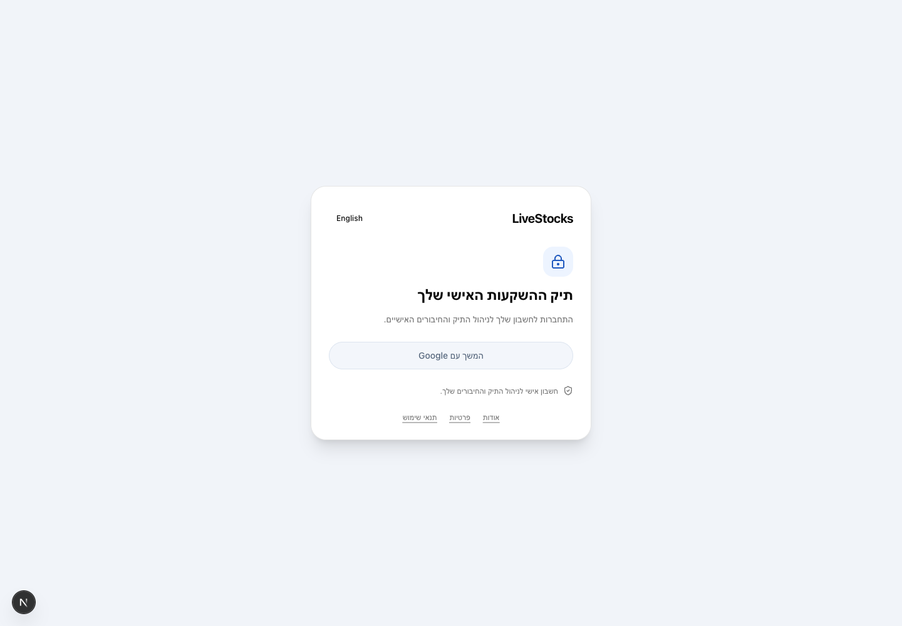
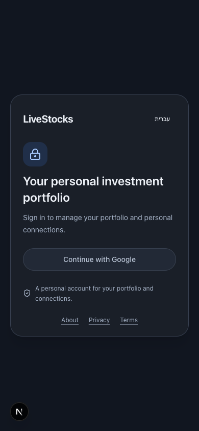
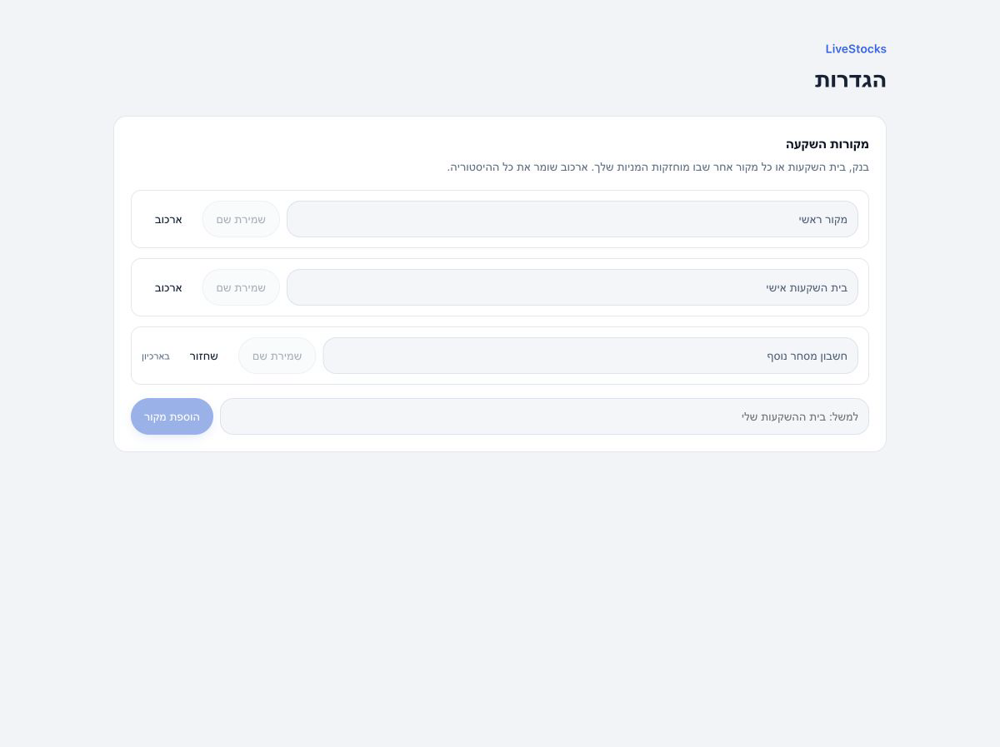
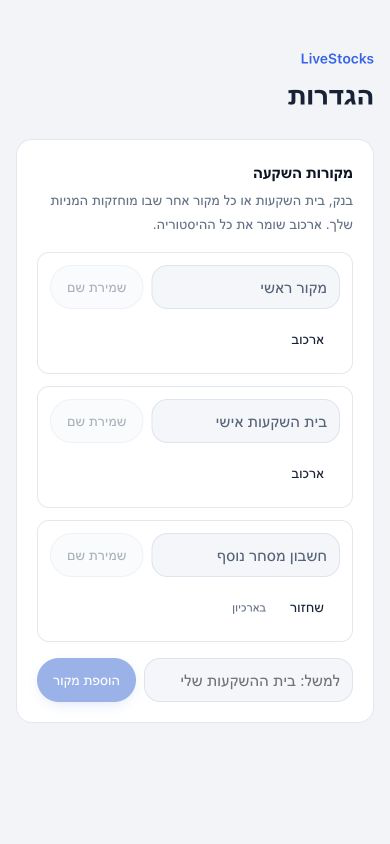
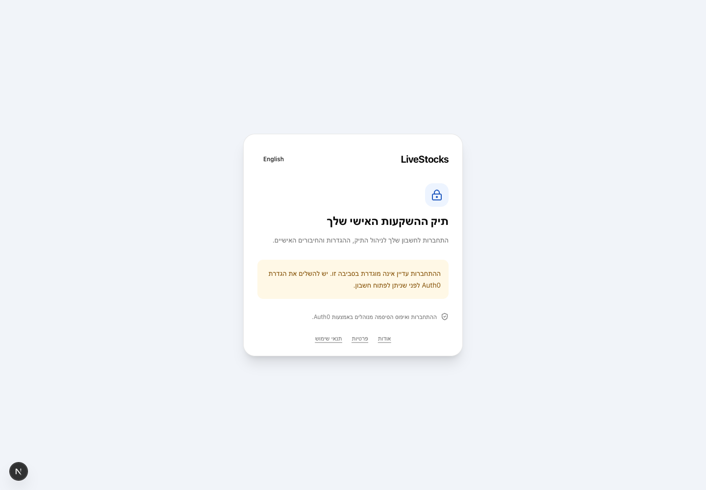
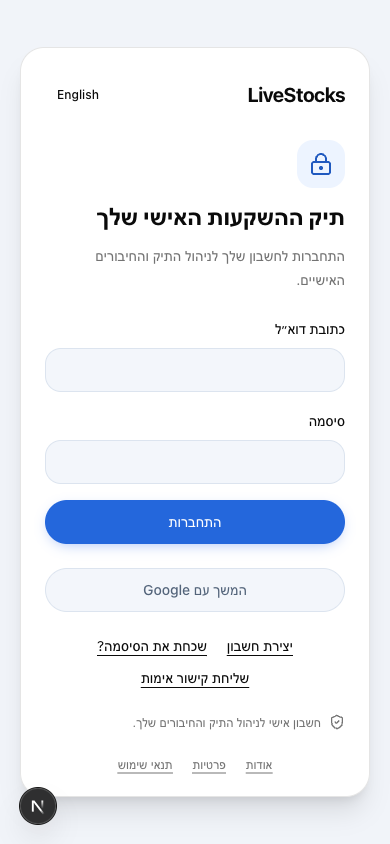
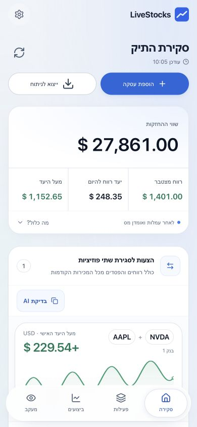
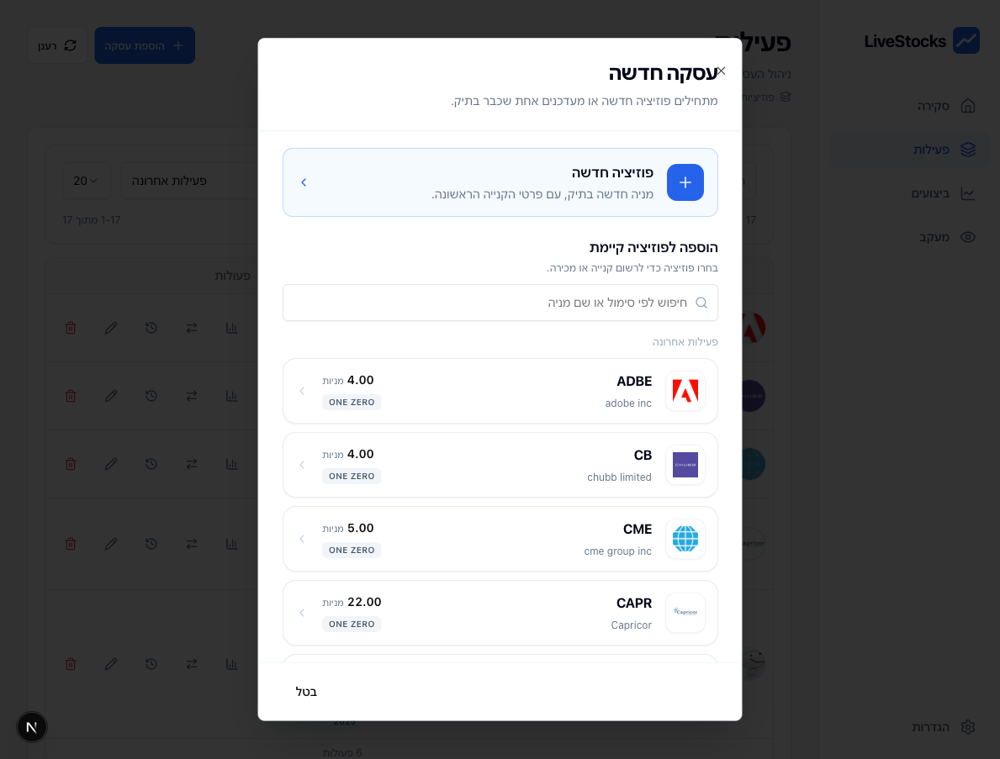
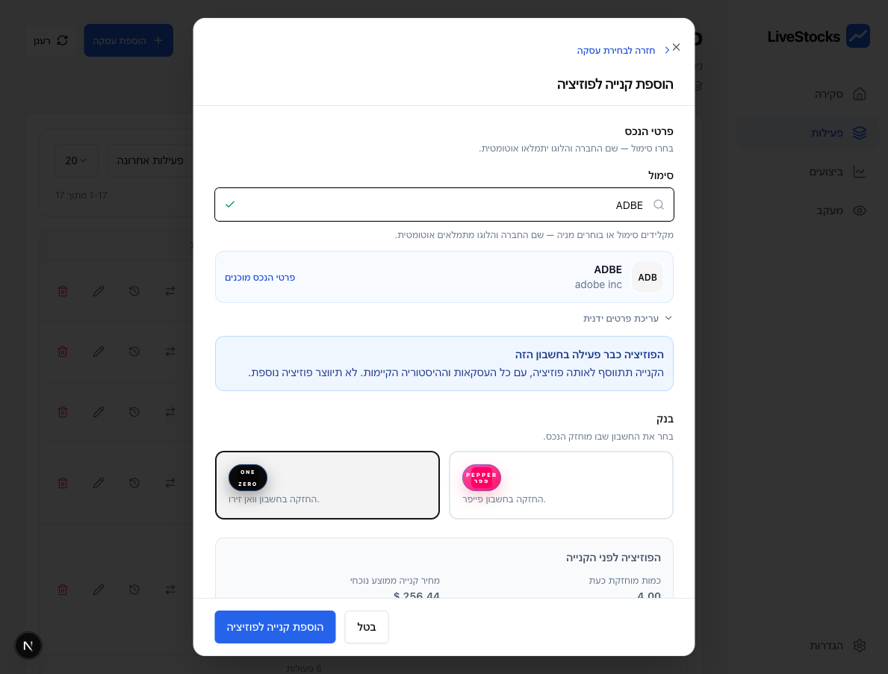
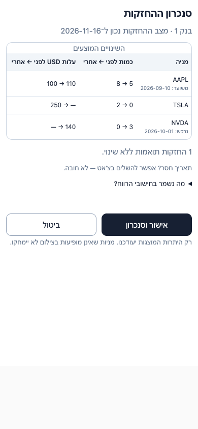

# LiveStocks

**חשבונות אישיים פעילים בייצור, עם כניסה ב־Google בתוך זרימת האתר.** [פתיחת האתר](https://razmaz-live-stocks.vercel.app) · [LiveStocks (OAuth) ב־ChatGPT](https://chatgpt.com/plugins/plugin_asdk_app_6af9b5f79fe48191a12eaa9c67d6ae7b).

התיק הקיים הועבר לחשבון שאושר במפורש, אחרי גיבוי מוצפן ובדיקת שחזור. ההשוואה לאחר ההעברה אימתה שימור של 17 פוזיציות, 55 עסקאות, כל המזהים, חותמות הזמן, ההגדרות ורשימת המעקב. כל משתמש ניגש לנתונים שלו בלבד; מפתחות Finnhub מוצפנים בשרת ואינם מוחזרים לממשק.

כניסות חוזרות באותה זהות Google חוזרות לאותו חשבון. האיחוד הכללי פעיל לאחר אישור הפעלה מפורש: התאמת אימייל מציעה מועמד בלבד, ושני חשבונות קיימים מחייבים אימות טרי של שניהם, סקירה ואישור לפני שינוי בעלות. משימת התאוששות מאומתת מוגדרת פעם ביום ב־04:00 UTC; האישור מנסה להשלים מיד, וקישור התאוששות מאפשר להמשיך גם אחרי ניתוק sessions.

הפלאגין החדש הוא היחיד המותקן. קריאת התיק האישי, חידוש הרשאה, ביטול וחיבור מחדש נבדקו בפועל. הפלאגין הישן הוסר מההתקנות. API הווידג׳ט עבר 25 בדיקות ייצור עם מפתח תקין, מבוטל ופג; בדיקת iPhone פיזי עדיין לא בוצעה.

הבדיקה המלאה האחרונה: **1005 עברו ו־3 בדיקות native אופציונליות דולגו בחבילה הרגילה**; בדיקות הספק והאיחוד המקומיות הורצו בנפרד ועברו. lint, טיפוסים, build מקומי ו־Vercel עברו. [הוכחת הפריסה](docs/verification/personal-accounts-production-release-2026-11-15.json) · [שימור הנתונים](docs/verification/production-personal-account-cutover-2026-11-15.json) · [אימות הפלאגין](docs/verification/chatgpt-oauth-activation-2026-11-15.json) · [מסמך המסירה](docs/ACCOUNTS_HANDOFF.md).

[מפתח Finnhub הוחלף ואומת](docs/verification/finnhub-key-rotation-2026-11-15.json): המפתח החדש עובד ונשמר מוצפן; המפתח הישן נדחה בידי הספק.

ההשקה היא Google בלבד. אימייל/סיסמה ומשלוח דוא״ל כבויים (`PASSWORD_AUTH_ENABLED=false`), והפעלתם בעתיד דורשת תשתית נפרדת. תיעוד וצילומי טפסי הסיסמה להלן מתארים אפשרות שאינה מופעלת בהשקה.

מסך ההשקה המקומי במצב Google בלבד (תצורה סינתטית, ללא כניסה אמיתית):

| עברית · מחשב | English · mobile dark |
| --- | --- |
|  |  |


אייקון המותג האחיד הוא גרף עולה בגוון כחול בתוך ריבוע מעוגל. מקור העיצוב הוא `public/brand/livestocks.svg`, המשמש בסרגל הצד, בכותרת בנייד ובדפדפן. קובצי PNG בגודל 32 ו־180 פיקסלים באותה תיקייה הם גרסאות של אותו סמל לדפדפנים ולמסך הבית ב־Apple; יש לייצר אותם מחדש מה־SVG בכל שינוי בעיצוב.

אפליקציית ווב לניהול ומעקב תיק מניות, עם תמיכה בעברית/אנגלית (RTL/LTR), ארבעה מסכי עבודה מרכזיים ותשתית נתונים מבוססת Supabase.

התחברות Google כוללת התאוששות מאתחול שרת שנכשל: הבקשה שנכשלה מחזירה שגיאה, ובקשה עצמאית הבאה יכולה לאתחל מחדש. אין ניסיון חוזר אוטומטי של פעולות. תקלות מדווחות לפי שלב וקודים מוגדרים בלבד, ללא הודעות שגיאה גולמיות או סודות. [אימות התחברות ובדיקת המקורות באתר החי](docs/verification/live-google-and-sources-2026-11-16.json).

## מקורות השקעה אישיים

היכולת פורסמה באתר ובמסד הנתונים ב־16.11.2026. כל משתמש חדש מתחיל ב„מקור ראשי” ויכול להוסיף בנקים, בתי השקעות או מקורות בשמות אישיים. בהגדרות אפשר לשנות שם, לארכב ולשחזר; בטופס החזקה חדשה אפשר ליצור מקור ולבחור אותו מיד. ארכוב מתאפשר רק ללא החזקות פעילות או הוראות ממתינות וכשנשאר מקור פעיל נוסף. ההיסטוריה נשמרת. בנקים קיימים מוסבים למקורות נפרדים, והמזהים והעסקאות נשמרים.

[מבנה הנתונים, המעבר ובדיקות](docs/INVESTMENT_SOURCES.md) · [הוכחת הפריסה ושימור הנתונים](docs/verification/investment-sources-production-2026-11-16.json). קוד הסנכרון ו־MCP משתמשים במזהי מקורות ובקטלוג השמות האישי; הנחיות המקורות האישיים פורסמו גם בפלאגין הקיים, בגרסה 1.1.2.

| מחשב · מקורות השקעה | מובייל · מקורות השקעה |
| --- | --- |
|  |  |

## חשבונות אישיים — Better Auth ו־Supabase

חזרה ללשונית מבצעת בדיקת התחברות שקטה ברקע, בלי לפרק את התיק או לאבד טיוטות. תגובה תקינה של אותו חשבון ותקלה זמנית ברשת משמרות את המסך; התנתקות מאומתת או מעבר לזהות אחרת מנקים את הנתונים. [21 בדיקות הרגרסיה ופריסת התיקון](docs/verification/background-session-revalidation-2026-11-15.json).

מסך ההשקה כולל כניסה עם Google בעברית ובאנגלית, עם תמיכה במצב בהיר וכהה. טפסי דוא״ל וסיסמה נשמרו בקוד כאפשרות כבויה להפעלה עתידית; הם אינם מוצגים ואינם נגישים ב־API במצב ההשקה. סיסמאות נשמרות כגיבוב בסכמה פרטית, ועוגיית ההתחברות מוגנת מגישת JavaScript. סודות ומפתחות אינם נשמרים ב־localStorage.

**מצב ההשקה:** האתר והאיחוד הכללי פעילים, Google הוא External / In production, והמשתמש אישר כניסה וצפייה בתיק הקיים. [הפלאגין החדש](plugins/livestocks-oauth/README.md) נבדק בחיבור אמיתי, כולל חידוש וביטול; הישן הוסר. בדיקת Google אנושית שנייה לא בוצעה לפי ויתור מפורש של המשתמש; הפרדת משתמשים סינתטיים נבדקה בענן ובמסד המקומי. תהליך ההגשה הציבורית ובדיקת iPhone הם שלבים נפרדים.

[בדיקת היסוד המקומית](docs/verification/onsite-local-foundation-2026-11-14.json): **711 בדיקות עברו**, בדיקת PostgreSQL הנפרדת ו־11 שלבי SQL עברו, וכן `lint`, בדיקת טיפוסים ו־build נקי. בדיקת ספק PostgreSQL מסומנת skipped בחבילה הרגילה ומורצת בנפרד באמצעות הסקריפט הייעודי. אלו אינן בדיקות ייצור.

בדיקות הטפסים והגבולות הציבוריים עברו **43 תרחישים ב־5 קבצים**, יחד עם בדיקת טיפוסים ו־lint ממוקד. בדפדפן מקומי נבדקו חמשת המסכים, עברית RTL ואנגלית LTR, מצב בהיר וכהה וגדלי מחשב ונייד. צילומי המסך משתמשים בתצורה סינתטית ובתגובה מדומה של בדיקת session; הם אינם הוכחה למשלוח דוא״ל או לכניסה אמיתית. בדיקת ספק נפרדת מול PostgreSQL מקומי כללה הרשמה, אימות, כניסה וטוקנים חתומים, עם דוא״ל מדומה.

השרת מאמת את המשתמש בכל API; לקוח Supabase בדפדפן מקבל הרשאה זמנית דרך `/api/account/database-token`, ללא שמירת טוקנים בדפדפן. נתוני התיק מוגנים בבעלות לפי חשבון ו־RLS. מפתחות Finnhub מוצפנים בשרת. החלפת חשבון או התנתקות מאפסות את נתוני הממשק והבקשות הקודמות. חיבור הפלאגין הוא לקריאה בלבד כברירת מחדל. הרשאת סנכרון נפרדת ומוגבלת מאפשרת רק התאמת יתרות שאושרה בכרטיס בתוך ChatGPT; הווידג׳ט נשאר לקריאה בלבד.

בדיקות Auth0 הקודמות נשמרות כראיה היסטורית בלבד ואינן מאמתות את Better Auth: [בדיקת ספק](docs/verification/auth0-oauth-gate-2026-11-14.json) הסתיימה ב־14 PASS ו־1 FAIL; [בדיקת Supabase מבודדת בענן](docs/verification/auth0-hosted-gate-2026-11-14.json) עברה 22 תרחישי הרשאה ו־4 בדיקות ניקוי; [בדיקת האתר המקומית הקודמת](docs/verification/account-local-e2e-2026-11-14.json) עברה 13 תרחישים. החריגה הידועה אצל Auth0 נשארת מסומנת FAIL בדוח המקורי.

| כניסה במחשב | כניסה בנייד |
| --- | --- |
|  |  |

מסך הכניסה משתמש בצבעי רקע וטקסט סמנטיים גם במצב כהה. נבדקו עברית ואנגלית במחשב ובנייד, ללא גלילה אופקית; [תצוגה כהה במחשב](docs/screenshots/account-sign-in-dark-desktop.png) ו־[תצוגה כהה באנגלית בנייד](docs/screenshots/account-sign-in-dark-english-mobile.png) מציגות סביבה מקומית ללא חשבון או נתוני תיק. זמינות גם תצוגות של [הרשמה](docs/screenshots/account-sign-up-desktop.png) ו־[בקשת שחזור סיסמה](docs/screenshots/account-forgot-password-dark-mobile.png).

דפי `/about`, `/privacy` ו־`/terms` זמינים בכתובת הקנונית בעברית ובאנגלית עם פרטי המפעיל והתמיכה שאושרו. שלושתם נבדקו ללא התחברות: HTTP 200 בכתובת המדויקת, בלי הפניה. קישוריהם נשמרו ב־Google Branding; Google פורסם כ־External / In production; [הוכחת מצב הפרסום](docs/verification/google-public-sign-in-2026-11-15.json). הדפים אינם טוענים נתוני תיק, ובסביבה ללא `PUBLISHER_NAME` ו־`PUBLIC_SUPPORT_EMAIL` הם ממשיכים להחזיר 503. [תוכן המדיניות והחלטות הפרסום](docs/PUBLIC_POLICY_DRAFT.md).

איחוד חשבונות זמין ב״החשבון שלי״. לפני האיחוד מוצגים נתוני שני החשבונות אחרי שני אימותים טריים, ונבחרות הגדרות ומפתח לשימור. הרשומות והיסטוריית העסקאות נשמרות, ושינוי נתונים לאחר הסקירה דורש אישור סקירה מעודכנת. [חוזה ה־API והממשק](docs/ACCOUNT_LINKING_UI.md) · [השרת והתאוששות מכשל](docs/ACCOUNT_LINKING.md). לא בוצע איחוד כללי של שני תיקים אמיתיים בייצור; בדיקת השימור וההתאוששות משתמשת בנתונים סינתטיים וב־SDK ובמסד אמיתיים.

[מצב המסירה והשלבים שנותרו](docs/ACCOUNTS_HANDOFF.md) · [פרומפטים מוכנים לשיחות המשך](docs/CONTINUATION_PROMPTS.md)

במצב סיסמאות אופציונלי בלבד, אפשר להוסיף Google לחשבון סיסמה דרך ההגדרות לאחר אימות הסיסמה ובחירה מפורשת, או להוסיף סיסמה לחשבון Google באמצעות קישור לדוא״ל המאומת. שתי השיטות נשארות באותו מזהה חשבון ובאותו תיק; התאמת דוא״ל לבדה אינה מעניקה גישה. [מימוש שיטות הכניסה ובדיקות השימור](docs/SIGN_IN_METHODS.md) מתארים את ההגנות ואת הגבולות של בדיקות Google ודוא״ל מדומים.

מסך ההסכמה לחיבור OAuth נמצא ב־`/oauth/consent`: הוא מציג את החשבון והרשאות הקריאה, שומר את ההקשר החתום לאחר הכניסה וחוסם החלפת חשבון בזמן האישור. [מדריך ההסכמה ויצירת לקוח MCP](docs/OAUTH_CONSENT.md) כולל כלי יצירה מוגבל לשרת ובדיקת PostgreSQL מקומית עם ספק אמיתי. בדיקה זו אינה מאמתת חיבור בפועל מתוך ChatGPT או פריסה לייצור.

## עיצוב Liquid Glass

הממשק משתמש ברקע פנינה בהיר או גרפיט כהה, במשטחי נתונים יציבים ובזכוכית חלבית לניווט ולתפריטים. במחשב יש סרגל צד צף וטבלאות רחבות; בנייד יש סרגל תחתון בצורת קפסולה, כרטיסי החזקות נפתחים וטפסים כגיליונות תחתונים עם גלילה פנימית. שווי התיק הוא המדד הראשי, ואזור ההצעות לסגירת קבוצות מוצג תמיד מעל ההחזקות הפעילות עם מספר ההצעות בכותרת. פירוט הסגירה של כל קבוצה נפתח בנפרד.

בהגדרות → מראה אפשר לבחור **לפי המכשיר / בהיר / כהה** ולהפעיל **הפחתת שקיפות**. ברירת המחדל עוקבת אחרי המכשיר. ההעדפות נשמרות מיד בדפדפן המקומי (`livestocks-theme`, `livestocks-reduce-transparency`), בלי שינוי בהגדרות החשבון, ב־API או בחישובים. העדפת מערכת להפחתת שקיפות גוברת על הבחירה המקומית כאשר הדפדפן תומך בה. תנועה מופחתת מכובדת, ולדפדפנים ללא טשטוש יש משטח אטום חלופי.

צילומי המסך הבאים מציגים את הממשק האמיתי עם **נתוני הדגמה סינתטיים בלבד**, שנלכדו ב־14.11.2026 דרך שירות fixtures מקומי לקריאה בלבד, ללא גישה לתיק האמיתי. יש לרענן אותם כשמשנים את מבנה המסך או את חומרי העיצוב.

| בהיר — מחשב | כהה — מחשב |
| --- | --- |
|  |  |

<p align="center">
  
  
</p>

אימות העיצוב כולל עברית RTL ואנגלית LTR, מסכי מחשב ומובייל ברוחב 320/390/430 פיקסלים, הרחבת החזקות, מעבר למניה וחזרה, סינון, לשוניות ביצועים, שמירת ערכה והפחתת שקיפות. גיליון העסקה נבדק גם ב־320×520 כדי לדמות שטח פנוי מצומצם בזמן הקלדה. אלה בדיקות בדפדפן; לא בוצעה בדיקה על iPhone פיזי.

## מה הפרויקט כולל
- סקירה עם שווי ההחזקות כמדד ראשי, רווח/הפסד מצטבר, יעד תשואה אישי ופער מהיעד; ההצעות לסגירת קבוצות מופיעות מעל ההחזקות הפעילות. גרף הביצועים המלא נמצא במסך הביצועים, ולכל מניה גרף מחיר קטן, שינוי יומי ותשואה מאז הקנייה
- פעילות: ניהול פוזיציות, עסקאות BUY/SELL, lots, עמלות ומיקום תיק
- ביצועים: היסטוריה, השוואה ליעד אישי ורווח ממומש באותו מסך
- Watchlist עם קבוצות, כרטיסי מניות, היסטוריית מחירים וגרירה למיון
- חלונית ייצוא לניתוח חיצוני, כפרומפט מחקר או JSON מצומצם
- הצעות לסגירה מלאה של מניה מרוויחה מול אחת עד שלוש מפסידות, תוך שמירה על רווח מצטבר מעל היעד האישי וסינון הפסדים קטנים והחזקות טריות
- Scriptable iOS widget מקומי שמציג סטטוס תיק מתוך אותו API
- המרות USD/ILS ושערים היסטוריים, לפי זמינות הספקים
- API פנימי ב-Next.js לציטוטים, נרות ופורטפוליו

## Stack טכנולוגי
- `Next.js 16` (App Router)
- `React 18` + `TypeScript`
- `Tailwind CSS` + `Radix UI`
- `Supabase` (Postgres + RLS)
- `Better Auth` לטפסי כניסה באתר, אימות דוא״ל ו־OAuth
- `Vitest` + `Testing Library`
- ספקי נתונים:
  - `Finnhub` למחירי מניות
  - `Yahoo Finance chart API` לנתוני נרות/היסטוריה
  - `open.er-api.com` לשערי מטבע

## מבנה תיקיות
```text
app/
  api/                          # API routes פנימיים
  ai-prompts/                   # הפניה לחלונית הייצוא בסקירה
  insights/                     # הפניה להיסטוריית הביצועים
  exceptions/                   # הפניה ללשונית היעד האישי
  portfolio/                    # היסטוריה, יעדים ורווח ממומש
  positions/                    # עסקאות, החזקות והיסטוריית lots
  realized/                     # הפניה ללשונית הרווח הממומש
  settings/                     # הגדרות אישיות, Finnhub וחיבורי MCP/ווידג׳ט
  sign-in/                      # טפסי כניסה, הרשמה ושחזור באתר
  stock/[symbol]/               # דף מניה
  watchlist/                    # רשימות מעקב

components/
  auth/ dashboard/ portfolio/ watchlist/ charts/ ui/

hooks/
  use-portfolio-data.ts         # טעינת נתוני תיק וחישובי ציר זמן
  use-watchlist.ts              # לוגיקת watchlist

lib/
  calculations.ts               # חישובים פיננסיים
  auth/                         # אימות Better Auth, סודות וחיבורים אישיים
  context.tsx                   # AppProvider: שפה, הגדרות ורענון משותף
  plans.ts                      # מנוע תוכניות; אינו מופעל אוטומטית בממשק
  services/                     # Finnhub, exchange-rate, historical-fx
  supabase.ts                   # לקוח דפדפן מבודד לפי משתמש וטייפים

supabase/
  migrations/                   # כל המיגרציות
  seed.sql                      # seed מקומי
  config.toml                   # קונפיגורציית Supabase CLI

```

## מסכים מרכזיים באפליקציה
ארבעת המסכים הראשיים הם:

- `/` **סקירה**: שווי ההחזקות הפעילות, רווח/הפסד, יעד אישי להיום, פער מהיעד, גרף ביצועים והחזקות עם חיפוש, סינון וגרף מחיר קטן לכל מניה, שינוי יומי ותשואה מאז הקנייה באחוזים
- `/positions` **פעילות**: עסקאות, החזקות והיסטוריית lots במסך אחד, ללא לשוניות. `?action=add` פותח בחירה בין הוספת פוזיציה חדשה לבין עסקת BUY/SELL בפוזיציה קיימת
  בחירת פוזיציה מציגה כרטיס עם לוגו, שם חברה, כמות וחשבון. בפוזיציה חדשה מספיק להקליד סימול או לבחור תוצאת חיפוש: שם החברה והלוגו מתמלאים מההחזקות הקיימות או מ־Finnhub. עריכה ידנית זמינה במקרה הצורך; חיפוש מקוון דורש Finnhub token מוגדר. מתגי העמלות תומכים בעברית ובאנגלית עם אזור מגע בגודל 44 פיקסלים.
  **מניעת כפילויות:** סימול מנורמל (ללא רווחי קצה וללא תלות באותיות גדולות) + חשבון מזהים פוזיציה אחת, גם לאחר סגירה מלאה. טופס פוזיציה חדשה עובר למצב הוספת קנייה או פתיחה מחדש, מציג את הכמות והמחיר הממוצע הנוכחיים, ומשתמש בשדות מחיר/כמות/תאריך של הקנייה החדשה במקום שדות רכישה ראשונה. הוא מוסיף קניית BUY לאותה פוזיציה ושומר את העסקאות והרווח הממומש; אותו סימול בחשבון אחר נשאר נפרד. השמירה אטומית דרך `record_position_purchase`, עם מפתח בקשה למניעת עסקה כפולה בניסיון חוזר. אינדקס ייחודי חוסם כפילויות גם בעריכה ובלקוחות ישנים. יש להחיל `20261110130000_reuse_position_identity.sql` לפני הפעלת הקוד; המיגרציה עוצרת לבדיקה אם כבר קיימות כפילויות ואינה ממזגת או מוחקת היסטוריה.

- `/portfolio` **ביצועים**: לשוניות היסטוריה (`?view=history`), יעד אישי (`?view=targets`) ורווח ממומש (`?view=realized`), עם פירוט מטבעות ואומדן מס לפי הצורך
- `/watchlist` **מעקב**: רשימת השוואה קומפקטית עם מחיר, שינוי יומי, שינוי בטווח וגרף קטן לכל מניה





בסקירה, **התיק במספרים** מציג שווי של ההחזקות הפתוחות, רווח/הפסד מצטבר (ממומש ולא ממומש), יעד רווח אישי להיום והסכום שחסר ליעד או נמצא מעליו. ברירת המחדל היא כותרת קצרה וסכום לכל נתון; הפסד וחוסר ליעד מסומנים במפורש. פירוט המשמעות ובסיס החישוב זמינים בפתיחת ״מה כלול?״, וסימון קצר של ניכוי העמלות ואומדן המס מסונכרן עם אפשרויות החישוב בגרף.

כרטיסי ההחזקות וטבלת הסקירה מציגים את לוגו החברה מתוך נתוני המניה, עם מקורות חלופיים במקרה של כשל טעינה והתאמת הלוגו למסגרת לבנה ללא חיתוך, הצללה מלאכותית או יצירת תמונת אותיות. כתובות מהמקור הישן `logo.clearbit.com` מסוננות לפני טעינה, גם כשהן מגיעות מנתונים קיימים או ממטמון הדפדפן. המקורות החלופיים הם Financial Modeling Prep, Parqet ו־EODHD; אין צורך לעדכן נתונים קיימים כדי לדלג על Clearbit. עבור CAPR נעשה שימוש בסמל המרובע מאתר החברה כדי להימנע מהקטנת לוגו מילולי בתוך אייקון. מקור: [האתר הרשמי של Capricor](https://www.capricor.com/) ו־[קובץ הסמל המקורי](https://d1io3yog0oux5.cloudfront.net/_b0d022e4c7dfa1af06d98e16045a450c/capricor/files/theme/images/favicons/apple-touch-icon.png).

בתצוגת כרטיסי ההחזקות (בנייד ובמחשב ברוחב קטן מ־1280px), גם כרטיס מכווץ מציג את מחיר המניה כעת ואת מחיר המכירה הדרוש ליעד האישי, שניהם בדולרים, את העלייה הנדרשת באחוזים (או כמה המחיר מעל היעד) ואת שווי ההחזקה במטבע התיק. גם בטבלה הרחבה מחירי השוק והמכירה ליעד מופיעים לצד המרחק מהיעד. מחיר המכירה הוא `requiredExitPrice`, המחושב לכל יתרת המניות של הסימול בכל החשבונות: עלות היתרה + הרווח הנדרש לפי היעד על המניות הפתוחות והנמכרות − הרווח שכבר מומש, חלקי כמות המניות שנותרו. כך הפסד במכירה חלקית מעלה את מחיר המכירה הנדרש ליתרה, ורווח קודם מפחית אותו. עמלות שנרשמו נכללות, לפני מס וללא עמלת מכירה עתידית. המחיר מעוגל מעלה לסנט והמרחק באחוזים מחושב מול המחיר המוצג. היעד מחושב להיום ואינו תחזית. כשחסר יעד מלא אין החלפה ביעד של המניות הפתוחות בלבד. הסינון והמיון לפי יעד משתמשים באותו מחיר מכירה. פתיחת הכרטיס רציפה ומציגה עלות, שינוי יומי, רווח פתוח, גרף רווח מצטבר, כמות, משקל בתיק ותאריך כניסה. הסבר החישוב נפתח לפי בחירה.

בכרטיסי ההחזקות משמש אותו גרף **רווח מצטבר בדולרים** גם כרקע מכווץ וגם כגרף המורחב, עם מעבר רציף. הרווח כולל מימושים קודמים ואת השווי שנותר פחות העלות שנותרה, בכל חשבונות הסימול; כך גם צבע הרקע והתג האחרון משתמשים באותו בסיס. מחיר המניה ומחיר המכירה ליעד נשארים בכותרת הכרטיס. קו האיזון הוא 0 רווח אמיתי וקבוע, ויעד הרווח המצטבר מחושב לכל יום לפי העסקאות עד סוף אותו יום ב־UTC ושיעור התשואה השנתי שמוגדר כעת. מניות שנמכרו מפסיקות לצבור יעד במועד המכירה; רווחים והפסדים ממומשים נשמרים גם לאחר סגירה ופתיחה מחדש. בכך נמנעות קפיצות מלאכותיות עקב שינוי העלות הממוצעת או חלוקת הפסד על יתרת מניות קטנה יותר. שינויי רווח אמיתיים ממחירים, ביצועים ועמלות אינם מוחלקים או מוסתרים. שיעור יעד חיובי יוצר יעד רווח שאינו שלילי; שיעור שלילי שהוגדר במפורש נשמר. קטעי הקו וההצללה צבועים יחד: אדום בהפסד, כחול ברווח שמתחת ליעד וירוק ביעד ומעלה. עסקאות עתידיות אינן משנות ימים קודמים, נתונים חסרים יוצרים פערים, ואין חיבור מלאכותי דרכם. סימוני העסקאות ממוקמים לפי תאריך ובגובה הרווח הנצפה בין ימים סמוכים; מחיר ביצוע העסקה מוצג בריחוף ואינו משמש כערך על ציר הרווח. לפני תחילת ההשקעה אין רווח מומצא. הפרטים הסגורים מוסתרים מהמיקוד ומקוראי מסך, הרקע דקורטיבי, והמעברים מכבדים הפחתת תנועה.

סרגל המעקב מפריד בין חיפוש מניה לבין טווח ההשוואה, עם בחירת תאריך התחלה נפרדת. חלונית המניה מפרידה בין מחיר נוכחי, שינוי יומי לעומת הסגירה הקודמת ושינוי בטווח הנבחר; מוצגים גם מחיר הבסיס ותאריך הבסיס. זמן רענון הנתונים אינו בהכרח זמן ציטוט השוק.

במעקב, בחירת שורה מציגה גרף מפורט אחד לצד הרשימה במחשב רחב, ובחלונית בנייד. הקבוצה, החיפוש, טווח הזמן, תאריך ההתחלה ובחירת המניה (`stock`) נשמרים בכתובת, גם בחזרה מפרטי מניה. רענון, עריכה ומחיקה זמינים בתפריט הפעולות; מצב סידור מציג ידיות גרירה ומאפשר סידור גם במקלדת. חיפוש משאיר את בחירת המניות פעילה ומשהה את שינוי הסדר.

הקישור לעמוד המניה הוא כפתור קומפקטי עם הכיתוב ״פרטי המניה״ וחץ, ללא פס נוסף או תג סימול. אזור הלחיצה בגובה 44 פיקסלים, עם משוב לחיצה ותזוזת חץ עדינה. בדפדפנים תומכים, View Transitions מחבר את הכרטיס שנבחר לאזור פרטי המניה באנימציה של 360 מילישניות. שם המניה והלוגו מועברים כתצוגת טעינה מיידית בלבד; המחירים והנתונים בעמוד נטענים מחדש כרגיל. המעבר מסתיים לאחר שהשלד עם זהות המניה מותקן, בלי לחכות לכל בקשות הנתונים; המתנה מוגבלת ל־1.2 שניות ומדלגת על האנימציה אם הניווט מתעכב. בדפדפן ללא תמיכה או בהעדפה להפחתת תנועה נשמר ניווט רגיל. Ctrl/Cmd-click, פתיחה בלשונית חדשה והקשר החזרה לכרטיס ממשיכים לעבוד. פירוט ״אופן החישוב״ אינו מוצג בכרטיס. בהחזקה חדשה שאין לה עדיין שתי נקודות רווח תקינות, הכרטיס מציג גרף **מחיר מניה** עם שבעה ימים קלנדריים של הקשר לפני הכניסה, לפי מחירי השוק הזמינים. התקופה לפני הכניסה אפורה, ורק מהכניסה המדויקת מתחילה הצביעה לפי העלות והיעד, גם במצב המכווץ. הכותרת והמקרא מתחלפים למחיר במקום רווח; אין יצירת רווח לפני ההחזקה או מחירי שוק מלאכותיים. ה־API מחזיר `contextCandlesByKey` בנפרד מ־`candlesByKey`, וה־hook חושף `contextSparklineData`; מחירי הרקע אינם משמשים לחישוב ביצועי התיק. פתיחת כרטיס החזקה וסגירתו משתמשות במעבר גובה חלק וחץ מונפש; כרטיס אחד פתוח בכל פעם.

מתחת לתמונת המצב ומעל ההחזקות מופיע אזור **הצעות לסגירת החזקות**. כל הצעה סוגרת 100% מהיתרה של מניה מרוויחה אחת מול אחת עד שלוש מניות מפסידות בכל החשבונות. הבורר מאפשר לבחור מפסידה אחת או עד שלוש (ברירת המחדל). המרוויחה חייבת להיות ברווח גם בהחזקה הפתוחה וגם במצטבר, ומעל יעד התשואה האישי. כל מפסידה חייבת להיות בהפסד גם בהחזקה הפתוחה וגם במצטבר, ומתחת ליעד; שתי מניות ברווח אינן יוצרות הצעה.

ספי הסינון שאושרו ב־14.11.2026: הפסד פתוח של לפחות **5% וגם $50**, וגיל החזקה משוקלל של לפחות **30 יום**; הפסד של **15% ומעלה** מאפשר להיכלל גם לפני 30 יום, ועדיין חייב לעמוד בסף הדולרי. הגיל משוקלל לפי עלות מנות ה־FIFO שנותרו, בלי לתת לסבב שכבר נסגר להזקין קנייה חדשה. אלה כללי סינון להצעות בלבד, לא הצדקה כלכלית למכירה. הספים מוגדרים במשותף ב־`DEFAULT_CLOSE_PAIR_POLICY`; אין שינוי מסד נתונים.

גם הרווח המצטבר בסגירת הקבוצה וגם העודף מעל היעד חייבים להיות לפחות סנט, לפני מס ועלויות מכירה עתידיות. החישוב כולל רווחים והפסדים מכל המכירות הקודמות ועמלות שנרשמו, ומתאים FIFO לכל חשבון בנפרד. יעד הרווח נצבר לכל מנת קנייה עד המכירה לחלק שנמכר, ועד מועד החישוב לחלק שפתוח. היעד הוא יעד תשואה אישי ולא תחזית שוק. תמורות עבר אינן נספרות שוב כמזומן שיתפנה כעת.

הבחירה נותנת קדימות להפסד המצטבר הבודד הגדול ביותר שניתן לסגור, אחריו לסך ההפסדים המכוסים, ואחריו לעודף מעל היעד. נבדקים כל הצירופים עד שלוש מפסידות מתוך 24 המפסידות הכשירות הגדולות ביותר; כשיש יותר, מגבלת החיפוש מצוינת. נבחרות עד שלוש קבוצות בסדר הדירוג, ללא שימוש חוזר בסימול. הבחירה בין קבוצות חמדנית ואינה מבטיחה אופטימום גלובלי. רשומות לא תקינות אינן מוחלפות בסבב הפעיל בלבד.

כרטיסי ההצעות מציגים את כל הסימולים, ובפתיחה את מלוא הכמויות, מחיר הייחוס, רווח ממומש קודם, רווח פתוח, רווח מצטבר, יעד ופער לכל מניה. תמורת המכירה הנוכחית מוצגת בנפרד. **רווח מצטבר חיובי אינו מבטיח שהמכירות של היום לבדן יממשו רווח**, מפני שהוא כולל את תוצאות העבר. הגרף מסכם את כל המניות בקבוצה לפי העסקאות והמחירים שהיו בכל מועד; ממומש ויעד שנעצר ממשיכים להיכלל לאחר סגירה. יום שחסר בו מחיר להחזקה פתוחה מושמט, ואין השלמת מחירים או שימוש בעסקאות עתידיות.

כפתור **בדיקת AI** מעתיק מקומית את כל הקבוצות המוצגות, ללא פרטי גישה, עם פירוט החשבון והספים. הוא מבקש מחקר עצמאי לכל חברה: דוח אחרון, תחזיות ועדכונים מהותיים, תמחור מול מתחרות, תזרים, מאזן, סיכונים, זרזים, תרחישים ורגישות למחיר ולעלויות. נבדקת גם האפשרות שהפסד אחרי קנייה הוא תנודה זמנית. ההכרעה לכל קבוצה היא **למכור את כולן** או **לא למכור**; אם אין הצדקה ליציאה מאחת מהן, אין תמיכה בסגירת הקבוצה. התשובה קצרה (עד 120 מילים לקבוצה, ללא המקורות), עם נימוק, הסתייגות, ביטחון ולפחות מקור ישיר שנבדק לכל חברה. חוסר אימות מהותי מוביל ללא־מכירה כעת בביטחון נמוך. היקף המחקר אינו מוגבל באורך התשובה. אין מסחר או שליחה אוטומטית.

צילומי קבוצת סגירה עם נתוני הדגמה סינתטיים בלבד (14.11.2026):

| מחשב — מרוויחה ושתי מפסידות | נייד |
| --- | --- |
|  |  |

הפלאגין משתמש באותו מנגנון דרך `get_close_pair_proposals`, עם מצבי מפסידה אחת/עד שלוש. `validate_close_proposal` מחשב מחדש את הקבוצה עבור החשבון המחובר, ללא תקציב קנייה. פלט הכלי מפריד בין רווח מצטבר, רווח שיתממש כעת ותמורה ברוטו, ומסמן כיסוי חסר וזמני ציטוט. במימוש החשבונות אין מטמון תיק משותף; גם נתונים שנקראו מחדש אינם מבטיחים מחיר בר־ביצוע. האתר והפלאגין תואמים כשהקלט ומועד החישוב זהים; זמני רענון שונים עשויים להציג הצעות שונות. הוראות הפלאגין ודרך פרסומו מתועדות ב־[plugins/livestocks/README.md](plugins/livestocks/README.md).

קישור נפרד מוביל לדף המניה. הבחירה נשמרת בכתובת (`holding`) ומשוחזרת בחזרה לדף יחד עם החיפוש והסינון.
הכרטיסים תומכים במקלדת, מסתירים פרטים סגורים מקוראי מסך ומסדר המיקוד, ומכבדים העדפה להפחתת תנועה.

`/settings` נשאר כלי משני להגדרת שפה, מטבע, יעד תשואה שנתי ו-Finnhub token; תדירות הרענון נקבעת אוטומטית לפי שעות המסחר. `/stock/[symbol]` מציג פירוט מניה, עם חזרה לרשימה ולסינון שמהם נפתחה.

כרטיס הביצועים מציג כותרת קומפקטית, בחירת טווח בעברית, מקרא וקווי רקע עדינים. אפשרויות החישוב וההסברים נפתחים לפי בחירה. כרטיס הביצועים מוצג רק בדף `/portfolio`, ולא בסקירה. בסקירה סדר האזורים הוא תמונת מצב התיק, הצעות סגירה אם קיימות, ואז ההחזקות הפעילות. הכותרת מרכזת הוספת עסקה, ייצוא ורענון בצורה קומפקטית המותאמת לנייד.

סיכום הסקירה ודף הביצועים משתמשים באותו בסיס חישוב: רווח ממומש ולא ממומש **אחרי העמלות שהוזנו ואומדן מס על מימושים כברירת מחדל**, מול יעד התשואה האישי. אפשר לבחור נטו, ברוטו או לכלול עמלות ומס בנפרד; הגרף והסיכום משתמשים באותה בחירה. המס הוא אומדן לפי המודל הקיים, ולא רישום של מס שנגבה בפועל. היעד אינו תחזית שוק. קו הרווח צבוע באדום בהפסד, בכחול ברווח שמתחת ליעד ובירוק ברווח שביעד או מעליו; היעד מוצג בקו מקווקו. אין סיכום שבועי כפול או עמוד תובנות נפרד בניווט.

הגרף מחושב לפי ימים קלנדריים ב-UTC: מחיר הסגירה הזמין לאותו יום, וביום ללא מסחר המחיר האחרון שפורסם עד אליו. עסקאות ועמלות נכללות לפי מועד הביצוע ובשיטת FIFO. רווח בשקלים מחושב משווי ההחזקה בשער יום השווי פחות עלות הקנייה בשער יום הקנייה; תמורת מכירה מחושבת בשער יום המכירה. היעד צובר תשואה לכל מנת קנייה, על העלות כולל עמלה ובשער הקנייה, ונעצר במועד מכירתה. היום משתמש באותם כללי חישוב ובנתונים החיים הזמינים. שער היסטורי חסר אינו מוחלף בשער הנוכחי; הערך מוצג כחסר.

נתיבים ישנים נשמרו כהפניות: `/insights` אל `/portfolio?view=history`, `/exceptions` אל `/portfolio?view=targets`, ו-`/realized` אל `/portfolio?view=realized`. `/ai-prompts` מפנה אל `/?export=research`, שפותח את חלונית **ייצוא לניתוח**; אפשר לפתוח אותה גם מהסקירה וממסך הביצועים.

### דף פרטי המניה

דף המניה בנוי מתצוגה קומפקטית של שם, סימול, חשבונות ומחיר, שלושה מספרים מרכזיים וגרף מחיר עם יעדים. הרווח הפתוח מובדל מהרווח המצטבר שכולל את כל המכירות הקודמות. העלות והכמות נאספות מיתרות FIFO של כל חשבון בנפרד, ללא התאמת מכירות בין חשבונות. ציטוט חסר אינו מוצג כאילו הרווח המצטבר המלא ידוע; נתונים חסרים מסומנים במקף. נתוני מורשת ללא עסקאות מסומנים לפי נתוני ההחזקה הזמינים.

פרטי העלות, המימושים, היעד והחשבונות זמינים תחת **פירוט ההחזקה**; העסקאות תחת **היסטוריית פעולות**. שתי הפתיחות סגורות בתחילה לשמירה על עמוד קצר, ומונפשות בדפדפנים שתומכים בכך. הגרף משתמש בגובה של 240 פיקסלים במחשב ו־220 בנייד, עם יעדים בשורת מידע קומפקטית ומקרא לפי בחירה. התצוגה מכבדת הפחתת תנועה ושומרת על מעבר הכרטיס ועל הקשר החזרה המקורי.

### גרף דף המניה וסבבי החזקה

דף `/stock/[symbol]` מציג כברירת מחדל את כל סבבי ההחזקה בטווח הנבחר. לאחר מכירה מלאה וקנייה מחדש, כל סבב מסומן ברקע ובפס תחתון, עם נקודות לעסקאות בפועל. כשיש יותר מסבב אחד מוצגים ציר הסבבים ומעבר למיקוד בהחזקה הנוכחית; כשיש סבב יחיד רכיבים אלה מוסתרים. המיקוד בהחזקה הנוכחית כולל עד שבוע של הקשר מחירים לפניה, ככל שקיים בטווח שנבחר.

קו המחיר צבוע לפי העלות והיעד ההיסטוריים הזמינים באותו מועד: אדום מתחת לעלות, כחול בין העלות ליעד, ירוק ביעד ומעלה, ואפור ללא החזקה או כשאין בסיס חישוב זמין. החישוב שומר על הפרדה בין חשבונות ומשתמש ב־FIFO ובעמלות הרשומות. הייחוס ההיסטורי מחושב לסוף יום UTC, כולל בנרות שבועיים; שינויי הייחוס אינם מנבאים עסקאות עתידיות.

מחיר היציאה הנדרש ממשיך לכלול את כל היסטוריית הסימול, מוצג בכרטיס נפרד, ומופיע תמיד בגרף בסגול כאשר יש פער מהותי מהיעד הנוכחי. אין כפתור הסתרה. כרטיסי העלות והיעד הנוכחי מבהירים את ההבדל בין שני בסיסי החישוב. עסקאות מאוחרות מנר המחיר האחרון מרחיבות את ציר הזמן בלי לייצר מחירי שוק מלאכותיים. טווח ״הכל״ מתחיל בסבב הראשון, ולא בקנייה האחרונה. כשאין שני מחירי סגירה מוצגת הודעה במקום גרף ריק.

בנייד טווחי הזמן מסודרים בשתי שורות, כרטיסי המחיר ברשת קומפקטית, ציר הסבבים בטור והגרף בגובה מותאם ללא גלילה אופקית של הדף.

## API פנימי (Next.js Route Handlers)

הנתיבים הבאים דורשים חשבון אתר מאומת או הרשאת OAuth תקפה של הפלאגין; מפתח ספק אינו מתקבל בפרמטרי URL. תגובות תיק הן `private, no-store`. הווידג׳ט משתמש רק ב־`POST /api/widget/summary` עם מפתח ייעודי לקריאה בלבד, המוגבל ל־90 יום וניתן לביטול בהגדרות.

- `GET /api/quote?symbol=...` ציטוט למניה אחת (עם cache קצר בזיכרון)
- `GET /api/quotes?symbols=AAPL,MSFT` ציטוטים מרובים
- `GET /api/candles?symbol=...&from=...&to=...&resolution=D|60|W|M` נרות מחיר
- `GET /api/exchange-rate` שער USD→ILS
- `POST /api/portfolio` חישוב summary + metrics + realized מול Supabase
- `GET /api/portfolio/combined-pnl` סיכום משולב לתיק
- `GET /api/portfolio/dashboard` נתוני המקור המשותפים למסכי התיק
- `GET /api/portfolio/ai` תמונת תיק מלאה לקריאה בלבד (מפורטת בהמשך)

## פלאגין LiveStocks

מקור הפלאגין נמצא ב־[`plugins/livestocks`](plugins/livestocks/README.md). [LiveStocks ב־ChatGPT](https://chatgpt.com/plugins/plugin_asdk_app_6af6d6f889a88191ae50abfc0070421b) הוא חיבור App פרטי בענן, עם אייקון האתר, לשרת LiveStocks הקיים באמצעות `POST /api/mcp`. הוא כולל קריאת תיק מלא, מחירי מועמדות מחוץ לתיק, הוראות מחקר ובדיקת טבלת פעולות: קנייה של מניה שאינה מוחזקת בלבד או מכירה מלאה בכל החשבונות. אין כלי לביצוע עסקאות או לעדכון נתוני התיק. המחקר מתבצע באמצעות חיפוש הרשת של ChatGPT ופתיחת מקורות עדכניים, עם קישורים ותאריכים ליד הטענות. לא נוסף ספק מחקר או מפתח API. אם חיפוש אינו זמין בשיחה, הפלאגין מציין את החסר ונמנע מהמלצה סופית שתלויה בו.

העלאת חבילה עם הצהרת MCP עשויה להגביל אותה למחשב גם כשהשרת בענן; לכן הפלאגין הפעיל שומר חיבור App דרך `.app.json`, ללא הצהרת MCP מקומית. **הגרסה הקודמת, ללא חשבונות אישיים**, נבדקה בקריאת תיק מתוך ChatGPT בדפדפן, והמשתמש אישר קריאה גם באפליקציה בטלפון. בדיקות אלה אינן מאמתות את זרימת OAuth החדשה. מצב האימות והוראות החיבור מפורטים ב־README של הפלאגין.

מחקר דוחות, חדשות ומאקרו נעשה באמצעות כלי המחקר הזמינים בשיחה; הפלאגין אינו מסנן שוק או מנוע חדשות עצמאי. להקצאה אישית נדרשים תקציב מזומן פנוי, אופק ורמת סיכון. המימוש החדש מחייב OAuth של Better Auth ומציג רק את נתוני החשבון המחובר, ללא אפשרות כתיבה גם במסד. החיבור הפעיל בענן יעודכן רק לאחר בדיקת התאימות והמעבר; הכנת הפרסום מפורטת ב־[מסמך ההפצה](plugins/livestocks/PUBLIC_RELEASE.md).

## בסיס נתונים (Supabase)
טבלאות עיקריות:
- `positions` פוזיציות בסיס
- `position_lots` פעולות BUY/SELL בפועל
- `position_plans` נתוני תוכניות קיימים (pending/triggered/expired/cancelled); נשמרו לתאימות, ללא ממשק תכנון גלוי
- `settings` שורת הגדרות אחת לכל משתמש
- `watchlist_groups` קבוצות watchlist
- `watchlist_tickers` ניירות בתוך כל קבוצה

הערות חשובות:
- קיימת תמיכה בעמלות ב-`position_lots` ו-`position_plans`
- `positions.location` ו-`position_plans.location` משתמשים ב-enum `position_location`
- המיגרציות החדשות מחליפות גישה ציבורית בבעלות לפי `user_id` קנוני ובמיפוי זהויות לפי issuer ו־subject. מזהי חשבונות בנק נשארים בתוך אותו משתמש; ספרי FIFO נפרדים נשמרים גם אחרי איחוד.
- `user_profiles` מחזיקה את זהויות המשתמשים; סודות וחיבורי MCP/ווידג׳ט נמצאים בסכמת `private` שאינה חשופה ל־Data API.
- השינוי שומר מזהים, עסקאות, עמלות וחותמות זמן. נתונים קיימים מחייבים חשבון יעד מפורש והעברה מוצפנת של מפתח Finnhub; המיגרציה נעצרת אם אחד מהם חסר.

## משתני סביבה
העתיקו:
```bash
cp .env.example .env.local
```

משתנים:
- `NEXT_PUBLIC_SUPABASE_URL` חובה
- `NEXT_PUBLIC_SUPABASE_ANON_KEY` חובה
- `APP_BASE_URL`, `BETTER_AUTH_SECRET`, `BETTER_AUTH_DATABASE_URL` לחיבור האתר בתפקיד מסד ייעודי
- `BETTER_AUTH_WEBSITE_CLIENT_ID`, `BETTER_AUTH_MCP_CLIENT_ID` לבידול הרשאות האתר והפלאגין
- `GOOGLE_CLIENT_ID`, `GOOGLE_CLIENT_SECRET` לכניסה עם Google
- `SMTP_HOST`, `SMTP_PORT`, `SMTP_FROM`, `SMTP_USER`, `SMTP_PASSWORD` למשלוח אימות ושחזור אמיתי
- `SUPABASE_SERVICE_ROLE_KEY`, `CREDENTIAL_ENCRYPTION_KEY` בשרת בלבד לאחסון סודות וחיבורים; אין לחשוף תחת `NEXT_PUBLIC_`
- משתני `AUTH0_*` נשמרים רק לכלי בדיקה והוכחת זהות היסטוריים; הם אינם מפעילים את האתר החדש
- `DEFAULT_GROWTH_RATE` אופציונלי (ברירת מחדל חישובית)
- `DEFAULT_USD_TO_ILS_RATE` אופציונלי (fallback)
- `EXCHANGE_RATE_URL` אופציונלי
- `OPENAI_API_KEY` אופציונלי (כרגע לא קריטי ל-core flow)

## התקנה והרצה מקומית
### 1) התקנת תלויות
```bash
npm install
```

### 2) הגדרת חשבונות וסביבת נתונים
הגדירו את Better Auth, תפקיד המסד, משלוח אימייל וכתובות החזרה לפי [מדריך ההתקנה](docs/BETTER_AUTH_SETUP.md). ללא תצורה מלאה הטפסים מציגים הודעת הגדרה חסרה והמידע הפרטי חסום. בדיקות PostgreSQL מבודדות זמינות דרך `python3 scripts/test-tenancy.py` ו־`python3 scripts/test-better-auth-postgres.py`, ללא חיבור לייצור.

להעלאת סביבת Supabase מקומית:
```bash
npx supabase start
```

### 3) החלת סכימה + seed
```bash
npx supabase db reset
```

### 4) הרצת האפליקציה
```bash
npm run dev
```

האפליקציה תהיה זמינה ב-`http://localhost:3000`.

## פקודות שימושיות
- `npm run dev` הרצת פיתוח
- `npm run build` בנייה לפרודקשן
- `npm run start` הרצת build
- `npm run lint` בדיקות ESLint
- `npm run typecheck` בדיקת TypeScript
- `npm test` הרצת בדיקות Vitest

## iOS widget
עותק להפצה של קוד ה-widget ל-Scriptable נמצא ב־[`output/widget/Stocks Status.js`](output/widget/Stocks%20Status.js), לצד [הוראות ובדיקות](output/widget/README.md). להתקנה יש להעתיק אותו ל־Scriptable ב־iCloud. התצוגות המקדימות משתמשות בנתוני דוגמה; הרינדור המקורי ב־iPhone לא אומת.


גרסה 8 קוראת ל־`POST /api/widget/summary` בלבד עם טוקן אישי לקריאה בלבד. יוצרים טוקן בהגדרות החשבון ומדביקים בחלון המאובטח בהפעלה מתוך Scriptable; הטוקן נשמר ב־Keychain לפי כתובת האתר המדויקת, ולא בקוד, בפרמטרי הווידג׳ט או בקובץ iCloud. נתוני התיק נשמרים מקומית עד שעה ולכל היותר עד תפוגת הטוקן. תשובת 401/403 מוחקת את המטמון ומבקשת להתחבר מחדש. פרטים ובדיקות ב־[מדריך הווידג׳ט](output/widget/README.md).

## בדיקות
תיקיית `__tests__/` כוללת בדיקות עבור:
- חישובים (`calculations`)
- FX היסטורי
- watchlist
- plans
- נתוני תיק משותפים, בסיס רווח לפני/אחרי מס, ניווט מסכים וייצוא לניתוח
- Better Auth, בדיקות Auth0 היסטוריות, הפרדת קהלים/לקוחות, sessions בדפדפן, איחוד ללא אובדן נתונים, API אישי, הצפנת מפתחות וביטול חיבורים

להרצה:
```bash
npm test
npm run typecheck
npm run lint
npm run build
node output/widget/widget-auth-test.cjs
node output/widget/widget-v7-test.cjs
```

אימות הווידג׳ט כולל 10 תרחישי הרשאה ו־222 בדיקות תצוגה ב־36 רינדורים מדומים. הוא אינו בדיקה על iPhone. הפלט הצפוי של חלק מבדיקות הכשל כולל הודעות Offline/נתון חסר; הודעות אלו אינן כישלון של חבילת הבדיקות.

## זרימת נתונים בקצרה
1. Better Auth מאמת את החשבון בתוך האתר; נתונים נשמרים ב־Supabase עם בעלות ו־RLS (`positions`, `lots`, `plans`, `settings`, `watchlist`).
2. `PortfolioDataProvider` משתמש ב-`/api/portfolio/dashboard`; צרכני `usePortfolioData` חולקים טעינה, חישובים ומצב רענון אחד.
3. מסכי UI וחלונית הייצוא צורכים את הנתונים המשותפים. רענון שנכשל משאיר את הנתונים האחרונים ומציג הודעה עם ניסיון חוזר.
4. `AppProvider` מנהל שפה, הגדרות, תדירות רענון וטריגרים לרענון. הוא אינו מפעיל את `processPendingPlans`. נתוני התוכניות וה-API הקיים נשמרו, אך תכנון עתידי אינו חלק מהממשק.

## דגשים לפיתוח שוטף
- ללא תצורת Better Auth מלאה מופיעה הודעת הגדרה חסרה. חיבור למסד דורש את משתני Supabase, תפקיד האימות הייעודי ואינטגרציית Custom OIDC התואמת.
- נתוני Finnhub דורשים מפתח אישי שנשמר בהגדרות החשבון; אין מפתח סביבתי משותף או fallback לחשבון אחר.
- `output/widget/` מכילה את קוד הווידג׳ט להפצה, הבדיקות, מחולל התצוגה והתמונה המוצגת ב־README; קבצים אלה נשמרים ב־Git. את `preview.html` המקומי אפשר לייצר מחדש באמצעות `node output/widget/widget-v7-preview.cjs`.
- תוצרי צילום ובנייה מקומיים (`output/playwright/`, `output/pdf/`, `tmp/`, `build.log`) וסביבת העיצוב `.venv-design/` אינם נשמרים ב־Git. תמונות התיעוד הפעילות נמצאות ב־`docs/screenshots/`.
- `seed.sql` קיים אך מינימלי, מומלץ להרחיב אותו ל-onboarding מהיר.

## Troubleshooting מהיר
- `Supabase client is not configured`:
  - לבדוק `NEXT_PUBLIC_SUPABASE_URL` ו-`NEXT_PUBLIC_SUPABASE_ANON_KEY`.
- אין ציטוטים חיים:
  - לבדוק שבהגדרות החשבון מופיע מפתח Finnhub שמור; אפשר להחליפו או למחוק אותו שם. אין להוסיף מפתח ל־URL, ל־localStorage או לטבלת `settings`.
- שגיאות טיפוסים/בנייה:
  - להריץ `npm run typecheck` ואז `npm run build`.

## קריאת נתונים ל-AI
חלונית **ייצוא לניתוח** בסקירה ובביצועים משתמשת באותו `usePortfolioData` של שאר מסכי התיק ואינה טוענת עותק נפרד. אפשר לבחור מניות ולעבור בין פרומפט מחקר ל-JSON לפני ההעתקה ללוח.
`lib/ai-snapshot.ts` מאחד החזקות פתוחות לפי סימול מנורמל ומייצר רשומה אחת לכל מניה.
מחיר הכניסה משוקלל לפי הכמות; ההקצאה מחושבת מול כל התיק הפתוח גם כאשר נבחרת רק קבוצת מניות.
המסמך כולל גרסת מבנה, זמן הטעינה האחרונה, מצב רענון, מטבע המחירים ובסיס ההקצאה. ערך חסר מיוצג ב-`null`.
הייצוא אינו כולל כמויות, מזהי החזקות, שווי תיק או סכומי רווח/הפסד. הפרומפט כולל את אותו JSON פעם אחת.

### תמונת תיק מלאה לניתוח AI

`GET /api/portfolio/ai` מחזיר JSON מלא לקריאה בלבד (ללא הרצת תוכניות), בשונה מהייצוא המצומצם בחלונית ייצוא לניתוח.

```bash
curl --fail --header "Authorization: Bearer $LIVESTOCKS_OAUTH_ACCESS_TOKEN" http://localhost:3000/api/portfolio/ai
```

הנתיב דורש כניסת אתר או הרשאת OAuth תקפה של הפלאגין. לשימוש בשיחה יש לחבר את LiveStocks לחשבון, או לייצא נתונים במפורש מתוך האתר; קישור לבדו אינו מקנה גישה.

`?format=html` מציג את אותו מידע עם escaping וללא JavaScript, ודורש את אותה הרשאה. הוא אינו ייצוא ציבורי או קישור לשיתוף.

תמונות תיק מחושבות לאחר אימות החשבון, ללא מטמון תיק משותף וללא איחוד בקשות בין משתמשים. מחירי שוק עשויים להשתמש במטמון הספק; `generatedAt` אינו זמן עדכון מחיר השוק.

כשל בטעינה אינו מוחלף בנתונים מחשבון אחר או בתמונה ציבורית ישנה. טביעות הצעות הסגירה כוללות את בעל החשבון, נתוני המקור, המדיניות ויום החישוב; האימות מחשב מחדש את ההצעה גם כאשר קריאה קודמת נעשתה לפני כמה שניות.

- `schemaVersion`, `startedAt`, `generatedAt`: גרסת החוזה וחלון איסוף הנתונים. הקריאות לבסיס הנתונים אינן טרנזקציה אטומית.
- `summary`: סיכום החזקות פתוחות יחד עם רווח ממומש ויעד; `totalValue` ו-`totalCost` הם ב-USD, `totalCurrentPnL*` כוללים ממומש ולא ממומש. `totalTaxesPaid*` הם **אומדן** מס של האפליקציה, ולא אישור מס ששולם.
- `holdings`: החזקות פתוחות, כמויות ומיקום, שווי, רווח לא ממומש, אחוז הקצאה ויעד מחיר.
- `positions`: כל הרשומות, לרבות סגורות, ועסקאות BUY/SELL עם תאריכים ועמלות.
- `goals`: יעד התשואה השנתי שנשמר בהגדרות ושיעורו באחוזים. `symbolTargets` כוללים מחיר יציאה נדרש לפי כל מחזורי ההחזקה של הסימול והמימושים. `currentGapUsd` חיובי מציין חוסר לעמידה ביעד. אלה יעדים אישיים להיום, לא תחזיות שוק.
- `plans`: כל תוכניות הקנייה והמכירה, כולל תוכניות שאינן מחוברות לפוזיציה, הסטטוס, הכמות, המחיר ותאריך היעד.
- `realizedSales`, `realized`: מכירות ממומשות, עלות, תמורה, רווח ואומדן מס במודל 25%.
- `quotes`, `currencies`, `dataQuality`, `limitations`: מקורות, זמני ציטוט, שערי מטבע, נתונים חסרים ומגבלות חישוב. שערי ILS היסטוריים משתמשים בנתוני יום זמינים ובשער נוכחי כגיבוי.

מחיר שוק חסר מוחזר כ-`null`; אין החלפה במחיר הכניסה. אם חסר מחיר להחזקה פתוחה, `summary` ואחוזי ההקצאה מוחזרים כ-`null`, כדי לא להציג תיק חלקי כתיק שלם. בהיעדר FX לא מוחזרים סכומי ILS. בהיעדר יעד אישי לא מומצא יעד ברירת מחדל. זמן יצירת התשובה אינו זמן עדכון מחיר השוק.

התשובה כוללת מידע כספי מלא של המשתמש המאומת בלבד. מפתחות ספקים אינם כלולים בתשובה. לא נשמרים באפליקציה מזומן, התחייבויות, הפקדות/משיכות, דיבידנדים, אופק השקעה או סיבולת סיכון; אין להסיק שהם אפס.

## Screenshot portfolio reconciliation inside ChatGPT

The fast path is **photo → short inline review → one confirm button**, without opening the website. ChatGPT reads the screenshot and calls prepare_screenshot_sync. A compact MCP App card shows the exact before/after balances, account, observation date and any confirmed/estimated dates. The user clicks “אישור וסנכרון” or cancels inside ChatGPT. Missing acquisition dates never block synchronization; dates can be supplied briefly in chat, from a transaction screenshot, or as separately labeled historical price-match estimates.

Research remains read-only. Users separately consent to the optional portfolio:sync scope; it allows only exact saved checkpoint proposals, not trading, history deletion, settings, plans or keys. A random confirmation secret travels only in host-private result metadata to the app-only tool and never appears in model-visible output. Proposals expire after 15 minutes and bind to the same owner, session, client and grant. Corrections supersede the old card, cancellation persists, and uncertain-response retries return the saved receipt.

Existing quantity and cost changes append immutable **RECONCILE checkpoints**, preserving historical trades and recorded realized sales. Future sales consuming snapshot basis are labeled reconciled_average. Incomplete lifetime returns, tax, benchmarks and historical FX remain unavailable rather than guessed; current USD value and open gain remain calculable. Omitted holdings are untouched; only an explicit zero clears a balance. See [the full accounting and security model](docs/SCREENSHOT_SYNC.md). The [isolated real-host gate](docs/CHAT_SYNC_ISOLATED_FIXTURE.md) uses disposable local data and separate synthetic accounts; it records incomplete host steps explicitly.

Deployment requires both migrations, compatible readers/writers, explicit operator opt-in for the client’s optional sync scope, user OAuth consent, and refresh of the existing App tools/skill. No production settings or plugin publication are changed by this PR. Real ChatGPT host acceptance remains a release check; the screenshots below use a synthetic MCP host.


