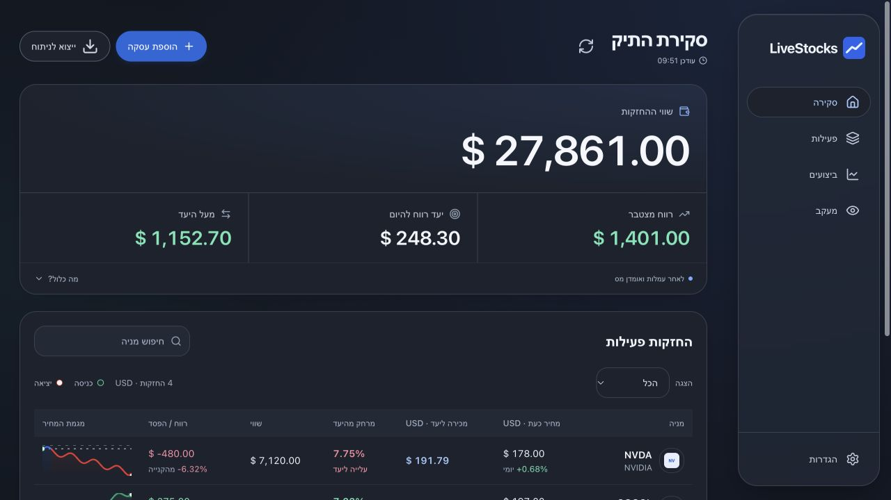

<div dir="rtl">

<p align="center">
  
</p>

<h1 align="center">LiveStocks</h1>

<p align="center"><strong>התיק שלך, ההיסטוריה שלך והדרך ליעד — במקום אחד.</strong></p>
<p align="center">ניהול ומעקב תיק מניות · עברית ואנגלית · מחשב ונייד · מצב בהיר וכהה</p>
<p align="center">
  <a href="https://razmaz-live-stocks.vercel.app">פתיחת האתר</a> ·
  <a href="https://chatgpt.com/plugins/plugin_asdk_app_6af9b5f79fe48191a12eaa9c67d6ae7b">LiveStocks ב־ChatGPT</a> ·
  <a href="#local-development">התחלה למפתחים</a> ·
  <a href="#documentation">מפת התיעוד</a>
</p>

מערכת LiveStocks מרכזת החזקות ועסקאות ממקורות השקעה שונים, מציגה את התוצאות לאורך זמן ומשווה אותן ליעד תשואה אישי. אפשר לראות מה קורה עכשיו, להבין איך הגענו לכאן ולהכין את הנתונים למחקר נוסף ב־ChatGPT.



*תצוגת הסקירה במחשב. כל צילומי המסך ב־README נלקחו מסביבות מקומיות עם נתוני הדגמה סינתטיים; הם אינם חושפים תיק אישי. צילומי הסקירה והעיצוב מ־14.11.2026, וצילומי מקורות ההשקעה והסנכרון מ־16.11.2026.*

## מה אפשר לעשות במערכת?

| יכולת | מה מקבלים |
| --- | --- |
| **תמונת מצב של התיק** | שווי החזקות פתוחות, רווח והפסד מצטברים, יעד אישי להיום והפער ממנו. |
| **פעילות והיסטוריה** | רישום קניות ומכירות, כמויות, מחירים, תאריכים ועמלות; מעקב אחר מנות רכישה ומימושים. |
| **מקורות השקעה אישיים** | בנקים, בתי השקעות או מקורות בשמות לבחירתך, עם הפרדה בין ההחזקות וההיסטוריה שלהם. |
| **ביצועים ויעדים** | גרפים, רווח ממומש, תצוגת USD/ILS ומחיר היציאה הנדרש לעמידה ביעד האישי. |
| **רשימת מעקב** | קבוצות מניות, חיפוש, השוואה לפי טווח זמן וגרף מפורט למניה שנבחרה. |
| **הצעות לסגירת קבוצות** | בחינת סגירה מלאה של מניה מרוויחה מול אחת עד שלוש מפסידות, עם פירוט החישוב וייצוא לבדיקת AI. |
| **סנכרון מצילום מסך** | סקירת שינויי החזקות ואישור מפורש בכרטיס בתוך ChatGPT, בהרשאה נפרדת. |
| **מחקר ב־ChatGPT** | חיבור OAuth לתיק האישי, תמונת תיק לניתוח ואימות הצעות מול הנתונים העדכניים. |
| **ווידג׳ט ל־iOS** | תמצית התיק ב־Scriptable, באמצעות טוקן אישי לקריאה בלבד. |

## סיור קצר

1. **נכנסים עם Google.** לכל משתמש חשבון ותיק משלו. בהגדרות מוסיפים מפתח Finnhub אישי לקבלת ציטוטים וחיפוש מניות.
2. **מגדירים את מקורות ההשקעה.** מתחילים ב״מקור ראשי״, ואפשר להוסיף בנק, בית השקעות או כל שם מתאים.
3. **מוסיפים עסקאות.** בוחרים מניה ומקור, מזינים קנייה או מכירה ומצרפים עמלה אם קיימת. קנייה נוספת או פתיחה מחדש ממשיכות את היסטוריית אותה פוזיציה.
4. **עוקבים אחר התוצאה.** הסקירה מציגה את המצב הנוכחי; מסך הביצועים ועמוד המניה מסבירים את ההיסטוריה ואת המרחק מהיעד.
5. **מעמיקים במחקר.** מייצאים פרומפט או JSON מהאתר, או מחברים את LiveStocks ב־ChatGPT ונותנים הרשאה לקריאת התיק.

| מסך | מה עושים בו |
| --- | --- |
| סקירה · `/` | תמונת מצב, הצעות סגירה, חיפוש וסינון ההחזקות הפעילות. |
| פעילות · `/positions` | הוספת עסקאות, ניהול החזקות ועיון בהיסטוריית הקניות והמכירות. |
| ביצועים · `/portfolio` | מעבר בין היסטוריה, יעד אישי ורווח ממומש. |
| מעקב · `/watchlist` | ארגון מניות בקבוצות והשוואת שינויי מחיר לאורך זמן. |
| פרטי מניה · `/stock/[symbol]` | מחיר, סבבי החזקה, עסקאות, עלות ויעדים של מניה אחת. |
| הגדרות · `/settings` | מקורות השקעה, שפה, מטבע, מראה, יעד תשואה וחיבורים אישיים. |

## ממשק שמותאם לנתונים ולמכשיר

במחשב יש סרגל צד וטבלאות רחבות; בנייד ההחזקות מוצגות בכרטיסים נפתחים, עם ניווט תחתון וטפסים מותאמים. הממשק תומך בעברית RTL ובאנגלית LTR, בערכה לפי המכשיר או בבחירת מצב בהיר/כהה, ובהפחתת שקיפות ותנועה.

<p align="center">
  
  
</p>

<details>
<summary><strong>הצצה למקורות השקעה ולהצעות סגירה</strong></summary>

### מקורות השקעה אישיים

אפשר להוסיף מקור גם מתוך טופס החזקה חדשה ולבחור אותו מיד. שינוי שם אינו משנה את זהות המקור. ארכוב שומר את ההיסטוריה ומתאפשר רק כשאין יתרה פעילה או הוראות ממתינות, וכשנשאר מקור פעיל נוסף.


### הצעות לסגירת קבוצות

כל הצעה מציגה את המניות בקבוצה, הרווח המצטבר, היעד, העודף מעליו והתמורה האפשרית מהמכירה הנוכחית. הפירוט מפריד בין תוצאות העבר לבין ההחזקות שעדיין פתוחות.


</details>

## העדכונים האחרונים

*תמונת מצב לפי הקוד ותיעוד השחרורים שבמאגר, נכון ל־16.11.2026.*

- **מקורות השקעה אישיים פורסמו באתר ובמסד הנתונים.** שמות לבחירת המשתמש, יצירה מתוך טופס החזקה, ארכוב ושחזור. המעבר למזהי מקור קבועים שמר על הרשומות והיסטוריית העסקאות. [פרטי השחרור ובדיקות השימור](docs/INVESTMENT_SOURCES.md).
- **הנחיות המקורות נוספו בגרסה 1.1.2 ונכללות גם בגרסה 1.1.3 של חיבור ChatGPT הקיים.** המחקר משתמש בקטלוג המקורות האישי; יצירה ושינוי שם נעשים באתר. [תיעוד החיבור](plugins/livestocks-oauth/README.md#configurable-investment-sources).
- **חשבונות אישיים וכניסה עם Google.** האתר מפריד את הנתונים לפי משתמש; חיבור ChatGPT דורש אישור לחשבון המתאים. טפסי אימייל וסיסמה אינם פעילים בהשקה. [מצב החשבונות והאימות](docs/ACCOUNTS_HANDOFF.md).
- **שיפור רציפות ההתחברות.** בדיקת session ברקע משמרת את התיק והטיוטות כשחוזרים ללשונית. הקוד כולל גם התאוששות מאתחול אימות שנכשל, הפרדה בין כשל שירות זמני לסשן לא תקף ושחרור חיבורי מסד לפני השהיית מופע שרת. [תיעוד בדיקות ההתחברות](docs/verification/live-google-and-sources-2026-11-16.json).

**סנכרון מצילום מסך עבר אימות בתוך ChatGPT עם חשבונות סינתטיים.** צילום → סקירת שינויי החזקות → לחיצה לאישור → בדיקת התיק המעודכן, כולל ניסיון חוזר שאינו מכפיל את העדכון. תשתית המסד הוחלה בייצור והנחיות הסנכרון פורסמו בגרסה 1.1.3. השימוש דורש הסכמה מפורשת להרשאת `portfolio:sync`; הרשאות משתמש קיימות לא הורחבו אוטומטית. [ראיות הקבלה](docs/verification/chat-sync-chatgpt-acceptance-2026-11-16.json) · [המודל החשבונאי וההרשאות](docs/SCREENSHOT_SYNC.md).

חקירת ההמשך מ־16.11.2026 מצאה מדיניות משאב OAuth ישנה שהסירה את הרשאת הסנכרון בזמן הנפקת הטוקן, גם אחרי הסכמה. מדיניות הייצור תוקנה, ונוסף תיקון לכלי ההגדרה ובדיקות מול משאב קיים. הרשאות משתמשים אינן מורחבות אוטומטית. [שורש התקלה, ראיות ומצב האימות](docs/OAUTH_SYNC_RESOURCE_POLICY.md).

## להבין את המספרים

**שווי ההחזקות** הוא שווי המניות שעדיין פתוחות. **רווח מצטבר** משלב רווח ממומש ולא ממומש; כברירת מחדל, סיכומי הסקירה והביצועים כוללים את העמלות שהוזנו ואומדן המס על מימושים. מחיר היציאה ליעד מחושב לפני מס וללא עמלת מכירה עתידית, ומביא בחשבון גם מימושים קודמים של אותו סימול.

המערכת מנהלת את מנות הרכישה בשיטת **FIFO** — המניות הראשונות שנקנו הן הראשונות שנמכרות — בנפרד לכל מקור השקעה. קנייה נוספת אינה מוחקת את ההיסטוריה, וסגירה ופתיחה מחדש אינן מאפסות את המימושים הקודמים.

יעד התשואה הוא **יעד אישי להיום**, ולא תחזית מחיר. גם הצעה עם רווח מצטבר חיובי עשויה לכלול הפסד במכירות של היום, משום שהסכום המצטבר כולל תוצאות עבר. הצעות הסגירה עוברות סינון לפי הפסד, גיל החזקה והיעד; הן כלי לבדיקה ואינן מבצעות מסחר.

מחירי השוק ושערי המטבע תלויים בזמינות הספקים. זמן רענון המסך אינו בהכרח זמן הציטוט. נתונים חסרים מסומנים, ואומדן המס אינו אישור מס ששולם. המערכת אינה מנהלת יתרות מזומן, הפקדות ומשיכות, דיבידנדים או פרופיל סיכון אישי.

## חיבור ל־ChatGPT ול־iOS

### מחקר על התיק האישי

[LiveStocks ב־ChatGPT](https://chatgpt.com/plugins/plugin_asdk_app_6af9b5f79fe48191a12eaa9c67d6ae7b) משתמש בחיבור OAuth לחשבון. החיבור הקיים פורסם בספריית סביבת העבודה RABEN; הגשה לספרייה הציבורית היא תהליך נפרד שטרם הושלם.

הכלים קוראים את התיק, בודקים מחירי מועמדות ומחשבים מחדש הצעות סגירה. המחקר נעשה בעזרת חיפוש הרשת ופתיחת מקורות בשיחה, עם קישורים ליד הטענות. החיבור אינו מבצע פקודות מסחר. הרשאת הסנכרון מצילום מסך נפרדת מהרשאות המחקר הקיימות ודורשת הסכמה מפורשת.

אפשר גם לבחור **ייצוא לניתוח** באתר: פרומפט מחקר או JSON מצומצם, ללא כמויות, שווי התיק וסכומי הרווח. לעומתו, `GET /api/portfolio/ai` מחזיר תמונת תיק מלאה למשתמש מאומת. קישור לנתיב לבדו אינו מעניק גישה.

### התאמת החזקות מצילום מסך

מעלים צילום החזקות ב־ChatGPT, בוחרים מקור השקעה וסוקרים כרטיס שמציג את היתרות לפני ואחרי. רק לחיצה על אישור מחילה את השינויים. תיקון נשמר כנקודת התאמה חדשה, בלי למחוק עסקאות היסטוריות או להמציא קניות ומכירות חסרות; מניות שלא הופיעו בצילום נשארות ללא שינוי. כשחסרה היסטוריה לחישוב תשואה מלאה או מס, הנתונים מסומנים כחסרים.


*הצילום מציג בדיקת קבלה ב־ChatGPT אמיתי עם החזקות סינתטיות. הוא אינו בדיקת מכשיר פיזי או ייבוא תיק אישי אמיתי.*

### ווידג׳ט Scriptable

הווידג׳ט מציג תמצית תיק באמצעות `POST /api/widget/summary`. יוצרים טוקן אישי בהגדרות ומזינים אותו ב־Scriptable; הוא נשמר ב־Keychain, ניתן לביטול ומוגבל לקריאה בלבד.

[קוד הווידג׳ט, התקנה ובדיקות](output/widget/README.md) · [תצוגה מקדימה עם נתוני דוגמה](output/widget/preview-dark.png)

בדיקות הממשק והווידג׳ט אינן מחליפות בדיקה במכשיר: התקנת הגרסה העדכנית ורינדור על iPhone פיזי עדיין לא אומתו.

## איך המערכת בנויה?

| שכבה | טכנולוגיה ותפקיד |
| --- | --- |
| ממשק ושרת | Next.js 16 App Router, React 18 ו־TypeScript. |
| רכיבי ממשק וגרפים | Tailwind CSS, Radix UI ו־Recharts. |
| חשבונות והרשאות | Better Auth, כניסת Google ו־OAuth לחיבור ChatGPT. |
| נתונים | Supabase PostgreSQL עם בעלות לפי משתמש ו־Row Level Security ‏(RLS). |
| נתוני שוק | Finnhub לציטוטים וחיפוש, Yahoo Finance להיסטוריית מחירים ו־open.er-api.com לשערי מטבע. |
| בדיקות | Vitest, Testing Library וכלי אימות מבודדים מול PostgreSQL. |

השרת מאמת את החשבון לפני גישה לנתונים. `PortfolioDataProvider` מרכז את נתוני `/api/portfolio/dashboard`, והמסכים והייצוא משתמשים באותו מקור דרך `usePortfolioData`. אם רענון נכשל, נשמרים הנתונים האחרונים ומוצעת טעינה חוזרת.

ההחזקות, מנות הרכישה, ההגדרות ורשימות המעקב שייכות למשתמש. `investment_sources` מחזיקה את קטלוג המקורות האישי, והפניות `location` משתמשות במזהי UUID. מפתחות Finnhub נשמרים מוצפנים בשרת; סודות אינם מוחזרים לממשק או נשמרים ב־localStorage. חיבורי ChatGPT והווידג׳ט ניתנים לביטול.

<div dir="ltr">

```text
app/                    מסכים, API, כניסה ו־OAuth
components/             רכיבי הממשק והתצוגות
hooks/                  נתוני תיק, מעקב ולוגיקה משותפת
lib/                    חישובים, אימות ושירותי נתונים
supabase/migrations/     סכמת הנתונים ומיגרציות
__tests__/              בדיקות יחידה, רכיבים והרשאות
scripts/                כלי אימות ותחזוקה
plugins/livestocks-oauth/ מקור החיבור הפעיל ל־ChatGPT
output/widget/          קוד Scriptable, בדיקות ותצוגה מקדימה
docs/                   מדריכים, ראיות אימות וצילומי מסך
```

</div>

<a id="local-development"></a>

## התחלה למפתחים

נדרשים Node.js ו־npm התואמים לתלויות ב־`package.json`. להרצת Supabase מקומית נדרשים גם Docker וה־Supabase CLI; לכלי הבדיקות המבודדים נדרשים כלי PostgreSQL מקומיים.

<div dir="ltr">

```bash
npm ci
cp .env.example .env.local
```

</div>

לפני ההרצה, מגדירים סביבת נתונים ואימות לפי [מדריך Better Auth](docs/BETTER_AUTH_SETUP.md). קובץ `.env.example` מספק את בסיס התצורה; הגישה לתיק דורשת גם תפקיד מסד ייעודי ואינטגרציית issuer/JWKS מול Supabase.

| תצורה | משתנים מרכזיים |
| --- | --- |
| כתובת ואימות | `APP_BASE_URL`, `BETTER_AUTH_SECRET`, `BETTER_AUTH_DATABASE_URL` ומזהי לקוחות האתר וה־MCP. |
| נתוני Supabase | `NEXT_PUBLIC_SUPABASE_URL`, `NEXT_PUBLIC_SUPABASE_ANON_KEY`, `SUPABASE_SERVICE_ROLE_KEY`. |
| הצפנת סודות | `CREDENTIAL_ENCRYPTION_KEY` — בשרת בלבד. |
| כניסת Google | `GOOGLE_CLIENT_ID`, `GOOGLE_CLIENT_SECRET`; כתובת חזרה: `${APP_BASE_URL}/api/auth/callback/google`. |
| סיסמאות ודוא״ל — אופציונלי | `PASSWORD_AUTH_ENABLED=true` ומשתני `SMTP_*`; אינם נדרשים במצב Google בלבד. |

בסביבת פיתוח מקומית חדשה אפשר לאתחל את הנתונים כך. `db reset` מאפס את מסד הפיתוח המקומי ומחיל מיגרציות ו־seed; אין להשתמש בו מול מסד שרוצים לשמור.

<div dir="ltr">

```bash
npx supabase start
npx supabase db reset
npm run dev
```

</div>

פותחים את [localhost:3000](http://localhost:3000). ללא תצורת אימות מלאה המידע הפרטי חסום ומוצגת הודעת הגדרה חסרה. לתצורת ענן ולמעבר נתונים קיימים יש לפעול לפי המדריכים הייעודיים, כולל מיפוי החשבון ובדיקות שימור.

### פקודות עבודה ובדיקות

| פקודה | תפקיד |
| --- | --- |
| `npm run dev` | שרת פיתוח. |
| `npm test` | חבילת Vitest. |
| `npm run typecheck` | בדיקת TypeScript. |
| `npm run lint` | ESLint ללא אזהרות. |
| `npm run build` | בניית ייצור באמצעות Webpack. |
| `npm run start` | הרצת הבנייה המקומית. |

הבדיקות מכסות חישובים, FIFO, שערי מטבע, מסכים, מקורות השקעה, בידוד משתמשים, OAuth וסנכרון. בדיקות PostgreSQL האופציונליות מורצות בנפרד ויוצרות מסדים מקומיים זמניים. [פקודות אימות המקורות](docs/INVESTMENT_SOURCES.md#validation) · [בדיקות ספק האימות](docs/BETTER_AUTH_SETUP.md#local-verification) · [בדיקות הווידג׳ט](output/widget/README.md).

### פתרון תקלות נפוצות

- **חסרה תצורת Supabase:** בדקו את שני משתני `NEXT_PUBLIC_SUPABASE_*` ואת תצורת האימות לפי המדריך.
- **אין ציטוטים או חיפוש מניות:** בדקו שמפתח Finnhub אישי נשמר בהגדרות. אין מפתח משותף כגיבוי.
- **הכניסה אינה מושלמת:** בדקו את `APP_BASE_URL`, כתובת החזרה של Google, תפקיד המסד ותצורת issuer/JWKS.
- **תקלה אחרי שינוי סכימה:** ודאו התאמה בין הקוד למיגרציות. בייצור יש להתאים מיגרציות לפי שם ותיעוד הפריסה, משום שגרסאות ההחלה עשויות להיות שונות משמות הקבצים המקומיים.

<a id="documentation"></a>

## להעמקה

| נושא | מדריך |
| --- | --- |
| מצב החשבונות, השחרור והבדיקות שנותרו | [מסמך מסירה](docs/ACCOUNTS_HANDOFF.md) |
| הגדרת אימות וסביבה | [Better Auth](docs/BETTER_AUTH_SETUP.md) |
| מקורות אישיים ומעבר הנתונים | [מקורות השקעה](docs/INVESTMENT_SOURCES.md) |
| איחוד חשבונות ושימור ההיסטוריה | [ממשק האיחוד](docs/ACCOUNT_LINKING_UI.md) · [מנגנון והתאוששות](docs/ACCOUNT_LINKING.md) |
| חיבור ChatGPT הפעיל | [מקור הפלאגין](plugins/livestocks-oauth/README.md) · [הפעלה ואימות](docs/CHATGPT_ACTIVATION.md) |
| סנכרון מצילום מסך | [חשבונאות, הרשאות ומגבלות](docs/SCREENSHOT_SYNC.md) · [בדיקת ChatGPT מבודדת](docs/CHAT_SYNC_ISOLATED_FIXTURE.md) |
| ווידג׳ט iOS | [התקנה, מקור ובדיקות](output/widget/README.md) |
| פרטיות ותנאי שימוש | [אודות](https://razmaz-live-stocks.vercel.app/about) · [פרטיות](https://razmaz-live-stocks.vercel.app/privacy) · [תנאי שימוש](https://razmaz-live-stocks.vercel.app/terms) |

צילומי תיעוד נשמרים ב־`docs/screenshots/` ומתעדכנים כשמסך או זרימת שימוש משתנים. תוצרי צילום ובנייה זמניים אינם חלק מהתיעוד שב־Git. ראיות הבדיקה נשמרות ב־`docs/verification/`, עם ההבחנה בין בדיקות מקומיות, נתונים סינתטיים ואימות בייצור.

</div>
