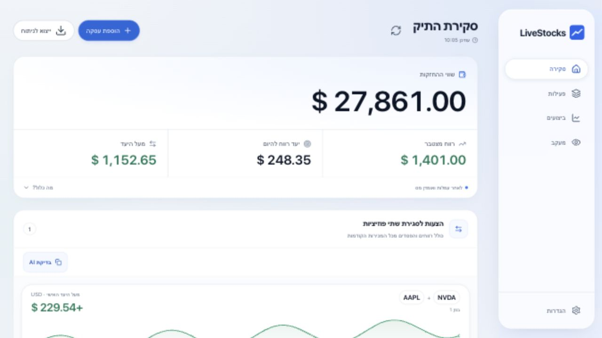
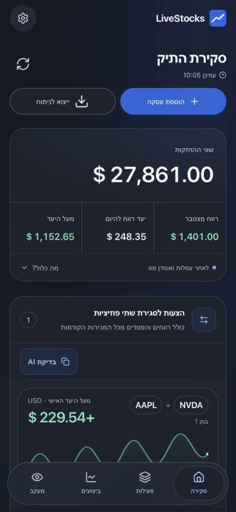
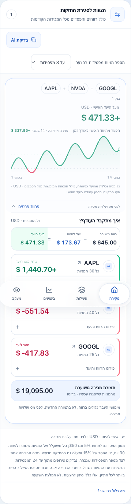

# LiveStocks


אייקון המותג האחיד הוא גרף עולה בגוון כחול בתוך ריבוע מעוגל. מקור העיצוב הוא `public/brand/livestocks.svg`, המשמש בסרגל הצד, בכותרת בנייד ובדפדפן. קובצי PNG בגודל 32 ו־180 פיקסלים באותה תיקייה הם גרסאות של אותו סמל לדפדפנים ולמסך הבית ב־Apple; יש לייצר אותם מחדש מה־SVG בכל שינוי בעיצוב.

אפליקציית ווב לניהול ומעקב תיק מניות, עם תמיכה בעברית/אנגלית (RTL/LTR), ארבעה מסכי עבודה מרכזיים ותשתית נתונים מבוססת Supabase.

## עיצוב Liquid Glass

הממשק משתמש ברקע פנינה בהיר או גרפיט כהה, במשטחי נתונים יציבים ובזכוכית חלבית לניווט ולתפריטים. במחשב יש סרגל צד צף וטבלאות רחבות; בנייד יש סרגל תחתון בצורת קפסולה, כרטיסי החזקות נפתחים וטפסים כגיליונות תחתונים עם גלילה פנימית. שווי התיק הוא המדד הראשי, ואזור ההצעות לסגירת קבוצות מוצג תמיד מעל ההחזקות הפעילות עם מספר ההצעות בכותרת. פירוט הסגירה של כל קבוצה נפתח בנפרד.

בהגדרות → מראה אפשר לבחור **לפי המכשיר / בהיר / כהה** ולהפעיל **הפחתת שקיפות**. ברירת המחדל עוקבת אחרי המכשיר. ההעדפות נשמרות מיד בדפדפן המקומי (`livestocks-theme`, `livestocks-reduce-transparency`), בלי שינוי בהגדרות החשבון, ב־API או בחישובים. העדפת מערכת להפחתת שקיפות גוברת על הבחירה המקומית כאשר הדפדפן תומך בה. תנועה מופחתת מכובדת, ולדפדפנים ללא טשטוש יש משטח אטום חלופי.

צילומי המסך הבאים מציגים את הממשק האמיתי עם **נתוני הדגמה סינתטיים בלבד**, שנלכדו ב־14.11.2026 דרך שירות fixtures מקומי לקריאה בלבד, ללא גישה לתיק האמיתי. יש לרענן אותם כשמשנים את מבנה המסך או את חומרי העיצוב.

| בהיר — מחשב | כהה — מחשב |
| --- | --- |
|  |  |

<p align="center">
  
  
</p>

אימות העיצוב כולל עברית RTL ואנגלית LTR, מסכי מחשב ומובייל ברוחב 320/390/430 פיקסלים, הרחבת החזקות, מעבר למניה וחזרה, סינון, לשוניות ביצועים, שמירת ערכה והפחתת שקיפות. גיליון העסקה נבדק גם ב־320×520 כדי לדמות שטח פנוי מצומצם בזמן הקלדה. אלה בדיקות בדפדפן; לא בוצעה בדיקה על iPhone פיזי.

## מה הפרויקט כולל
- סקירה עם שווי ההחזקות כמדד ראשי, רווח/הפסד מצטבר, יעד תשואה אישי ופער מהיעד; ההצעות לסגירת קבוצות מופיעות מעל ההחזקות הפעילות. גרף הביצועים המלא נמצא במסך הביצועים, ולכל מניה גרף מחיר קטן, שינוי יומי ותשואה מאז הקנייה
- פעילות: ניהול פוזיציות, עסקאות BUY/SELL, lots, עמלות ומיקום תיק
- ביצועים: היסטוריה, השוואה ליעד אישי ורווח ממומש באותו מסך
- Watchlist עם קבוצות, כרטיסי מניות, היסטוריית מחירים וגרירה למיון
- חלונית ייצוא לניתוח חיצוני, כפרומפט מחקר או JSON מצומצם
- הצעות לסגירה מלאה של מניה מרוויחה מול אחת עד שלוש מפסידות, תוך שמירה על רווח מצטבר מעל היעד האישי וסינון הפסדים קטנים והחזקות טריות
- Scriptable iOS widget מקומי שמציג סטטוס תיק מתוך אותו API
- המרות USD/ILS ושערים היסטוריים, לפי זמינות הספקים
- API פנימי ב-Next.js לציטוטים, נרות ופורטפוליו

## Stack טכנולוגי
- `Next.js 16` (App Router)
- `React 18` + `TypeScript`
- `Tailwind CSS` + `Radix UI`
- `Supabase` (Postgres + RLS)
- `Vitest` + `Testing Library`
- ספקי נתונים:
  - `Finnhub` למחירי מניות
  - `Yahoo Finance chart API` לנתוני נרות/היסטוריה
  - `open.er-api.com` לשערי מטבע

## מבנה תיקיות
```text
app/
  api/                          # API routes פנימיים
  ai-prompts/                   # הפניה לחלונית הייצוא בסקירה
  insights/                     # הפניה להיסטוריית הביצועים
  exceptions/                   # הפניה ללשונית היעד האישי
  portfolio/                    # היסטוריה, יעדים ורווח ממומש
  positions/                    # עסקאות, החזקות והיסטוריית lots
  realized/                     # הפניה ללשונית הרווח הממומש
  settings/                     # הגדרות שפה/מטבע/Token
  stock/[symbol]/               # דף מניה
  watchlist/                    # רשימות מעקב

components/
  dashboard/ portfolio/ watchlist/ charts/ ui/

hooks/
  use-portfolio-data.ts         # טעינת נתוני תיק וחישובי ציר זמן
  use-watchlist.ts              # לוגיקת watchlist

lib/
  calculations.ts               # חישובים פיננסיים
  context.tsx                   # AppProvider: שפה, הגדרות ורענון משותף
  plans.ts                      # מנוע תוכניות; אינו מופעל אוטומטית בממשק
  services/                     # Finnhub, exchange-rate, historical-fx
  supabase.ts                   # יצירת Supabase client וטייפים

supabase/
  migrations/                   # כל המיגרציות
  seed.sql                      # seed מקומי
  config.toml                   # קונפיגורציית Supabase CLI

```

## מסכים מרכזיים באפליקציה
ארבעת המסכים הראשיים הם:

- `/` **סקירה**: שווי ההחזקות הפעילות, רווח/הפסד, יעד אישי להיום, פער מהיעד, גרף ביצועים והחזקות עם חיפוש, סינון וגרף מחיר קטן לכל מניה, שינוי יומי ותשואה מאז הקנייה באחוזים
- `/positions` **פעילות**: עסקאות, החזקות והיסטוריית lots במסך אחד, ללא לשוניות. `?action=add` פותח בחירה בין הוספת פוזיציה חדשה לבין עסקת BUY/SELL בפוזיציה קיימת
  בחירת פוזיציה מציגה כרטיס עם לוגו, שם חברה, כמות וחשבון. בפוזיציה חדשה מספיק להקליד סימול או לבחור תוצאת חיפוש: שם החברה והלוגו מתמלאים מההחזקות הקיימות או מ־Finnhub. עריכה ידנית זמינה במקרה הצורך; חיפוש מקוון דורש Finnhub token מוגדר. מתגי העמלות תומכים בעברית ובאנגלית עם אזור מגע בגודל 44 פיקסלים.
  **מניעת כפילויות:** סימול מנורמל (ללא רווחי קצה וללא תלות באותיות גדולות) + חשבון מזהים פוזיציה אחת, גם לאחר סגירה מלאה. טופס פוזיציה חדשה עובר למצב הוספת קנייה או פתיחה מחדש, מציג את הכמות והמחיר הממוצע הנוכחיים, ומשתמש בשדות מחיר/כמות/תאריך של הקנייה החדשה במקום שדות רכישה ראשונה. הוא מוסיף קניית BUY לאותה פוזיציה ושומר את העסקאות והרווח הממומש; אותו סימול בחשבון אחר נשאר נפרד. השמירה אטומית דרך `record_position_purchase`, עם מפתח בקשה למניעת עסקה כפולה בניסיון חוזר. אינדקס ייחודי חוסם כפילויות גם בעריכה ובלקוחות ישנים. יש להחיל `20261110130000_reuse_position_identity.sql` לפני הפעלת הקוד; המיגרציה עוצרת לבדיקה אם כבר קיימות כפילויות ואינה ממזגת או מוחקת היסטוריה.

- `/portfolio` **ביצועים**: לשוניות היסטוריה (`?view=history`), יעד אישי (`?view=targets`) ורווח ממומש (`?view=realized`), עם פירוט מטבעות ואומדן מס לפי הצורך
- `/watchlist` **מעקב**: רשימת השוואה קומפקטית עם מחיר, שינוי יומי, שינוי בטווח וגרף קטן לכל מניה


בסקירה, **התיק במספרים** מציג שווי של ההחזקות הפתוחות, רווח/הפסד מצטבר (ממומש ולא ממומש), יעד רווח אישי להיום והסכום שחסר ליעד או נמצא מעליו. ברירת המחדל היא כותרת קצרה וסכום לכל נתון; הפסד וחוסר ליעד מסומנים במפורש. פירוט המשמעות ובסיס החישוב זמינים בפתיחת ״מה כלול?״, וסימון קצר של ניכוי העמלות ואומדן המס מסונכרן עם אפשרויות החישוב בגרף.

כרטיסי ההחזקות וטבלת הסקירה מציגים את לוגו החברה מתוך נתוני המניה, עם מקורות חלופיים במקרה של כשל טעינה והתאמת הלוגו למסגרת לבנה ללא חיתוך, הצללה מלאכותית או יצירת תמונת אותיות. כתובות מהמקור הישן `logo.clearbit.com` מסוננות לפני טעינה, גם כשהן מגיעות מנתונים קיימים או ממטמון הדפדפן. המקורות החלופיים הם Financial Modeling Prep, Parqet ו־EODHD; אין צורך לעדכן נתונים קיימים כדי לדלג על Clearbit. עבור CAPR נעשה שימוש בסמל המרובע מאתר החברה כדי להימנע מהקטנת לוגו מילולי בתוך אייקון. מקור: [האתר הרשמי של Capricor](https://www.capricor.com/) ו־[קובץ הסמל המקורי](https://d1io3yog0oux5.cloudfront.net/_b0d022e4c7dfa1af06d98e16045a450c/capricor/files/theme/images/favicons/apple-touch-icon.png).

בתצוגת כרטיסי ההחזקות (בנייד ובמחשב ברוחב קטן מ־1280px), גם כרטיס מכווץ מציג את מחיר המניה כעת ואת מחיר המכירה הדרוש ליעד האישי, שניהם בדולרים, את העלייה הנדרשת באחוזים (או כמה המחיר מעל היעד) ואת שווי ההחזקה במטבע התיק. גם בטבלה הרחבה מחירי השוק והמכירה ליעד מופיעים לצד המרחק מהיעד. מחיר המכירה הוא `requiredExitPrice`, המחושב לכל יתרת המניות של הסימול בכל החשבונות: עלות היתרה + הרווח הנדרש לפי היעד על המניות הפתוחות והנמכרות − הרווח שכבר מומש, חלקי כמות המניות שנותרו. כך הפסד במכירה חלקית מעלה את מחיר המכירה הנדרש ליתרה, ורווח קודם מפחית אותו. עמלות שנרשמו נכללות, לפני מס וללא עמלת מכירה עתידית. המחיר מעוגל מעלה לסנט והמרחק באחוזים מחושב מול המחיר המוצג. היעד מחושב להיום ואינו תחזית. כשחסר יעד מלא אין החלפה ביעד של המניות הפתוחות בלבד. הסינון והמיון לפי יעד משתמשים באותו מחיר מכירה. פתיחת הכרטיס רציפה ומציגה עלות, שינוי יומי, רווח פתוח, גרף רווח מצטבר, כמות, משקל בתיק ותאריך כניסה. הסבר החישוב נפתח לפי בחירה.

בכרטיסי ההחזקות משמש אותו גרף **רווח מצטבר בדולרים** גם כרקע מכווץ וגם כגרף המורחב, עם מעבר רציף. הרווח כולל מימושים קודמים ואת השווי שנותר פחות העלות שנותרה, בכל חשבונות הסימול; כך גם צבע הרקע והתג האחרון משתמשים באותו בסיס. מחיר המניה ומחיר המכירה ליעד נשארים בכותרת הכרטיס. קו האיזון הוא 0 רווח אמיתי וקבוע, ויעד הרווח המצטבר מחושב לכל יום לפי העסקאות עד סוף אותו יום ב־UTC ושיעור התשואה השנתי שמוגדר כעת. מניות שנמכרו מפסיקות לצבור יעד במועד המכירה; רווחים והפסדים ממומשים נשמרים גם לאחר סגירה ופתיחה מחדש. בכך נמנעות קפיצות מלאכותיות עקב שינוי העלות הממוצעת או חלוקת הפסד על יתרת מניות קטנה יותר. שינויי רווח אמיתיים ממחירים, ביצועים ועמלות אינם מוחלקים או מוסתרים. שיעור יעד חיובי יוצר יעד רווח שאינו שלילי; שיעור שלילי שהוגדר במפורש נשמר. קטעי הקו וההצללה צבועים יחד: אדום בהפסד, כחול ברווח שמתחת ליעד וירוק ביעד ומעלה. עסקאות עתידיות אינן משנות ימים קודמים, נתונים חסרים יוצרים פערים, ואין חיבור מלאכותי דרכם. סימוני העסקאות ממוקמים לפי תאריך ובגובה הרווח הנצפה בין ימים סמוכים; מחיר ביצוע העסקה מוצג בריחוף ואינו משמש כערך על ציר הרווח. לפני תחילת ההשקעה אין רווח מומצא. הפרטים הסגורים מוסתרים מהמיקוד ומקוראי מסך, הרקע דקורטיבי, והמעברים מכבדים הפחתת תנועה.

סרגל המעקב מפריד בין חיפוש מניה לבין טווח ההשוואה, עם בחירת תאריך התחלה נפרדת. חלונית המניה מפרידה בין מחיר נוכחי, שינוי יומי לעומת הסגירה הקודמת ושינוי בטווח הנבחר; מוצגים גם מחיר הבסיס ותאריך הבסיס. זמן רענון הנתונים אינו בהכרח זמן ציטוט השוק.

במעקב, בחירת שורה מציגה גרף מפורט אחד לצד הרשימה במחשב רחב, ובחלונית בנייד. הקבוצה, החיפוש, טווח הזמן, תאריך ההתחלה ובחירת המניה (`stock`) נשמרים בכתובת, גם בחזרה מפרטי מניה. רענון, עריכה ומחיקה זמינים בתפריט הפעולות; מצב סידור מציג ידיות גרירה ומאפשר סידור גם במקלדת. חיפוש משאיר את בחירת המניות פעילה ומשהה את שינוי הסדר.

הקישור לעמוד המניה הוא כפתור קומפקטי עם הכיתוב ״פרטי המניה״ וחץ, ללא פס נוסף או תג סימול. אזור הלחיצה בגובה 44 פיקסלים, עם משוב לחיצה ותזוזת חץ עדינה. בדפדפנים תומכים, View Transitions מחבר את הכרטיס שנבחר לאזור פרטי המניה באנימציה של 360 מילישניות. שם המניה והלוגו מועברים כתצוגת טעינה מיידית בלבד; המחירים והנתונים בעמוד נטענים מחדש כרגיל. המעבר מסתיים לאחר שהשלד עם זהות המניה מותקן, בלי לחכות לכל בקשות הנתונים; המתנה מוגבלת ל־1.2 שניות ומדלגת על האנימציה אם הניווט מתעכב. בדפדפן ללא תמיכה או בהעדפה להפחתת תנועה נשמר ניווט רגיל. Ctrl/Cmd-click, פתיחה בלשונית חדשה והקשר החזרה לכרטיס ממשיכים לעבוד. פירוט ״אופן החישוב״ אינו מוצג בכרטיס. בהחזקה חדשה שאין לה עדיין שתי נקודות רווח תקינות, הכרטיס מציג גרף **מחיר מניה** עם שבעה ימים קלנדריים של הקשר לפני הכניסה, לפי מחירי השוק הזמינים. התקופה לפני הכניסה אפורה, ורק מהכניסה המדויקת מתחילה הצביעה לפי העלות והיעד, גם במצב המכווץ. הכותרת והמקרא מתחלפים למחיר במקום רווח; אין יצירת רווח לפני ההחזקה או מחירי שוק מלאכותיים. ה־API מחזיר `contextCandlesByKey` בנפרד מ־`candlesByKey`, וה־hook חושף `contextSparklineData`; מחירי הרקע אינם משמשים לחישוב ביצועי התיק. פתיחת כרטיס החזקה וסגירתו משתמשות במעבר גובה חלק וחץ מונפש; כרטיס אחד פתוח בכל פעם.

מתחת לתמונת המצב ומעל ההחזקות מופיע אזור **הצעות לסגירת החזקות**. כל הצעה סוגרת 100% מהיתרה של מניה מרוויחה אחת מול אחת עד שלוש מניות מפסידות בכל החשבונות. הבורר מאפשר לבחור מפסידה אחת או עד שלוש (ברירת המחדל). המרוויחה חייבת להיות ברווח גם בהחזקה הפתוחה וגם במצטבר, ומעל יעד התשואה האישי. כל מפסידה חייבת להיות בהפסד גם בהחזקה הפתוחה וגם במצטבר, ומתחת ליעד; שתי מניות ברווח אינן יוצרות הצעה.

ספי הסינון שאושרו ב־14.11.2026: הפסד פתוח של לפחות **5% וגם $50**, וגיל החזקה משוקלל של לפחות **30 יום**; הפסד של **15% ומעלה** מאפשר להיכלל גם לפני 30 יום, ועדיין חייב לעמוד בסף הדולרי. הגיל משוקלל לפי עלות מנות ה־FIFO שנותרו, בלי לתת לסבב שכבר נסגר להזקין קנייה חדשה. אלה כללי סינון להצעות בלבד, לא הצדקה כלכלית למכירה. הספים מוגדרים במשותף ב־`DEFAULT_CLOSE_PAIR_POLICY`; אין שינוי מסד נתונים.

גם הרווח המצטבר בסגירת הקבוצה וגם העודף מעל היעד חייבים להיות לפחות סנט, לפני מס ועלויות מכירה עתידיות. החישוב כולל רווחים והפסדים מכל המכירות הקודמות ועמלות שנרשמו, ומתאים FIFO לכל חשבון בנפרד. יעד הרווח נצבר לכל מנת קנייה עד המכירה לחלק שנמכר, ועד מועד החישוב לחלק שפתוח. היעד הוא יעד תשואה אישי ולא תחזית שוק. תמורות עבר אינן נספרות שוב כמזומן שיתפנה כעת.

הבחירה נותנת קדימות להפסד המצטבר הבודד הגדול ביותר שניתן לסגור, אחריו לסך ההפסדים המכוסים, ואחריו לעודף מעל היעד. נבדקים כל הצירופים עד שלוש מפסידות מתוך 24 המפסידות הכשירות הגדולות ביותר; כשיש יותר, מגבלת החיפוש מצוינת. נבחרות עד שלוש קבוצות בסדר הדירוג, ללא שימוש חוזר בסימול. הבחירה בין קבוצות חמדנית ואינה מבטיחה אופטימום גלובלי. רשומות לא תקינות אינן מוחלפות בסבב הפעיל בלבד.

כרטיסי ההצעות מציגים את כל הסימולים, ובפתיחה את מלוא הכמויות, מחיר הייחוס, רווח ממומש קודם, רווח פתוח, רווח מצטבר, יעד ופער לכל מניה. תמורת המכירה הנוכחית מוצגת בנפרד. **רווח מצטבר חיובי אינו מבטיח שהמכירות של היום לבדן יממשו רווח**, מפני שהוא כולל את תוצאות העבר. הגרף מסכם את כל המניות בקבוצה לפי העסקאות והמחירים שהיו בכל מועד; ממומש ויעד שנעצר ממשיכים להיכלל לאחר סגירה. יום שחסר בו מחיר להחזקה פתוחה מושמט, ואין השלמת מחירים או שימוש בעסקאות עתידיות.

כפתור **בדיקת AI** מעתיק מקומית את כל הקבוצות המוצגות, ללא פרטי גישה, עם פירוט החשבון והספים. הוא מבקש מחקר עצמאי לכל חברה: דוח אחרון, תחזיות ועדכונים מהותיים, תמחור מול מתחרות, תזרים, מאזן, סיכונים, זרזים, תרחישים ורגישות למחיר ולעלויות. נבדקת גם האפשרות שהפסד אחרי קנייה הוא תנודה זמנית. ההכרעה לכל קבוצה היא **למכור את כולן** או **לא למכור**; אם אין הצדקה ליציאה מאחת מהן, אין תמיכה בסגירת הקבוצה. התשובה קצרה (עד 120 מילים לקבוצה, ללא המקורות), עם נימוק, הסתייגות, ביטחון ולפחות מקור ישיר שנבדק לכל חברה. חוסר אימות מהותי מוביל ללא־מכירה כעת בביטחון נמוך. היקף המחקר אינו מוגבל באורך התשובה. אין מסחר או שליחה אוטומטית.

צילומי קבוצת סגירה עם נתוני הדגמה סינתטיים בלבד (14.11.2026):

| מחשב — מרוויחה ושתי מפסידות | נייד |
| --- | --- |
|  |  |

הפלאגין משתמש באותו מנגנון דרך `get_close_pair_proposals`, עם מצבי מפסידה אחת/עד שלוש. `validate_close_proposal` בודק את כל הקבוצה מול תמונת הנתונים האחרונה הזמינה, ללא תקציב קנייה. פלט הכלי מפריד בין רווח מצטבר, רווח שיתממש כעת ותמורה ברוטו, ומסמן כיסוי חסר וזמני ציטוט. תמונת השרת נשמרת במטמון כחמש דקות ועשויה להיות ישנה יותר בזמן רענון או תקלה; האימות אינו עוקף אותו ואינו מבטיח מחיר בר־ביצוע. האתר והפלאגין תואמים כשהקלט ומועד החישוב זהים; זמני רענון שונים עשויים להציג הצעות שונות. הוראות הפלאגין ודרך פרסומו מתועדות ב־[plugins/livestocks/README.md](plugins/livestocks/README.md).

קישור נפרד מוביל לדף המניה. הבחירה נשמרת בכתובת (`holding`) ומשוחזרת בחזרה לדף יחד עם החיפוש והסינון.
הכרטיסים תומכים במקלדת, מסתירים פרטים סגורים מקוראי מסך ומסדר המיקוד, ומכבדים העדפה להפחתת תנועה.

`/settings` נשאר כלי משני להגדרת שפה, מטבע, יעד תשואה שנתי ו-Finnhub token; תדירות הרענון נקבעת אוטומטית לפי שעות המסחר. `/stock/[symbol]` מציג פירוט מניה, עם חזרה לרשימה ולסינון שמהם נפתחה.

כרטיס הביצועים מציג כותרת קומפקטית, בחירת טווח בעברית, מקרא וקווי רקע עדינים. אפשרויות החישוב וההסברים נפתחים לפי בחירה. כרטיס הביצועים מוצג רק בדף `/portfolio`, ולא בסקירה. בסקירה סדר האזורים הוא תמונת מצב התיק, הצעות סגירה אם קיימות, ואז ההחזקות הפעילות. הכותרת מרכזת הוספת עסקה, ייצוא ורענון בצורה קומפקטית המותאמת לנייד.

סיכום הסקירה ודף הביצועים משתמשים באותו בסיס חישוב: רווח ממומש ולא ממומש **אחרי העמלות שהוזנו ואומדן מס על מימושים כברירת מחדל**, מול יעד התשואה האישי. אפשר לבחור נטו, ברוטו או לכלול עמלות ומס בנפרד; הגרף והסיכום משתמשים באותה בחירה. המס הוא אומדן לפי המודל הקיים, ולא רישום של מס שנגבה בפועל. היעד אינו תחזית שוק. קו הרווח צבוע באדום בהפסד, בכחול ברווח שמתחת ליעד ובירוק ברווח שביעד או מעליו; היעד מוצג בקו מקווקו. אין סיכום שבועי כפול או עמוד תובנות נפרד בניווט.

הגרף מחושב לפי ימים קלנדריים ב-UTC: מחיר הסגירה הזמין לאותו יום, וביום ללא מסחר המחיר האחרון שפורסם עד אליו. עסקאות ועמלות נכללות לפי מועד הביצוע ובשיטת FIFO. רווח בשקלים מחושב משווי ההחזקה בשער יום השווי פחות עלות הקנייה בשער יום הקנייה; תמורת מכירה מחושבת בשער יום המכירה. היעד צובר תשואה לכל מנת קנייה, על העלות כולל עמלה ובשער הקנייה, ונעצר במועד מכירתה. היום משתמש באותם כללי חישוב ובנתונים החיים הזמינים. שער היסטורי חסר אינו מוחלף בשער הנוכחי; הערך מוצג כחסר.

נתיבים ישנים נשמרו כהפניות: `/insights` אל `/portfolio?view=history`, `/exceptions` אל `/portfolio?view=targets`, ו-`/realized` אל `/portfolio?view=realized`. `/ai-prompts` מפנה אל `/?export=research`, שפותח את חלונית **ייצוא לניתוח**; אפשר לפתוח אותה גם מהסקירה וממסך הביצועים.

### דף פרטי המניה

דף המניה בנוי מתצוגה קומפקטית של שם, סימול, חשבונות ומחיר, שלושה מספרים מרכזיים וגרף מחיר עם יעדים. הרווח הפתוח מובדל מהרווח המצטבר שכולל את כל המכירות הקודמות. העלות והכמות נאספות מיתרות FIFO של כל חשבון בנפרד, ללא התאמת מכירות בין חשבונות. ציטוט חסר אינו מוצג כאילו הרווח המצטבר המלא ידוע; נתונים חסרים מסומנים במקף. נתוני מורשת ללא עסקאות מסומנים לפי נתוני ההחזקה הזמינים.

פרטי העלות, המימושים, היעד והחשבונות זמינים תחת **פירוט ההחזקה**; העסקאות תחת **היסטוריית פעולות**. שתי הפתיחות סגורות בתחילה לשמירה על עמוד קצר, ומונפשות בדפדפנים שתומכים בכך. הגרף משתמש בגובה של 240 פיקסלים במחשב ו־220 בנייד, עם יעדים בשורת מידע קומפקטית ומקרא לפי בחירה. התצוגה מכבדת הפחתת תנועה ושומרת על מעבר הכרטיס ועל הקשר החזרה המקורי.

### גרף דף המניה וסבבי החזקה

דף `/stock/[symbol]` מציג כברירת מחדל את כל סבבי ההחזקה בטווח הנבחר. לאחר מכירה מלאה וקנייה מחדש, כל סבב מסומן ברקע ובפס תחתון, עם נקודות לעסקאות בפועל. כשיש יותר מסבב אחד מוצגים ציר הסבבים ומעבר למיקוד בהחזקה הנוכחית; כשיש סבב יחיד רכיבים אלה מוסתרים. המיקוד בהחזקה הנוכחית כולל עד שבוע של הקשר מחירים לפניה, ככל שקיים בטווח שנבחר.

קו המחיר צבוע לפי העלות והיעד ההיסטוריים הזמינים באותו מועד: אדום מתחת לעלות, כחול בין העלות ליעד, ירוק ביעד ומעלה, ואפור ללא החזקה או כשאין בסיס חישוב זמין. החישוב שומר על הפרדה בין חשבונות ומשתמש ב־FIFO ובעמלות הרשומות. הייחוס ההיסטורי מחושב לסוף יום UTC, כולל בנרות שבועיים; שינויי הייחוס אינם מנבאים עסקאות עתידיות.

מחיר היציאה הנדרש ממשיך לכלול את כל היסטוריית הסימול, מוצג בכרטיס נפרד, ומופיע תמיד בגרף בסגול כאשר יש פער מהותי מהיעד הנוכחי. אין כפתור הסתרה. כרטיסי העלות והיעד הנוכחי מבהירים את ההבדל בין שני בסיסי החישוב. עסקאות מאוחרות מנר המחיר האחרון מרחיבות את ציר הזמן בלי לייצר מחירי שוק מלאכותיים. טווח ״הכל״ מתחיל בסבב הראשון, ולא בקנייה האחרונה. כשאין שני מחירי סגירה מוצגת הודעה במקום גרף ריק.

בנייד טווחי הזמן מסודרים בשתי שורות, כרטיסי המחיר ברשת קומפקטית, ציר הסבבים בטור והגרף בגובה מותאם ללא גלילה אופקית של הדף.

## API פנימי (Next.js Route Handlers)
- `GET /api/quote?symbol=...` ציטוט למניה אחת (עם cache קצר בזיכרון)
- `GET /api/quotes?symbols=AAPL,MSFT` ציטוטים מרובים
- `GET /api/candles?symbol=...&from=...&to=...&resolution=D|60|W|M` נרות מחיר
- `GET /api/exchange-rate` שער USD→ILS
- `POST /api/portfolio` חישוב summary + metrics + realized מול Supabase
- `GET /api/portfolio/combined-pnl` סיכום משולב לתיק
- `GET /api/portfolio/dashboard` נתוני המקור המשותפים למסכי התיק
- `GET /api/portfolio/ai` תמונת תיק מלאה לקריאה בלבד (מפורטת בהמשך)

## פלאגין LiveStocks

מקור הפלאגין נמצא ב־[`plugins/livestocks`](plugins/livestocks/README.md). [LiveStocks ב־ChatGPT](https://chatgpt.com/plugins/plugin_asdk_app_6af6d6f889a88191ae50abfc0070421b) הוא חיבור App פרטי בענן, עם אייקון האתר, לשרת LiveStocks הקיים באמצעות `POST /api/mcp`. הוא כולל קריאת תיק מלא, מחירי מועמדות מחוץ לתיק, הוראות מחקר ובדיקת טבלת פעולות: קנייה של מניה שאינה מוחזקת בלבד או מכירה מלאה בכל החשבונות. אין כלי לביצוע עסקאות או לעדכון נתוני התיק. המחקר מתבצע באמצעות חיפוש הרשת של ChatGPT ופתיחת מקורות עדכניים, עם קישורים ותאריכים ליד הטענות. לא נוסף ספק מחקר או מפתח API. אם חיפוש אינו זמין בשיחה, הפלאגין מציין את החסר ונמנע מהמלצה סופית שתלויה בו.

העלאת חבילה עם הצהרת MCP עשויה להגביל אותה למחשב גם כשהשרת בענן; לכן הפלאגין הפעיל שומר חיבור App דרך `.app.json`, ללא הצהרת MCP מקומית. מסלול הענן נבדק בקריאת תיק מתוך ChatGPT בדפדפן, והמשתמש אישר קריאה גם באפליקציה בטלפון. החיבור הממותג משתמש באותו שרת ובאותן הרשאות. מצב האימות והוראות החיבור מפורטים ב־README של הפלאגין.

מחקר דוחות, חדשות ומאקרו נעשה באמצעות כלי המחקר הזמינים בשיחה; הפלאגין אינו מסנן שוק או מנוע חדשות עצמאי. להקצאה אישית נדרשים תקציב מזומן פנוי, אופק ורמת סיכון. החיבור משתמש במודל הגישה המשותף הקיים של ה־API; פלאגין פרטי אינו הופך את נתיב השרת למאומת. פירוט מגבלות ועדכון הוראות המחקר מופיע ב־README של הפלאגין.

## בסיס נתונים (Supabase)
טבלאות עיקריות:
- `positions` פוזיציות בסיס
- `position_lots` פעולות BUY/SELL בפועל
- `position_plans` נתוני תוכניות קיימים (pending/triggered/expired/cancelled); נשמרו לתאימות, ללא ממשק תכנון גלוי
- `settings` שורת הגדרות גלובלית (singleton)
- `watchlist_groups` קבוצות watchlist
- `watchlist_tickers` ניירות בתוך כל קבוצה

הערות חשובות:
- קיימת תמיכה בעמלות ב-`position_lots` ו-`position_plans`
- `positions.location` ו-`position_plans.location` משתמשים ב-enum `position_location`
- ב-local המיגרציות מגדירות מדיניות RLS פתוחה לפיתוח

## משתני סביבה
העתיקו:
```bash
cp .env.exemple .env.local
```

משתנים:
- `NEXT_PUBLIC_SUPABASE_URL` חובה
- `NEXT_PUBLIC_SUPABASE_ANON_KEY` חובה
- `FINNHUB_TOKEN` אופציונלי אך מומלץ מאוד
- `DEFAULT_GROWTH_RATE` אופציונלי (ברירת מחדל חישובית)
- `DEFAULT_USD_TO_ILS_RATE` אופציונלי (fallback)
- `EXCHANGE_RATE_URL` אופציונלי
- `OPENAI_API_KEY` אופציונלי (כרגע לא קריטי ל-core flow)

## התקנה והרצה מקומית
### 1) התקנת תלויות
```bash
npm install
```

### 2) העלאת Supabase מקומי
```bash
npx supabase start
```

### 3) החלת סכימה + seed
```bash
npx supabase db reset
```

### 4) הרצת האפליקציה
```bash
npm run dev
```

האפליקציה תהיה זמינה ב-`http://localhost:3000`.

## פקודות שימושיות
- `npm run dev` הרצת פיתוח
- `npm run build` בנייה לפרודקשן
- `npm run start` הרצת build
- `npm run lint` בדיקות ESLint
- `npm run typecheck` בדיקת TypeScript
- `npm test` הרצת בדיקות Vitest

## iOS widget
עותק להפצה של קוד ה-widget ל-Scriptable נמצא ב־[`output/widget/Stocks Status.js`](output/widget/Stocks%20Status.js), לצד [הוראות ובדיקות](output/widget/README.md). להתקנה יש להעתיק אותו ל־Scriptable ב־iCloud. התצוגות המקדימות משתמשות בנתוני דוגמה; הרינדור המקורי ב־iPhone לא אומת.


ה-widget קורא ל-`POST /api/portfolio` עם `includeWeightedPrice: true` ו-`targetCurrency: "ILS"`, ולכן הוא נשאר מסונכרן עם אותו חוזה API של האפליקציה.

## בדיקות
תיקיית `__tests__/` כוללת בדיקות עבור:
- חישובים (`calculations`)
- FX היסטורי
- watchlist
- plans
- נתוני תיק משותפים, בסיס רווח לפני/אחרי מס, ניווט מסכים וייצוא לניתוח

להרצה:
```bash
npm test
```

## זרימת נתונים בקצרה
1. נתונים נשמרים ב-Supabase (`positions`, `lots`, `plans`, `settings`, `watchlist`).
2. `PortfolioDataProvider` משתמש ב-`/api/portfolio/dashboard`; צרכני `usePortfolioData` חולקים טעינה, חישובים ומצב רענון אחד.
3. מסכי UI וחלונית הייצוא צורכים את הנתונים המשותפים. רענון שנכשל משאיר את הנתונים האחרונים ומציג הודעה עם ניסיון חוזר.
4. `AppProvider` מנהל שפה, הגדרות, תדירות רענון וטריגרים לרענון. הוא אינו מפעיל את `processPendingPlans`. נתוני התוכניות וה-API הקיים נשמרו, אך תכנון עתידי אינו חלק מהממשק.

## דגשים לפיתוח שוטף
- הפרויקט תלוי בהגדרת Supabase env vars; בלעדיהם ייזרק error בעלייה.
- ללא `FINNHUB_TOKEN` המערכת תעבוד חלקית (פחות נתונים חיים).
- `output/widget/` מכילה את קוד הווידג׳ט להפצה, הבדיקות, מחולל התצוגה והתמונה המוצגת ב־README; קבצים אלה נשמרים ב־Git. את `preview.html` המקומי אפשר לייצר מחדש באמצעות `node output/widget/widget-v7-preview.cjs`.
- תוצרי צילום ובנייה מקומיים (`output/playwright/`, `output/pdf/`, `tmp/`, `build.log`) וסביבת העיצוב `.venv-design/` אינם נשמרים ב־Git. תמונות התיעוד הפעילות נמצאות ב־`docs/screenshots/`.
- `seed.sql` קיים אך מינימלי, מומלץ להרחיב אותו ל-onboarding מהיר.

## Troubleshooting מהיר
- `Supabase client is not configured`:
  - לבדוק `NEXT_PUBLIC_SUPABASE_URL` ו-`NEXT_PUBLIC_SUPABASE_ANON_KEY`.
- אין ציטוטים חיים:
  - לבדוק `FINNHUB_TOKEN` ב-`.env.local` ובטבלת `settings`.
- שגיאות טיפוסים/בנייה:
  - להריץ `npm run typecheck` ואז `npm run build`.

## קריאת נתונים ל-AI
חלונית **ייצוא לניתוח** בסקירה ובביצועים משתמשת באותו `usePortfolioData` של שאר מסכי התיק ואינה טוענת עותק נפרד. אפשר לבחור מניות ולעבור בין פרומפט מחקר ל-JSON לפני ההעתקה ללוח.
`lib/ai-snapshot.ts` מאחד החזקות פתוחות לפי סימול מנורמל ומייצר רשומה אחת לכל מניה.
מחיר הכניסה משוקלל לפי הכמות; ההקצאה מחושבת מול כל התיק הפתוח גם כאשר נבחרת רק קבוצת מניות.
המסמך כולל גרסת מבנה, זמן הטעינה האחרונה, מצב רענון, מטבע המחירים ובסיס ההקצאה. ערך חסר מיוצג ב-`null`.
הייצוא אינו כולל כמויות, מזהי החזקות, שווי תיק או סכומי רווח/הפסד. הפרומפט כולל את אותו JSON פעם אחת.

### תמונת תיק מלאה לניתוח AI

`GET /api/portfolio/ai` מחזיר JSON מלא לקריאה בלבד (ללא הרצת תוכניות), בשונה מהייצוא המצומצם בחלונית ייצוא לניתוח.

```bash
curl --fail http://localhost:3000/api/portfolio/ai
```

אפשר לתת לכלי AI בעל גישה לשרת את הכתובת `<your-app-url>/api/portfolio/ai`, או להעביר אליו את ה-JSON.

לכלי גלישה שמתקשים לקרוא JSON ישירות, השתמשו ב־`<your-app-url>/api/portfolio/ai?format=html`. זו גרסת HTML של אותו מידע מלא, עם אותו מטמון שרת, ללא JavaScript ועם escaping של הנתונים. ב־Vercel Standard Protection דומיין ה־Production הקבוע נגיש לציבור; כתובת פריסה זמנית עשויה לדרוש התחברות. השתמשו ב־`https://razmaz-live-stocks.vercel.app/api/portfolio/ai?format=html`, ולא בכתובת הפריסה שנוצרת לכל build. נגישות HTTP אינה מבטיחה שכלי גלישה חיצוני יצליח לקרוא את התוכן.

התמונה נשמרת במטמון Data Cache של Next.js בצד השרת ל־5 דקות, גם בין בקשות ומופעי שרת ב־Vercel. לאחר מכן בקשה יכולה לקבל את התמונה הקודמת בזמן רענון ברקע (stale-while-revalidate); `generatedAt` נשאר זמן יצירת התמונה המקורית. שינויים בתיק ובהגדרות מופיעים לאחר הרענון. פרמטרים בכתובת וכותרות בקשה אינם עוקפים את המטמון.

בקשות מקבילות באותו מופע שרת מאוחדות לטעינה אחת. כשל בטעינה גורר המתנה של 30 שניות באותו מופע לפני ניסיון נוסף; שגיאה אינה נשמרת כתמונת תיק מוצלחת. ללא תמונה זמינה מוחזר `500` עם `Retry-After: 30`; אם יש תמונה קודמת, מטמון Next.js יכול להמשיך להחזיר אותה בזמן תקלה. התשובות נשארות `private, no-store` בדפדפן וב־CDN. זהו צמצום עומס על בסיס הנתונים וספקי המידע, ולא חסימת תעבורה או מגבלת בקשות גלובלית; טעינות ראשונות במופעי שרת נפרדים עדיין עשויות לחפוף.

- `schemaVersion`, `startedAt`, `generatedAt`: גרסת החוזה וחלון איסוף הנתונים. הקריאות לבסיס הנתונים אינן טרנזקציה אטומית.
- `summary`: סיכום החזקות פתוחות יחד עם רווח ממומש ויעד; `totalValue` ו-`totalCost` הם ב-USD, `totalCurrentPnL*` כוללים ממומש ולא ממומש. `totalTaxesPaid*` הם **אומדן** מס של האפליקציה, ולא אישור מס ששולם.
- `holdings`: החזקות פתוחות, כמויות ומיקום, שווי, רווח לא ממומש, אחוז הקצאה ויעד מחיר.
- `positions`: כל הרשומות, לרבות סגורות, ועסקאות BUY/SELL עם תאריכים ועמלות.
- `goals`: יעד התשואה השנתי שנשמר בהגדרות ושיעורו באחוזים. `symbolTargets` כוללים מחיר יציאה נדרש לפי כל מחזורי ההחזקה של הסימול והמימושים. `currentGapUsd` חיובי מציין חוסר לעמידה ביעד. אלה יעדים אישיים להיום, לא תחזיות שוק.
- `plans`: כל תוכניות הקנייה והמכירה, כולל תוכניות שאינן מחוברות לפוזיציה, הסטטוס, הכמות, המחיר ותאריך היעד.
- `realizedSales`, `realized`: מכירות ממומשות, עלות, תמורה, רווח ואומדן מס במודל 25%.
- `quotes`, `currencies`, `dataQuality`, `limitations`: מקורות, זמני ציטוט, שערי מטבע, נתונים חסרים ומגבלות חישוב. שערי ILS היסטוריים משתמשים בנתוני יום זמינים ובשער נוכחי כגיבוי.

מחיר שוק חסר מוחזר כ-`null`; אין החלפה במחיר הכניסה. אם חסר מחיר להחזקה פתוחה, `summary` ואחוזי ההקצאה מוחזרים כ-`null`, כדי לא להציג תיק חלקי כתיק שלם. בהיעדר FX לא מוחזרים סכומי ILS. בהיעדר יעד אישי לא מומצא יעד ברירת מחדל. זמן יצירת התשובה אינו זמן עדכון מחיר השוק.

הנתיב פועל באותו מודל גישה משותף של ה-API הקיים, ללא מנגנון אימות חדש. התשובה כוללת מידע כספי מלא; יש להגן על הגישה לשרת אם הוא נגיש מבחוץ. מפתחות ספקים אינם כלולים בתשובה. לא נשמרים באפליקציה מזומן, התחייבויות, הפקדות/משיכות, דיבידנדים, אופק השקעה או סיבולת סיכון; אין להסיק שהם אפס.
