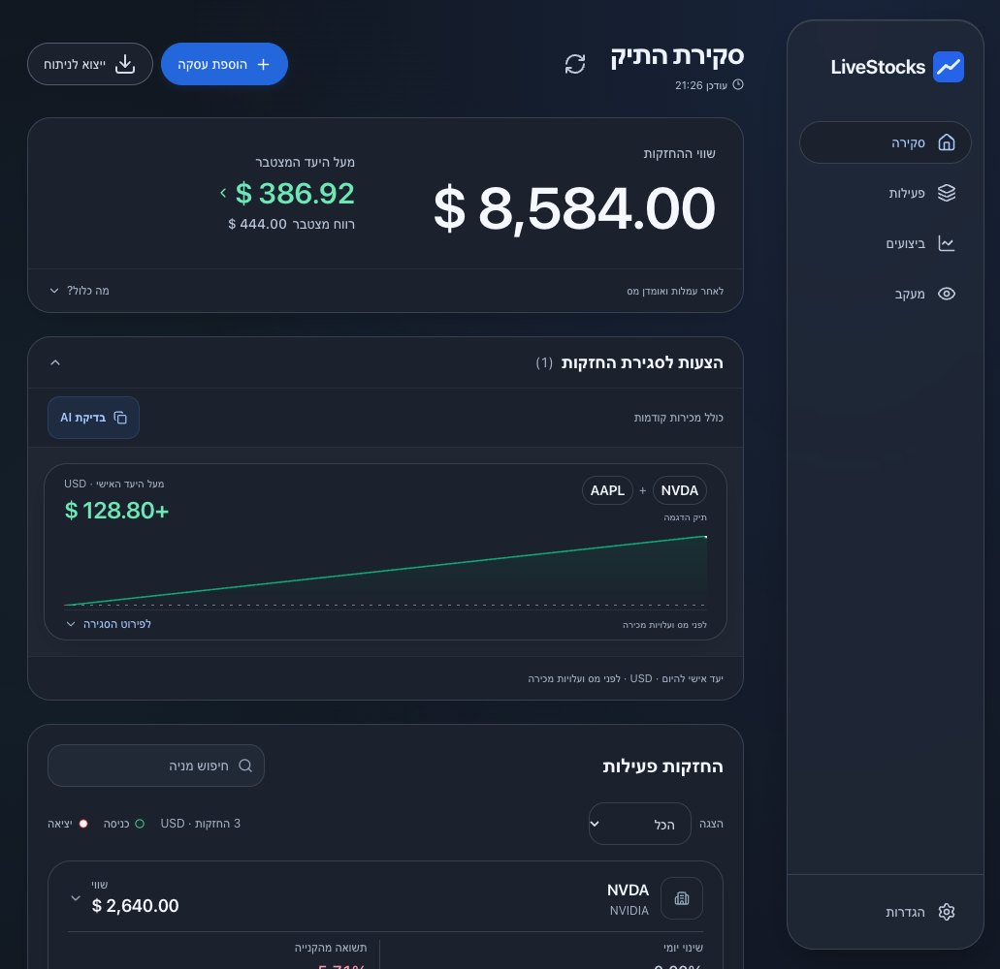

<div dir="rtl">

<p align="center"></p>

# LiveStocks

LiveStocks מרכז החזקות ועסקאות, מציג רווח והפסד בפועל מול יעד אישי ומשווה את הביצועים לאורך זמן למדד S&P 500 באמצעות SPY. הממשק זמין בעברית ובאנגלית, במחשב ובנייד, במצב בהיר וכהה.

[פתיחת האתר](https://razmaz-live-stocks.vercel.app) · [חיבור ל־ChatGPT](https://chatgpt.com/plugins/plugin_asdk_app_6af9b5f79fe48191a12eaa9c67d6ae7b) · [התקנת ווידג׳ט Scriptable](output/widget/README.md)



הסקירה מציגה את הפער מהיעד המצטבר ומתחתיו את הרווח או ההפסד. הצעות הסגירה פתוחות מעל רשימת ההחזקות. הצילומים מציגים נתוני דמו. [סקירה בנייד, כהה](docs/screenshots/overview-mobile-dark-2026-11-22.jpg) · [סקירה בנייד, בהיר](docs/screenshots/overview-mobile-light-2026-11-22.jpg) · [פירוט החזקה בנייד](docs/screenshots/holding-mobile-2026-11-22.jpg)

- ניהול קניות, מכירות ועמלות לפי מקורות השקעה, עם היסטוריית מנות רכישה ומימושים.
- מעקב אחר מניות, שערי USD/ILS, ביצועים מול יעד והצעות לסגירת קבוצות.
- מחקר ב־ChatGPT לפי נתוני התיק ורישום עסקאות שכבר בוצעו לאחר אישור בכרטיס.
- חשבונות אישיים עם כניסת Google או מייל וסיסמה בהתאם לתצורת הסביבה.

## הרצה מקומית

<div dir="ltr">

```bash
npm ci
LIVESTOCKS_DEMO_DATA_DIR="$(mktemp -d)" npm run dev
```

</div>

פותחים את כתובת ה־loopback שהשרת מדפיס ובוחרים **כניסה לחשבון דמו** במסך הכניסה. הפקודה משתמשת בתיקייה זמנית עבור נתוני הדמו. בהרצה רגילה נתוני הדמו נשמרים מקומית בין הפעלות. להרצה עם ספקי אימות ומסד פיתוח, מתחילים מ־[.env.example](.env.example) ועוקבים אחר [מדריך ההגדרה](docs/BETTER_AUTH_SETUP.md).

## בדיקות

| פקודה | שימוש |
| --- | --- |
| `npm test` | חבילת הבדיקות |
| `npm test -- <test-path>` | בדיקה ממוקדת |
| `npm run lint` | ESLint |
| `npm run typecheck` | TypeScript |
| `npm run build` | בניית ייצור מקומית |

## מפת התיעוד

| נושא | מקור |
| --- | --- |
| נקודות כניסה בקוד ובדיקות לפי משימה | [AGENTS.md](AGENTS.md) |
| אימות, סביבת פיתוח ודוא״ל | [Better Auth](docs/BETTER_AUTH_SETUP.md) · [דוא״ל](docs/TRANSACTIONAL_EMAIL.md) |
| קישור חשבונות והתאוששות | [קישור חשבונות](docs/ACCOUNT_LINKING.md) |
| מקורות השקעה | [תפעול ובדיקות](docs/INVESTMENT_SOURCES.md) |
| ChatGPT | [חיבור OAuth](plugins/livestocks-oauth/README.md) · [עסקאות והרשאות](docs/CHAT_TRANSACTION_AUTH.md) |
| Scriptable | [התקנה ובדיקות](output/widget/README.md) |

דוחות וצילומים שהוחלפו זמינים ב־[גרסת הבסיס לפני הניקוי](https://github.com/razmazlih/live-stocks/tree/870801f821060e8eccf0d99124c1606f3f565e64/docs).

</div>
