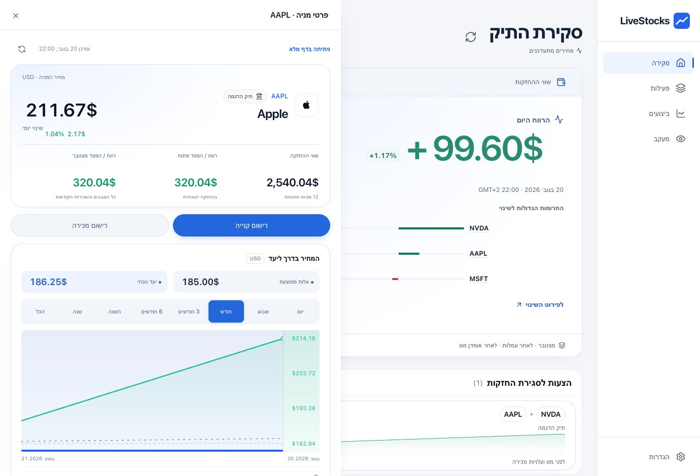

<div dir="rtl">

<p align="center"></p>

# LiveStocks

LiveStocks מרכז החזקות ועסקאות, מציג רווח והפסד בפועל מול יעד אישי ומשווה את הביצועים לאורך זמן למדד S&P 500 באמצעות SPY. הממשק זמין בעברית ובאנגלית, במחשב ובנייד, במצב בהיר וכהה.

[פתיחת האתר](https://razmaz-live-stocks.vercel.app) · [חיבור ל־ChatGPT](https://chatgpt.com/plugins/plugin_asdk_app_6af9b5f79fe48191a12eaa9c67d6ae7b) · [התקנת ווידג׳ט Scriptable](output/widget/README.md)



מסך הבית בוחר אוטומטית מה להציג לפי לוח המסחר בניו יורק והציטוטים הזמינים. בשעות המסחר הרגילות מוביל הרווח או ההפסד האישי להיום, כולל קניות ומכירות שבוצעו במהלך היום. אפשר לפתוח את הפירוט ולראות כמה תרמה כל מניה בכל מקור השקעה.

במסחר המורחב אפשר לראות איזו החזקה זזה הכי הרבה באחוזים מאז הסגירה ולפתוח את דירוג המניות שקיבלו ציטוט. בין ימי המסחר מוביל הפער מהיעד המצטבר, ולצדו תוצאת יום המסחר האחרון והתאריך שלה. [מסחר מורחב בנייד](docs/screenshots/market-extended-mobile.jpg) · [בין ימי מסחר בנייד](docs/screenshots/market-closed-mobile.jpg)

- לחיצה על מניה פותחת את הגרף, העסקאות וההחזקות שלה לצד התיק במחשב ובחלונית מתרחבת בנייד. אפשר לבחור נקודה בגרף במגע, בעכבר או בחצים. הבחירה נשמרת בזמן עדכון מחיר. [חלונית מניה בנייד](docs/screenshots/stock-inspector-mobile.png) · [סקירת מסחר במחשב](docs/screenshots/market-regular-desktop.jpg)
- לחיצה על הפער מהיעד פותחת עורך תשואה שנתית עם חישוב מיידי של היעד והפער. אפשר לנסות אחוז ולבחור שמירה או ביטול.
- רישום קנייה או מכירה ישירות מתוך המניה, עם בחירת מקור כאשר אותה מניה מוחזקת בכמה מקורות. מחיר שהוקלד נשמר בטופס גם כשמגיע ציטוט חדש.
- כשמחיר או שווי משתנים, המספר נע מהערך הקודם לחדש. הממשק מכבד את העדפת המכשיר להפחתת תנועה.
- ניהול קניות, מכירות ועמלות לפי מקורות השקעה, עם היסטוריית מנות רכישה ומימושים.
- מעקב אחר מניות, שערי USD/ILS, ביצועים מול יעד והצעות לסגירת קבוצות.
- מחקר ב־ChatGPT לפי נתוני התיק ורישום עסקאות שכבר בוצעו לאחר אישור בכרטיס.
- חשבונות אישיים עם כניסת Google או מייל וסיסמה בהתאם לתצורת הסביבה.

## הרצה מקומית

<div dir="ltr">

```bash
npm ci
LIVESTOCKS_DEMO_DATA_DIR="$(mktemp -d)" npm run dev
```

</div>

פותחים את כתובת ה־loopback שהשרת מדפיס ובוחרים **כניסה לחשבון דמו** במסך הכניסה. הפקודה משתמשת בתיקייה זמנית עבור נתוני הדמו. בהרצה רגילה נתוני הדמו נשמרים מקומית בין הפעלות. להרצה עם ספקי אימות ומסד פיתוח, מתחילים מ־[.env.example](.env.example) ועוקבים אחר [מדריך ההגדרה](docs/BETTER_AUTH_SETUP.md).

כדי להשוות בין התצוגות אפשר להפעיל את השרת המקומי עם `LIVESTOCKS_REVIEW_DEMO=1 npm run dev` ולפתוח את אחד הנתיבים שלהלן. כל קישור קובע את השעון של אותה לשונית. בתצוגה זו העסקאות וההגדרות נשמרות עד לסגירת הלשונית. אפשר להפעיל אותה גם בפריסת Preview ב־Vercel באמצעות אותו משתנה סביבה.

| נתיב בדמו | זמן בניו יורק |
| --- | --- |
| `/?scenario=regular` | יום שישי, 20 בנובמבר 2026, 15:00 |
| `/?scenario=extended` | יום שישי, 20 בנובמבר 2026, 17:00 |
| `/?scenario=closed` | שבת, 21 בנובמבר 2026, 12:00 |

בתרחישי המסחר המורחב והרגיל, מחירי ההדגמה מתעדכנים ברצף סינתטי. אפשר לפתוח מניה, לרשום עסקה ולנסות יעד אישי באותה לשונית. בתרחיש הסגור נשמרים מחירי הסגירה.

## ציטוטים בחשבון אישי

האתר קורא עדכוני מחיר מ־Finnhub במפתח האישי של החשבון. מניות פתוחות וגלויות מקבלות קדימות במסגרת מכסת הספק. בזמן ניתוק התיק נשאר זמין עם המחירים האחרונים והרענון התקופתי. לפני הפעלת ההזרמה בסביבה מחוברת יש להחיל את מיגרציית תיאום החיבורים. [הגדרת ההזרמה, המכסות והבדיקות](docs/LIVE_QUOTES.md)

## בדיקות

| פקודה | שימוש |
| --- | --- |
| `npm test` | חבילת הבדיקות |
| `npm test -- <test-path>` | בדיקה ממוקדת |
| `npm run lint` | ESLint |
| `npm run typecheck` | TypeScript |
| `npm run build` | בניית ייצור מקומית |

## מפת התיעוד

| נושא | מקור |
| --- | --- |
| נקודות כניסה בקוד ובדיקות לפי משימה | [AGENTS.md](AGENTS.md) |
| אימות, סביבת פיתוח ודוא״ל | [Better Auth](docs/BETTER_AUTH_SETUP.md) · [דוא״ל](docs/TRANSACTIONAL_EMAIL.md) |
| קישור חשבונות והתאוששות | [קישור חשבונות](docs/ACCOUNT_LINKING.md) |
| מקורות השקעה | [תפעול ובדיקות](docs/INVESTMENT_SOURCES.md) |
| ChatGPT | [חיבור OAuth](plugins/livestocks-oauth/README.md) · [עסקאות והרשאות](docs/CHAT_TRANSACTION_AUTH.md) |
| Scriptable | [התקנה ובדיקות](output/widget/README.md) |

דוחות וצילומים שהוחלפו זמינים ב־[גרסת הבסיס לפני הניקוי](https://github.com/razmazlih/live-stocks/tree/870801f821060e8eccf0d99124c1606f3f565e64/docs).

</div>
