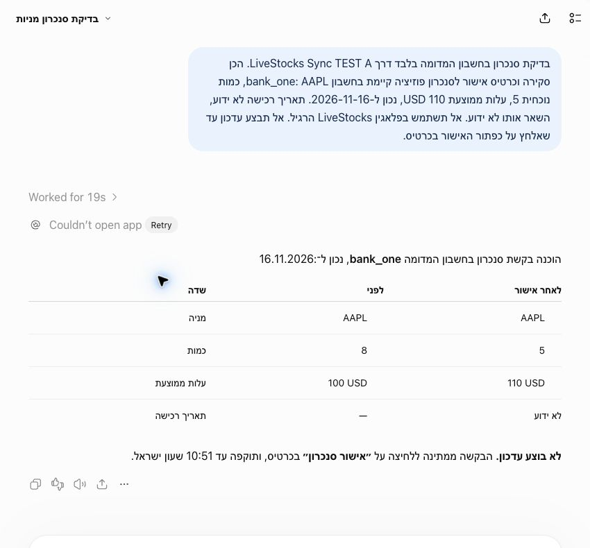

# Isolated real-host screenshot-sync gate

Use this gate to exercise the real application from ChatGPT without connecting the test to a retained portfolio or production service. The runner is `scripts/chat-sync-isolated-fixture.mjs`. It does not deploy to Vercel, restore Supabase projects, change an existing App, load `.env`, or reuse an existing database.

## What runs

- A new native PostgreSQL cluster in an owner-only temporary directory, bound only to loopback. All committed migrations are applied to that new empty database.
- An official temporary PostgREST binary, with the application's real RLS and limited roles. Its private JWT set contains the test provider's public EC key plus a new test-only HMAC key for synthetic anon/service credentials.
- A fresh production Next build from `git archive HEAD`, with `node_modules` reused but every `.env*` and `.vercel` entry removed. Uncommitted application changes are intentionally not part of this source copy; record the tested commit.
- A loopback-only HTTP gateway on port 3137. It routes `/rest/v1/` to PostgREST and other paths to Next on port 3140. An externally managed temporary HTTPS tunnel exposes only that gateway.
- Two synthetic, preverified password accounts using the actual Better Auth password hashing and sign-in code. Password mode is enabled only in this fixture; Google and external email delivery are not used.

The first account starts with AAPL BUY 10 at $100 and SELL 2 at $120: current quantity 8, average cost $100, recorded realized gain $40. The second has MSFT 7 at $200 and is the independent isolation sentinel. No real portfolio rows or production provider keys are copied.

## Start and inspect

Prerequisites: repository dependencies, native `initdb`, `pg_ctl`, `psql`, `openssl`, Node.js, an official PostgREST binary downloaded to a temporary directory, and an HTTPS tunnel to `127.0.0.1:3137`. The runner accepts temporary ngrok/Cloudflare hostnames only. Ensure ports 3137 and 3140 are available before starting.

```sh
node scripts/chat-sync-isolated-fixture.mjs start \
  --origin https://YOUR_TEMPORARY_TUNNEL.ngrok-free.app \
  --postgrest /private/tmp/verified-tools/postgrest \
  --state-file /private/tmp/livestocks-chat-sync-state.json

node scripts/chat-sync-isolated-fixture.mjs status \
  --state-file /private/tmp/livestocks-chat-sync-state.json

node scripts/chat-sync-isolated-fixture.mjs snapshot \
  --state-file /private/tmp/livestocks-chat-sync-state.json
```

Binding and loopback database access may require the desktop sandbox's normal execution approval. The state and runtime are owner-only; the state contains **synthetic** account passwords, session cookies and client credentials. Never print or commit that state or paste its complete contents into a conversation. Normal status output excludes credentials. Failure details go to a protected log rather than stdout. The source copy, authentication/database keys and PostgreSQL TLS certificate are all new test values.

The temporary PostgreSQL cluster uses local trust authentication for setup, so it is suitable only for this disposable loopback fixture. Never expose its TCP port or point these commands at a retained database. The HTTPS tunnel must forward only to the HTTP gateway, not PostgreSQL or PostgREST directly.

## Connect the temporary ChatGPT App

Create a clearly named private test App pointing to the temporary origin's `/api/mcp`. Keep the existing LiveStocks App and its OAuth connection unchanged. Use the synthetic static client ID/secret from the protected state through the owning OAuth settings; do not publish those values in a package or log.

Observe the exact callback in the host. The runner's initial callback is the previously observed `https://chatgpt.com/connector_platform_oauth_redirect`. If the host presents a different callback, stop and review it; do not guess or silently widen the registration. The `seed-client` command accepts an exact observed ChatGPT callback and the application's supported seeder refuses an existing mismatched registration.

Sign into the OAuth flow with a synthetic account only. Verify that the consent page names the isolated origin/account and requests the narrow sync capability. A normal browser navigation must redirect to sign-in/consent, not stop on a JSON `{redirect:true}` object. The gateway deliberately uses raw `node:http` forwarding: Undici `fetch` rewrites `Sec-Fetch-Mode` to `cors` and changes this provider's real navigation transport.

```sh
node scripts/chat-sync-isolated-fixture.mjs seed-client \
  --state-file /private/tmp/livestocks-chat-sync-state.json \
  --callback https://chatgpt.com/EXACT_OBSERVED_CALLBACK
```

The state stores private cookies for the two fixture accounts; an unrelated production browser session must never be substituted. The public health marker `/__isolated-health` reports `productionAccess:false` and the source commit only.

## Evidence and cases

Save a private `snapshot` before any confirmation. It reports counts and SHA256 digests for all six financial tables, a separate digest of original BUY/SELL rows, mapped current holdings and recorded realized profit. After synchronizing the first account's AAPL to 5 at $110, expect one new RECONCILE lot, unchanged original trade digest, current quantity 5 and recorded realized profit $40. All six digests of the second account must remain identical.

Exercise screenshot extraction and explicit inline confirmation in the real host when the browser permits image upload. Also test cancellation, duplicate/uncertain-response retry, stale proposals and cross-account denial. If image upload or the embedded App is blocked by the host/browser, record the exact observed limit. Text preparation, direct API calls and a synthetic iframe harness do not prove screenshot extraction or real-host inline rendering.

For an optional lost-response test, arm a **local-only** marker. The gateway replaces the next successful confirmation receipt with a synthetic error after the upstream confirmation has applied. A repeat of the same proposal must return its saved receipt without another lot.

```sh
node scripts/chat-sync-isolated-fixture.mjs arm-lost-reply \
  --state-file /private/tmp/livestocks-chat-sync-state.json
```

`restart-gateway` reloads only the fixture gateway while preserving its database/accounts/sessions. Use it only when no authentication request is in progress. Ordinary gateway errors must not be confused with application or real-host failures.

## Cleanup

```sh
node scripts/chat-sync-isolated-fixture.mjs stop \
  --state-file /private/tmp/livestocks-chat-sync-state.json
```

The runner stops only its recorded process groups, confirms PostgreSQL shutdown, removes its generated source/database/runtime and deletes its state. If PostgreSQL shutdown fails, it retains the state/runtime for diagnosis. Stop the separately managed tunnel as well. Remove or disconnect only the temporary test App through its owning controls; never alter the installed production LiveStocks connection. Keep sanitized evidence and the tested commit, not credentials, cookies, raw tokens or private capability values.

## Actual-host observation on 2026-11-16

The temporary private OAuth connection succeeded using a synthetic account. Both ChatGPT and Work reached the real `prepare_screenshot_sync` tool and returned the expected saved review. The UI card itself displayed **“Couldn’t open app”**, even though observed `resources/read` requests returned HTTP 200. Consequently, actual-host rendering, the human confirmation click and final writes from that card remain **unverified**. Do not label the complete in-chat flow PASS from a successful prepare response alone.

Uploading the synthetic screenshot was separately blocked by the browser extension's file-URL permission. Screenshot extraction was not exercised; a text-described holding is only a text-preparation test. A legacy resource MIME compatibility experiment may be performed through a test-only disposable gateway override; it is not a production change or proof of success unless the card actually renders and the user can confirm within ChatGPT.

The intended product still performs all review and final confirmation inside ChatGPT. The initial OAuth sign-in/consent is a separate authorization step; opening the website to approve the financial change is not an acceptable substitute for this host acceptance gate.

The legacy MIME experiment also failed to open the original card. The attempted static-HTML diagnostic was not actually served and supplies no evidence; the exact cause remains unknown. Both synthetic portfolios were byte-for-byte unchanged across all six financial tables after preparation. The temporary test connection was uninstalled and its local database, source copy, tunnel and credential page were stopped/removed. Uninstalled draft plugin records were not permanently deleted.


