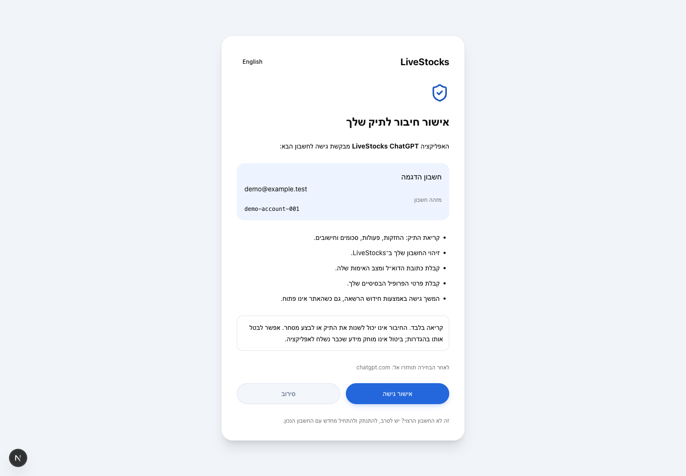
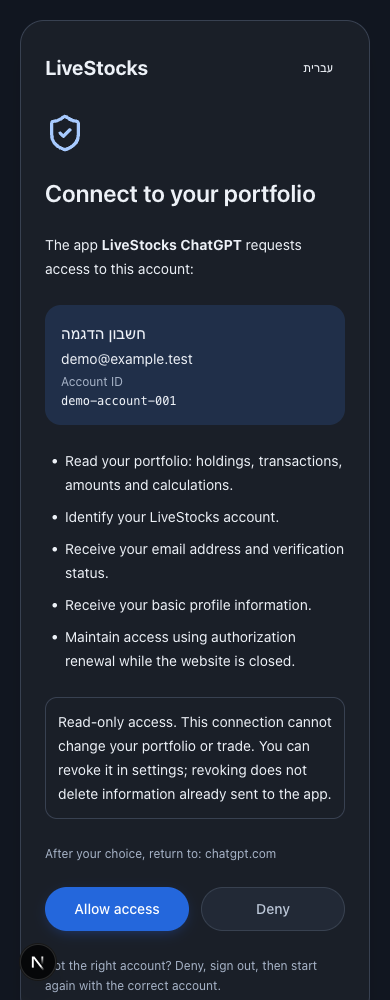

# OAuth consent and static MCP client

The Better Auth flow uses the on-site `/sign-in` and `/oauth/consent` pages. The consent screen is bilingual, shows the verified account name, email and identifier, identifies the requesting application and callback host, and lists the requested permissions. The portfolio permission is read-only. Accept and deny both return through the provider's checked continuation; denial does not revoke an earlier grant.

## Request boundaries

- The server verifies the SDK's signed query before rendering, including its expiry. It accepts only the configured MCP client, exact registered callback, MCP resource, S256 PKCE, and the supported read-only scopes. Custom OIDC claims are not accepted by this UI.
- The current registration must still be enabled, require PKCE and require consent. Names are rendered as text; remote client logos and links are not loaded.
- A short-lived signed review receipt binds the displayed request to the exact user and session. Changing accounts or sessions before submission requires starting again. The decision endpoint requires the configured same-origin request and repeats validation.
- The SDK checks consent, registration and code issuance again. Neither unsigned query parameters nor browser-supplied callback URLs choose the destination.
- Consent pages and responses use no-store; the consent page and decision API use no-referrer. The page does not mount the portfolio data provider or fetch portfolio records.
- Auth page navigation preserves the signed query. After password sign-in, the SDK's continuation takes priority over the ordinary portfolio redirect. If a signed request expires during registration or email recovery, start a fresh connection from the requesting app.

Implementation follows the [official sign-in/consent flow](https://better-auth.com/docs/plugins/oauth-provider/sign-in-flow) and the installed `@better-auth/oauth-provider` **1.7.23** source. SDK request signatures and a session are separate checks; neither replaces the other.

## Operator-only client bootstrap

`scripts/seed-mcp-client.mjs` calls the same server-only `seedMcpClient` implementation used in local integration tests. There is no public administrative endpoint. The operator needs the limited authentication database credentials, the intended MCP client secret, and a current verified operator session matching an explicitly supplied user ID.

Prepare three owner-only regular files (`0600`) outside the checkout:

1. Configuration JSON containing `APP_BASE_URL`, `BETTER_AUTH_SECRET`, `BETTER_AUTH_DATABASE_URL`, `BETTER_AUTH_WEBSITE_CLIENT_ID`, `BETTER_AUTH_MCP_CLIENT_ID`, `BETTER_AUTH_MCP_CLIENT_SECRET`, and optionally `BETTER_AUTH_DATABASE_CA`. These are the deployment's exact settings. No `.env` file is loaded.
2. A plain-text session `Cookie` header value, supplied privately. Do not put it in command arguments, documentation, screenshots or Git.
3. A JSON array of one to three **exact callback URLs copied from the actual client registration**. Do not guess ChatGPT callback paths or add wildcards. HTTPS is required except for a fully local test.

Review the nonsecret target first:

```sh
node scripts/seed-mcp-client.mjs \
  --config-file /private/path/auth-config.json \
  --cookie-file /private/path/operator-cookie.txt \
  --callbacks-file /private/path/callbacks.json \
  --origin https://your-deployment.example \
  --client-id your-configured-mcp-client \
  --operator-id your-verified-user-id
```

After reviewing that exact target, append `--apply` to create the registration. This is a database mutation and should run only as part of the authorized target setup. Review mode does not contact the database. The script prints only origin, client ID, operator ID, callbacks and creation status; failures omit raw provider/database errors.

Re-running with the same configuration is idempotent. Existing differing callbacks, scopes, resources, grants, disabled state, PKCE, consent or authentication method are refused. Existing client secrets are verified through the SDK's introspection authentication; this command does not rotate secrets or overwrite registrations. The private pool is closed and temporary compiled code is removed on exit. Remove the temporary session-cookie file after use.

## Verification and remaining scope

The disposable local PostgreSQL gate exercises the actual limited-role provider, operator CLI creation and reuse, password-login continuation, consent review and approval, code exchange, denial/state preservation, receipt/account-switch checks, query tampering and real expiry, disabled-client rejection, origin validation, resource/PKCE/refresh checks and logout revocation. SMTP is mocked in memory. Run:

```sh
python3 scripts/test-better-auth-postgres.py
npm test -- --run __tests__/oauth-consent-ui.test.tsx __tests__/oauth-continuation.test.ts __tests__/seed-mcp-client.test.ts __tests__/onsite-auth.test.tsx
```

These local results do not prove production registration, hosted callbacks, SMTP delivery, Google sign-in or the ChatGPT host's connection flow. Those require their own target-specific checks.

Screenshots below use an isolated local component preview, a synthetic account and a placeholder callback. No production credentials or portfolio records were used.

| Hebrew desktop | English mobile, dark |
| --- | --- |
|  |  |
