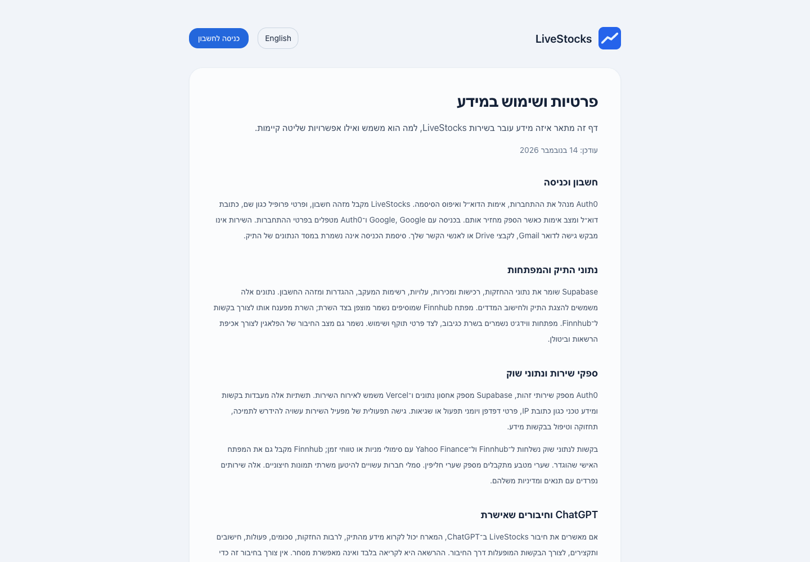
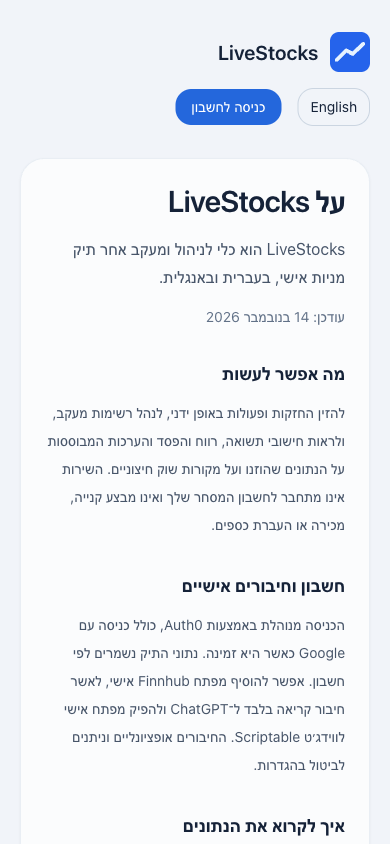

# Public information pages — review before publication

Prepared 2026-11-14. These are factual service disclosures for review, not a claim that legal, regulatory or Google verification requirements have been satisfied. No production deployment or Google Branding update is included.

## Reviewable pages

- `/about` describes LiveStocks and its optional connections. It can be used as the public application-homepage URL once published.
- `/privacy` describes account and portfolio data, providers, keys, local storage, optional ChatGPT sharing and manual requests.
- `/terms` explains service scope, data limitations, authorized use and support.
- Hebrew is the default. Append `?lang=en` for English. The exact bilingual copy is in [`lib/public-information.ts`](../lib/public-information.ts); the shared page is [`components/public-information.tsx`](../components/public-information.tsx).

All three routes return HTTP **503**, `Cache-Control: no-store` and `X-Robots-Tag: noindex` until both `PUBLISHER_NAME` and `PUBLIC_SUPPORT_EMAIL` contain explicitly approved public values. There is no fallback to a Google consent email, authentication account, Git identity or private setup file. Setting these values makes the pages publicly readable; it is a publication decision, not just a technical default. Portfolio pages and APIs retain their existing authorization.

For a local review, use an isolated local server with clearly synthetic values, for example `PUBLISHER_NAME="Example Operator" PUBLIC_SUPPORT_EMAIL="support@example.test"`. Do not copy these example values into production.

## Decisions still required from the operator

1. Approve the exact public operator/publisher name and support email. Approval to use an email in Google's consent configuration does not by itself authorize putting it on the public website.
2. Review and approve both language versions and confirm the manual identity-verified information/deletion request process can be operated. There is no automatic whole-account deletion implementation or complete account export. The existing research-export feature copies a selected analytical snapshot.
3. Define operational retention and deletion handling for account data, backups and provider logs. The draft states the present limitation without inventing deadlines or guaranteeing deletion of copies in external services.
4. Confirm the production provider list and hosting arrangements at publication. Determine whether additional operator identity, jurisdiction-specific rights, age restrictions or legal terms are needed. The draft deliberately invents no company, jurisdiction, compliance certification or guaranteed retention period.
5. After approval and deployment, verify each HTTPS page without signing in before adding its URL to Google Branding. Google OAuth publication/verification and real user flows remain separate checks.

## Implementation evidence and scope

| Disclosure | Owning implementation |
| --- | --- |
| Better Auth sessions, password hashes, identity and verified email | `lib/auth/better-auth.ts`, `lib/auth/auth-email.ts`, private-session migration, `app/api/account/session/route.ts` |
| Account-owned portfolio and connection state | Canonical-profile and ownership migrations, `lib/auth/server.ts`, account routes |
| Encrypted Finnhub key / hashed widget keys | `lib/auth/credentials.ts`, widget and credential routes |
| Read-only ChatGPT access and revocation | `app/api/mcp/route.ts`, `lib/auth/server.ts`, connection routes |
| Finnhub, Yahoo and currency requests | `lib/services/finnhub.ts`, `yahoo-candles.ts`, `exchange-rate.ts` |
| Browser state and appearance preferences | `lib/supabase.ts`, `components/auth/auth-provider.tsx`, appearance/theme modules |
| Scriptable Keychain and up-to-one-hour offline cache | `output/widget/Stocks Status.js` |
| Selected research snapshot copying | `components/portfolio/research-export-dialog.tsx` |

Provider-policy links reference the providers' own notices: [Supabase](https://supabase.com/privacy), [Vercel](https://vercel.com/legal/privacy-notice), [Google](https://policies.google.com/privacy) and [OpenAI](https://openai.com/policies/privacy-policy/). They do not replace the operator's own review. No claim is made about advertising practices, sale of data, data residency, legal bases or statutory response deadlines that was not established by this implementation review.

## Local verification

The full suite passed 611 tests across 59 files, lint, build and post-build typecheck. The built site returned 200 for all three public routes with synthetic publisher details and kept `/settings` and `/privacy/export` behind sign-in. Tests verify missing publisher/contact produces 503 and that public pages skip session/private providers. Chromium checks found no API requests on public pages, no horizontal overflow at 1440px/390px and no console errors. Hebrew RTL and English LTR were checked. The test server and browser were stopped.

These screenshots show a local draft with synthetic operator/contact configuration, not published policies:

| Privacy on desktop | About on mobile |
| --- | --- |
|  |  |

## Operator review received

On 2026-11-14 the user explicitly approved public publisher name **LiveStocks**, the selected support email, both language disclosures and the stated manual identity-verified request process, including the disclosed retention/backup limitations without invented deletion deadlines. Production values remain configuration rather than hardcoded personal details. Approval is not a claim of regulatory certification or Google verification. Deployment and public HTTPS read-back are separate steps.

## Better Auth draft update

The current bilingual source now describes onsite Better Auth forms, password hashes in the private authentication schema, HttpOnly session cookies and the configured email provider. The earlier operator/contact and manual-request approval remains recorded above; the revised provider disclosures require review before publication. The policy screenshots above predate this provider change and are historical layout examples. Actual SMTP delivery and the new Google flow are not claimed verified.
