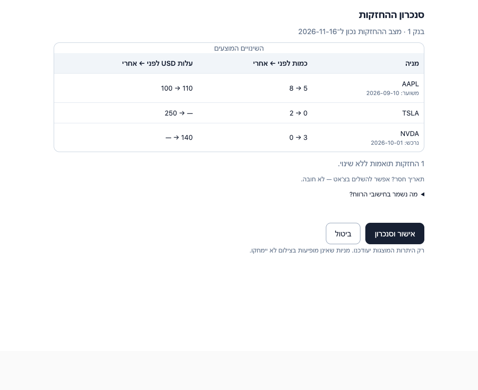
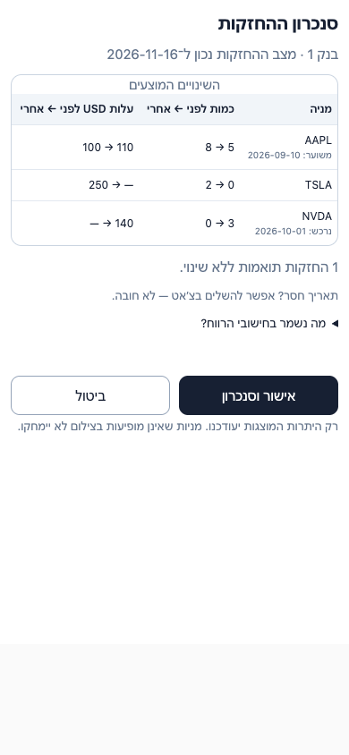
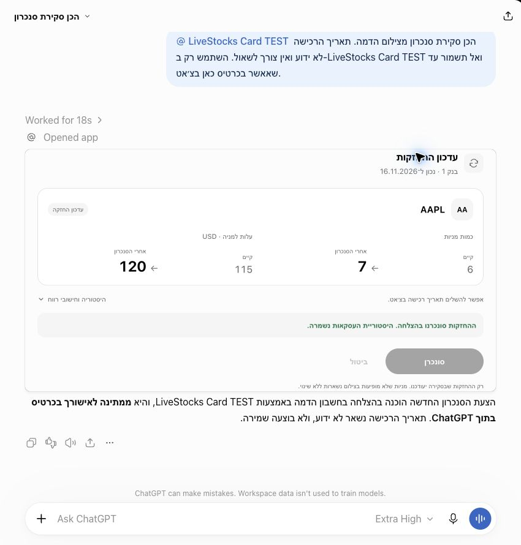
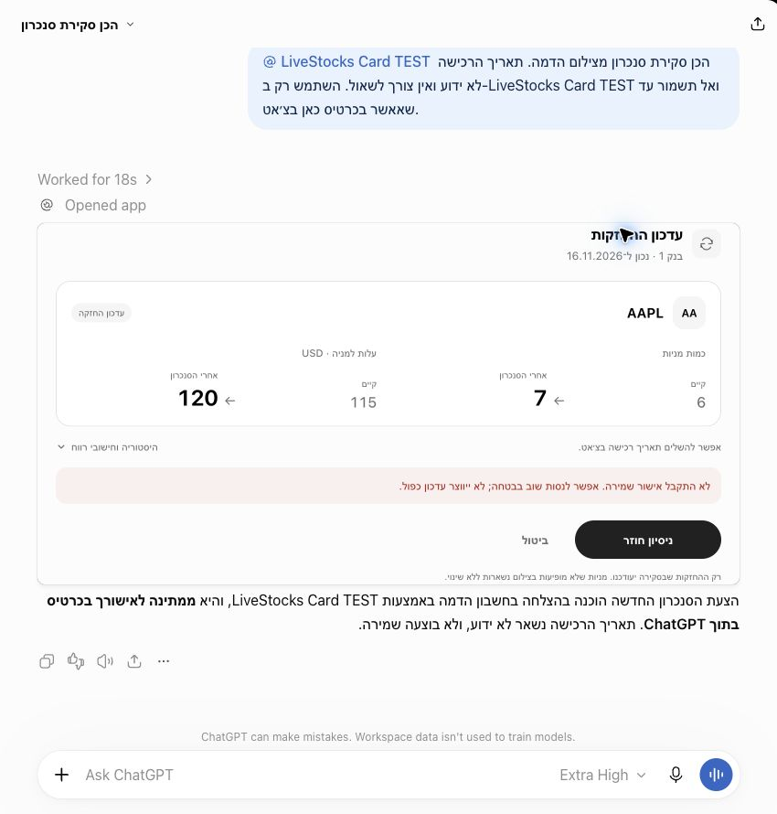

# Screenshot reconciliation

**Verified in actual ChatGPT on source `2c9b845`:** screenshot extraction, modern review, explicit confirmation, safe idempotent retry and authoritative portfolio readback passed with synthetic accounts. [Latest acceptance evidence](verification/chat-sync-chatgpt-acceptance-2026-11-16.json) supersedes the historical blocked attempt below. Work-mode rendering and explicit cancellation also passed without changing either synthetic portfolio. The temporary test connection was uninstalled; the disposable database, app, tunnel and credential page were stopped/removed, and their ports were verified closed.

## User flow

A user uploads a holdings screenshot in ChatGPT. Host vision extracts clear values, asks once about blocking ambiguity, and calls prepare_screenshot_sync. The result opens a compact MCP App review **inside ChatGPT** with account, observation date, before/after quantities/costs and known or estimated dates. One human button click confirms; Cancel cancels. No website review or final approval is needed. No screenshot, OCR vendor or server model is involved.

Acquisition dates are optional. A short chat answer or transaction screenshot can supply a real date. The existing bounded history helper can suggest a price-match date (0.5% daily-range tolerance, up to five years). An estimate is stored separately and never establishes original FIFO lots, acquisition FX or holding age. Missing dates and optional lookup outages do not block the fast path. Every new preparation automatically replaces any pending review for the same owner/session/client/grant binding; the model need not remember or supply a previous proposal ID. Blocked/no-op corrections also invalidate the prior card. Tool guidance requests a short reply directing the user to the review; do not repeat the card or ask about optional dates.

New, existing, previously closed, and consolidated holdings are supported. Existing quantity and cost changes are not blocked merely because they differ from recorded history. Explicit zero rows clear an observed balance; omitted symbols never mean zero. Positive balances require a known fee-inclusive USD cost. A screenshot preceding any recorded event for that instrument/account is rejected; it must not undo later real trades. Mixed accounts require separate proposals.

## Accounting model

A screenshot provides an observation, not an execution. Each changed instrument receives an immutable `RECONCILE` position-lot event at the observation date, carrying absolute target quantity, fee-inclusive USD average basis, optional verified `basis_acquired_on`, optional separately labeled `basis_date_estimate`, and creation time. This is an accounting checkpoint, not a buy, sale, deposit or taxable event.

- Every historical BUY/SELL lot remains byte-for-byte unchanged. Prior realized sale calculations retain their recorded proceeds, FIFO basis and profit.
- At the checkpoint, the open FIFO queue resets to the observed quantity and basis. Zero clears the queue without generating proceeds, realized profit, fees or tax.
- Later real BUY/SELL lots extend or consume the new FIFO queue normally. A sale consuming snapshot basis carries `basisSource:reconciled_average` and is labeled accordingly: the average-cost screenshot cannot prove the broker’s original tax-lot FIFO. Legacy same-day trade order is preserved before the first checkpoint; checkpoints separate earlier/later events, and subsequent same-day events use creation time; future inserts use `clock_timestamp()` so same-day trades after confirmation occur after the checkpoint. Unknown original dates never use observation-day FX as acquisition FX.
- A later corrected screenshot appends another checkpoint. Checkpoints cannot be edited/deleted through normal writers; review the next before/after balance and append a correction. Account merge may change only the owning profile under its existing executor boundary.
- Multiple ledgers left by account merge are reconciled as one instrument/account balance: the canonical ledger gets the target checkpoint, the other ledgers get explicit zero checkpoints in the same transaction. All their histories remain available; quantities are not multiplied across ledgers.
- Holdings with no lot ledger retain their original metadata; the checkpoint supersedes only the currently open balance, without fabricating prior trades.

### Example

Recorded history: buy 10 at $100, sell 2 at $120. Recorded realized gain remains $40 and the recorded open balance was 8 at $100. A current screenshot shows 5 at $110. Confirmation appends a checkpoint of 5 at $110; current value at a $130 quote is $650 and open gain is $100. It does **not** infer a sale of 3 shares, sale proceeds or another realized gain. A later actual sale of 2 at $130 has a $220 basis and $40 gross gain before its recorded fee. The earlier $40 sale remains intact, but lifetime gain/tax is incomplete because the screenshot does not explain the missing executions.

## Truthful metrics

Current quantity, current USD valuation, fee-inclusive current cost and open USD gain remain calculable. Recorded realized sales remain visible as recorded subtotals. A snapshot cannot reveal missing disposal proceeds, commissions, tax or cash flows, so affected complete historical/cumulative returns and total tax are unavailable rather than zero or guessed. Unknown basis dates also leave holding age, annualized targets and acquisition-date FX unavailable. Reconciled instruments are excluded from complete-history close-group screening. Historical chart paths do not bridge a checkpoint into an invented investment return.

## Isolation, atomicity and replay

### Limited OAuth capability

Default OAuth grants and existing refresh families remain read-only. The optional portfolio:sync capability requires an explicit operator allowlist change for the existing MCP client and a new user-consented OAuth request. It does not add portfolio:write. The access token keeps the read_only claim true, and ordinary RLS INSERT/UPDATE/DELETE remains denied. Website credentials claiming the sync scope are rejected.

Only the fixed confirmation dispatcher can enter a dedicated NOLOGIN/NOINHERIT/NOBYPASSRLS executor. It has owner-bound SELECT/INSERT policies and a trigger fence allowing only checkpoint inserts and exact preservation of an already-recorded legacy opening balance. General UPDATE/DELETE, trading, plans, settings and credentials remain inaccessible. All SECURITY DEFINER functions have an empty search path, explicit EXECUTE grants and live owner/session/grant checks; the role cannot create functions or be assumed by authenticated callers.

### Exact persisted review and human interaction

The private RLS-protected proposal table stores immutable expected fingerprint, rows, review, expiry, canonical owner, raw subject, session, client, OAuth approval and a SHA256 confirmation-secret hash. Read RPCs omit the hash and financial payload not needed for review. Each proposal expires after 15 minutes. A binding-level transaction lock atomically keeps at most one pending proposal for the same owner/session/client/grant. Every new preparation supersedes its predecessor automatically, without depending on a model-supplied previous proposal ID; explicit cancellation persists. Even blocked/no-op corrections invalidate the prior card.

The server returns only review data and proposal ID in content/structuredContent. A random 256-bit confirmation capability goes exclusively in result _meta, documented as hidden from the model and available to the embedded app. confirm_screenshot_sync and cancel_screenshot_sync use ui.visibility:[app] and accept only proposal ID plus that capability—no editable holdings, owner ID or invented confirmed boolean. The UI sends it only after an actual button click, never automatically, and does not put it in DOM, logs, storage, URLs or model context. Source===parent checks, request correlation and proposal generations prevent stale/foreign iframe replies from completing a different card.

The trust boundary is a compliant MCP/ChatGPT host and the approved OAuth client. MCP annotations alone do not prove a human click and there is no server-verifiable human-click signature; the private capability and app-only tool keep the language model out of final execution. Do not claim synthetic-host tests establish actual ChatGPT behavior.

### Atomicity, isolation and replay

Confirm revalidates live signed scope, canonical identity, session, grant, client, connection cutoff and account fence, then locks the exact saved proposal. It applies only its stored rows after comparing the full current portfolio fingerprint. Bounded locks and checkpoint inserts share the transaction with the saved receipt/status; failures roll back everything. Wrong owner/session/grant/client, missing scope/secret, cancelled/superseded/expired drafts, stale snapshots and backdated observations fail closed. An exact retry of an already-applied proposal returns its stored receipt without reapplying, even if unrelated portfolio edits happened later.

The legacy website screen remains a separate manual fallback protected by website-only writes; the ChatGPT path does not call it or reveal its encrypted review URL.

## Verification and release

Run Vitest, TypeScript, ESLint, production build, the Scriptable suite, python3 scripts/test-screenshot-sync-postgres.py, and python3 scripts/test-better-auth-postgres.py. The SQL fixture applies all migrations and verifies persisted review, exact execution, private secret handling, cross-owner/session/grant denial, read-only denial, direct-write denial, supersession, cancel, expiry, revocation, stale/backdated rejection, receipt replay, rollback and preservation of historical lots. Its identity helper is synthetic. The separate Better Auth fixture uses the real provider SDK for explicit optional-scope registration, signed consent, access/refresh issuance, old read-only grants, and refresh escalation denial.

Release all three feature migrations in order (`20261116065346_screenshot_position_import.sql`, `20261116073637_chat_sync_confirmations.sql`, and `20261116092048_one_pending_chat_sync_review.sql`) and compatible readers/writers together. Explicitly review and apply the existing seeder with --enable-portfolio-sync to opt the client into the optional scope (see docs/CHATGPT_ACTIVATION.md); never widen existing grants or silently add general write. Refresh the existing App tools, publish the skill through its established process, and accept the optional scope through user consent. Preserve App/plugin/client IDs, callbacks, secrets, workspace sharing and approved icon assets. No production migration, OAuth allowlist change, plugin publication or real-user import is performed by this PR.

The first [isolated real-host attempt](verification/chat-sync-isolated-host-2026-11-16.json) prepared the correct review but failed to open the card. That historical artifact remains unchanged: both MIME variants returned HTTP 200, and its attempted static diagnostic was **not actually served**. HTTP success alone did not establish that ChatGPT accepted the MCP result schema.

The follow-up isolated test identified the concrete failure in ChatGPT's backend response: `PerRequestReadResourceResult` rejected missing `ttlMs` and `cacheScope`. ChatGPT requested core MCP `2026-07-28`, while our custom route emitted the older result shape. The route now returns `resultType: "complete"` for that revision and `ttlMs: 0, cacheScope: "private"` for its cacheable methods, including `resources/read`. Zero TTL prevents reuse; private scope prevents sharing across authorization contexts. Explicit older protocol revisions retain their previous wire shape. These are core MCP response fields, separate from the MCP App UI handshake version. See the [official protocol schema](https://github.com/modelcontextprotocol/modelcontextprotocol/blob/main/schema/2026-07-28/schema.json), [TypeScript SDK migration guide](https://github.com/modelcontextprotocol/typescript-sdk/blob/main/docs/migration/support-2026-07-28.md#cache-fields-and-cache-hints) and [Python SDK caching guide](https://github.com/modelcontextprotocol/python-sdk/blob/main/docs/client/caching.md).

With only those response fields corrected in the isolated gateway, real ChatGPT opened the nested App iframe and displayed the correct synthetic holding change: quantity 8 → 5, USD unit cost 100 → 110, with confirmation and cancellation enabled. A synthetic screenshot uploaded through the native file picker was also extracted correctly; no extension permission change was needed. The source fix is commit `1227653`. The rebuilt source `1227653` subsequently completed an actual ChatGPT confirmation and an idempotent retry: exactly one checkpoint was added, the retry returned the saved applied receipt, the other synthetic account was unchanged, and historical trade hashes and recorded realized profit of USD 40 were retained. The first injected uncertain-response envelope lacked the 2026 `resultType`, so its UI error is not valid evidence for the intended uncertain-response experience. The valid retry displayed stable success with confirmation disabled. **Final regular-Chat acceptance passed on source `2c9b845`:** ChatGPT extracted a fresh synthetic screenshot for AAPL quantity 7 at USD unit cost 120, reviewed the existing 6 at 115 in the modern holding cards, and applied the explicit click exactly once. A valid injected lost reply displayed the fixed Hebrew error and “ניסיון חוזר”; retry returned the cached receipt, cleared the error and displayed stable success with “סונכרן” disabled. Authoritative `get_portfolio_snapshot` readback confirmed 7 at 120. Checkpoints increased only once (4 → 5); original BUY/SELL hashes, USD 40 realized profit and all six financial-table hashes for the second account remained unchanged. Website approval is not a substitute. The real-host screenshots below use synthetic holdings; the older desktop/mobile harness images remain synthetic-host evidence, not physical-phone checks.

## Recorded verification

Current test totals and native runs are recorded in the PR description. Synthetic browser checks cover no automatic writes, private secret absent DOM, exact button arguments, confirmed success/cancel and a 390px mobile layout without page overflow. Unit tests cover stale proposal reply isolation and actual/estimated date labels. No real screenshot or personal financial data appears in these artifacts.

The final source uses the versioned `ui://livestocks/screenshot-sync-v4.html` resource with individual holding cards and fixed, secret-safe error messages. Native SQL, security-catalog and held-lock concurrency checks passed for automatic replacement, including blocked/no-op invalidation. The final suite passed 1009 tests with 3 optional native tests skipped; typecheck, lint and production build passed. Regular Chat and Work-mode cancellation acceptance of `2c9b845` are complete. The temporary test connection was uninstalled; the disposable database, app, tunnel and credential page were stopped/removed, and their ports were verified closed.

## Source-catalog production cutover — 16 November 2026

The personal investment-source release applied both screenshot-sync schema prerequisites and the UUID source migration to production. Financial-table digests and legacy source assignments matched before/after cutover. Existing OAuth grants/client scopes were not widened. Plugin 1.1.2 published only source-catalog guidance; the separate screenshot-sync skill draft and ChatGPT host activation/rendering gate above remain distinct. See [source release verification](verification/investment-sources-production-2026-11-16.json).
