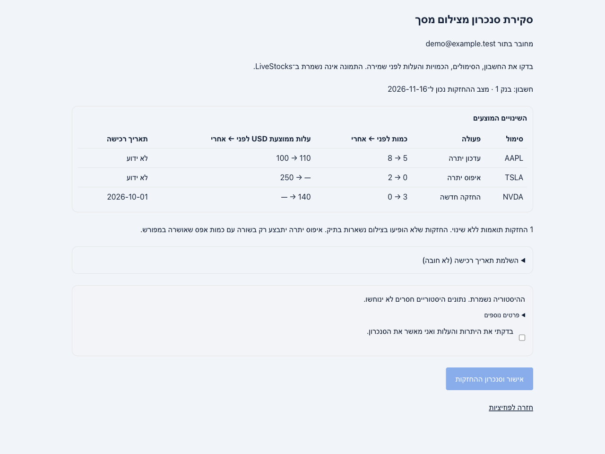
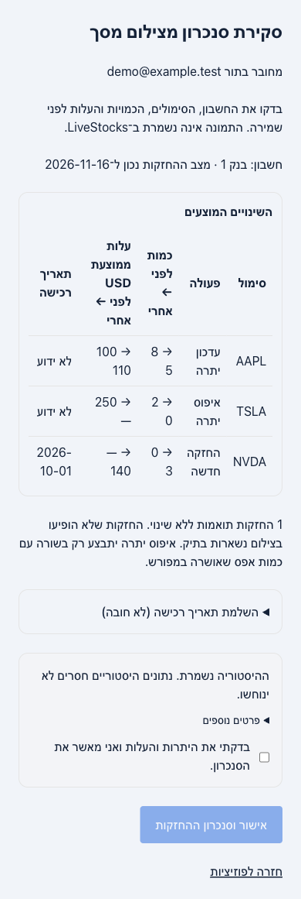

# Screenshot reconciliation

## User flow

A user uploads a holdings screenshot in ChatGPT. Host vision extracts structured observations, asks about ambiguous tickers/currency/decimal separators, and prepares a same-owner review link. No server model, OCR vendor, screenshot upload or public search of private holdings is used. The website shows the logged-in account, brokerage location, observation date, and before/after quantity and USD average cost. Original acquisition dates may remain unknown. Date completion is optional and collapsed by default: enter a known date, return to chat with a transaction screenshot, or request the most recent daily price-range match (within 0.5%, up to five years before the observation). Selecting an estimate stores `estimatedAcquiredOn` / `basis_date_estimate` separately from the actual acquisition date. It never drives historical FX, holding age, or tax-lot assertions. A no-match/provider failure leaves the date unknown without blocking sync. Date edits travel with the same final confirmation; the original snapshot must still match, and there is no extra save step. The user acknowledges the accounting limitations and explicitly confirms the batch.

New, existing, previously closed, and consolidated holdings are supported. Existing quantity and cost changes are not blocked merely because they differ from recorded history. Explicit zero rows clear an observed balance; omitted symbols never mean zero. Positive balances require a known fee-inclusive USD cost. A screenshot preceding any recorded event for that instrument/account is rejected; it must not undo later real trades. Mixed accounts require separate proposals.

## Accounting model

A screenshot provides an observation, not an execution. Each changed instrument receives an immutable `RECONCILE` position-lot event at the observation date, carrying absolute target quantity, fee-inclusive USD average basis, optional verified `basis_acquired_on`, optional separately labeled `basis_date_estimate`, and creation time. This is an accounting checkpoint, not a buy, sale, deposit or taxable event.

- Every historical BUY/SELL lot remains byte-for-byte unchanged. Prior realized sale calculations retain their recorded proceeds, FIFO basis and profit.
- At the checkpoint, the open FIFO queue resets to the observed quantity and basis. Zero clears the queue without generating proceeds, realized profit, fees or tax.
- Later real BUY/SELL lots extend or consume the new FIFO queue normally. A sale consuming snapshot basis carries `basisSource:reconciled_average` and is labeled accordingly: the average-cost screenshot cannot prove the broker’s original tax-lot FIFO. Legacy same-day trade order is preserved before the first checkpoint; checkpoints separate earlier/later events, and subsequent same-day events use creation time; future inserts use `clock_timestamp()` so same-day trades after confirmation occur after the checkpoint. Unknown original dates never use observation-day FX as acquisition FX.
- A later corrected screenshot appends another checkpoint. Checkpoints cannot be edited/deleted through normal writers; review the next before/after balance and append a correction. Account merge may change only the owning profile under its existing executor boundary.
- Multiple ledgers left by account merge are reconciled as one instrument/account balance: the canonical ledger gets the target checkpoint, the other ledgers get explicit zero checkpoints in the same transaction. All their histories remain available; quantities are not multiplied across ledgers.
- Holdings with no lot ledger retain their original metadata; the checkpoint supersedes only the currently open balance, without fabricating prior trades.

### Example

Recorded history: buy 10 at $100, sell 2 at $120. Recorded realized gain remains $40 and the recorded open balance was 8 at $100. A current screenshot shows 5 at $110. Confirmation appends a checkpoint of 5 at $110; current value at a $130 quote is $650 and open gain is $100. It does **not** infer a sale of 3 shares, sale proceeds or another realized gain. A later actual sale of 2 at $130 has a $220 basis and $40 gross gain before its recorded fee. The earlier $40 sale remains intact, but lifetime gain/tax is incomplete because the screenshot does not explain the missing executions.

## Truthful metrics

Current quantity, current USD valuation, fee-inclusive current cost and open USD gain remain calculable. Recorded realized sales remain visible as recorded subtotals. A snapshot cannot reveal missing disposal proceeds, commissions, tax or cash flows, so affected complete historical/cumulative returns and total tax are unavailable rather than zero or guessed. Unknown basis dates also leave holding age, annualized targets and acquisition-date FX unavailable. Reconciled instruments are excluded from complete-history close-group screening. Historical chart paths do not bridge a checkpoint into an invented investment return.

## Isolation, atomicity and replay

Existing MCP OAuth stays `portfolio:read`. `prepare_screenshot_sync` reads only the RLS-scoped owner snapshot and seals the proposal with AES-256-GCM using a domain-separated key derived from the existing Better Auth secret. The encrypted envelope binds canonical owner, schema version, validated input, immutable per-row UUIDs, eligible symbols, full snapshot fingerprint and 15-minute expiry. Secret rotation invalidates pending links.

The proposal is in the URL fragment, cleared after reading, not query parameters or local storage. Reopen the chat link after sign-in/reload if needed. Review and apply are same-origin POST, require the website principal and enforce an explicit limitations acknowledgment on apply. MCP bearer tokens cannot gain write permission or choose another owner. Tampered, expired, wrong-owner and stale proposals fail closed.

The SQL functions are security invoker and use existing RLS and account fences. Bounded transaction locks, a fresh snapshot comparison, validation and all checkpoint inserts happen atomically; any failure rolls back the batch. Replays validate exact immutable checkpoint payloads and return their original receipt without reapplying. Direct SQL/API callers are subject to the same ownership, value, duplicate and observation-date checks.

## Verification and release

Run Vitest, TypeScript, ESLint, production build, and `python3 scripts/test-screenshot-sync-postgres.py`. The disposable PostgreSQL fixture applies all migrations and tests owner isolation, website-only writes, rollback, stale/backdated rejection, exact replay/tamper, explicit closure, consolidated ledgers, immutable checkpoints and byte-for-byte history preservation. Its identity helper is synthetic; this is not a live ChatGPT OAuth test.

Release requires deploying the reviewed migration and compatible readers/writers together, then refreshing existing App tools and publishing the updated OAuth skill through its established workflow. Preserve existing App/plugin IDs, sharing, OAuth scopes and icon assets. No production migration, plugin publication or real-user import is performed by this PR. An actual ChatGPT screenshot-to-website flow and physical-phone rendering remain release acceptance checks.

## Recorded validation (2026-11-16)

- Full Vitest: **955 passed, 3 existing native suites skipped**; skipped suites are not passes.
- Disposable local PostgreSQL: passed full checkpoint, legacy baseline, canonical/consolidated ledger, immutable-history, merge ownership, subsequent real BUY/SELL, replay, tamper, stale/backdated rejection, rollback, owner isolation and frozen-account checks.
- Scriptable: **223 assertions, 36 render scenarios** passed, including missing historical FX.
- Browser: the actual production-built React page was rendered with a **synthetic account and intercepted fixture responses**, on desktop and 390px mobile. The fragment cleared, confirmation stayed disabled until acknowledgment, and explicit confirmation produced the saved state. Mobile document width stayed 390px with no page overflow. This is not proof of a live OAuth/screenshot flow.
- TypeScript, ESLint and production build passed; browser-support dataset age notices are preexisting.

