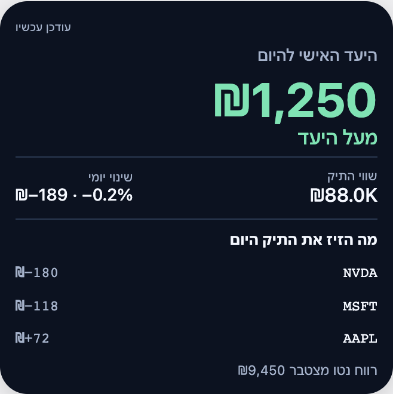
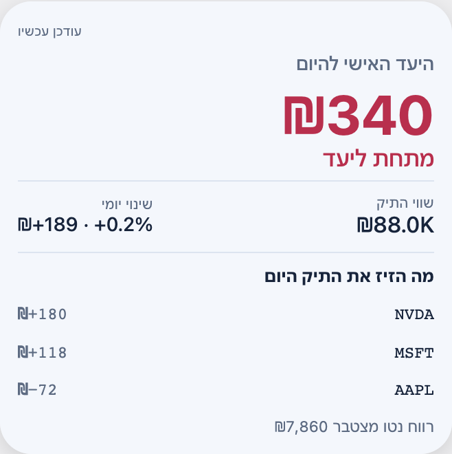

# LiveStocks personal widget — 2026-11-24

The personal-account backend and `POST /api/widget/summary` are live. [25 production API checks](../../docs/verification/widget-production-api-2026-11-15.json) passed, including valid, revoked and expired credentials, restricted scope, cleanup and financial data preservation. This source distribution has not been installed or verified on the user's physical iPhone by this work; device setup, iCloud sync and native rendering remain separate.

## Connect your account

1. Sign in to LiveStocks and open **Settings → Personal widget tokens**. Create a named token and copy it while it is displayed.
2. Install `Stocks Status.js` in Scriptable and run it inside the app. Paste the token into the secure prompt. It is stored in Scriptable's native Keychain under the exact HTTPS site origin.
3. Add a Scriptable widget and select this script. The default is `currency=ILS;mode=target`. To display dollars, use `currency=USD`. If you previously set `mode=value` or `mode=pnl`, remove that parameter or select `mode=target` to see the new layout. To use another deployment, use `baseurl=https://your-host` and run the script with that same host to set up its separate credential.
4. Run the script inside Scriptable again to replace the token or disconnect this device. Revoke a token from the website to invalidate server access. Tokens expire after 90 days.

Never paste a token into the script source, widget parameters, a URL, or an iCloud text file. The script does not write tokens to the filesystem. A changed host does not receive credentials saved for another host; HTTP redirects are disabled. Website sign-out and ChatGPT disconnection do not revoke a separately issued widget token.

The widget caches portfolio data locally for up to one hour and no later than token expiry. Cache names and records are scoped to the HTTPS origin and a non-secret token fingerprint. Missing credentials, known expiry, and HTTP 401/403 clear the cache and show a reconnect prompt; denied requests never fall back to a saved portfolio. The upgrade removes only this widget's legacy `stocks-glance-v3-<hex>.json` cache files. Keychain behavior and prompts are tested with mocked Scriptable APIs; no physical-device claim is made.

## היעד האישי להיום

המספר הגדול מציג את המרחק מיעד הצמיחה האישי שנצבר עד היום. בדוגמה הכהה התיק נמצא ₪1,250 מעל היעד גם אחרי ירידה יומית של ₪189. בדוגמה הבהירה חסרים ₪340 ליעד ביום שבו התיק עלה ב־₪189.

<p>
  
  
</p>

[הדמיה מקומית עם בחירת מצב בהיר או כהה, מטבע ותרחיש](preview.html) — הורידו ופתחו את הקובץ בדפדפן. ארבעת הגדלים מוצגים יחד. ההדמיות הופקו מקוד הווידג׳ט עם נתוני דוגמה. הריווח והגופנים ב־Scriptable עשויים להשתנות לפי המכשיר.

| גודל | פרטים נוספים בתצוגת היעד |
| --- | --- |
| קטן | שווי התיק והשינוי היומי באחוזים |
| בינוני | שווי, שינוי יומי בסכום ובאחוזים, ורווח או הפסד נטו בתחתית |
| גדול | עד שלוש המניות בעלות ההשפעה הכספית היומית הגדולה ביותר. לחיצה על מניה פותחת את העמוד שלה |
| גדול במיוחד | עד שש מניות לפי תרומה יומית, לצד שלוש ההחזקות הגדולות לפי משקלן בתיק |

## Display and verification

The target gap comes from `summary.totalForecastGapIls` or `summary.totalForecastGapUsd`. When unavailable, the widget subtracts the accrued target from net P/L if both amounts exist in the selected currency. A gap that rounds to zero displays “בדיוק ביעד”. If the history is incomplete, the target area explains the missing data. The portfolio value and daily figures can still be available.

Daily movement reflects the quoted price change of the current holdings. In ILS it uses the current FX rate. The time in the margin shows when the widget retrieved the summary. An offline copy is labeled with its age.

Explicit `mode=value` and `mode=pnl` keep the earlier layouts. In those layouts, the small and medium sizes lead with portfolio value. On large and extra-large widgets, `mode=pnl` leads with net P/L.

From this directory, run the display and account-access checks and regenerate the local HTML preview:

```sh
node widget-v7-test.cjs
node widget-auth-test.cjs
node widget-v7-preview.cjs
```

The browser preview covers four sizes, two themes and two currencies. Its scenarios include opposite daily and target directions, a rounded zero, incomplete history and large values. The final check for native text spacing, taps and iCloud installation takes place on an iPhone running Scriptable.

Broker-balance reconciliation keeps current USD holdings/value and open profit available, while incomplete lifetime profit and target gaps remain unavailable. The API includes `dataQuality.completeTransactionHistory` and `reconciledSymbols`. Missing ILS open P/L is never reconstructed by converting USD P/L at today's FX because the historic currency basis can be unknown.
