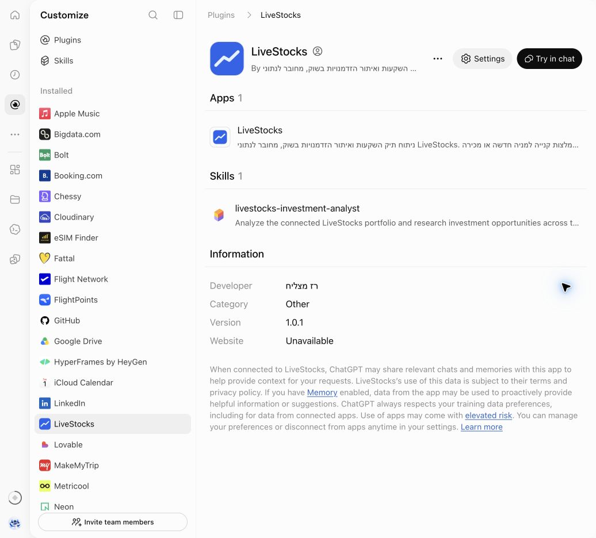

# LiveStocks — historical private source

**Historical source notice (2026-11-15):** this directory retains the old App binding and release history. That plugin was uninstalled with user approval after the new private OAuth connection passed its real host lifecycle tests. The sole installed connection and current skill source are [LiveStocks](../livestocks-oauth/README.md). Do not update or reinstall the old binding as the active connection. Its owned cloud artifact was not permanently deleted.

**Legacy cleanup (2026-11-15):** the two retired cloud entries are now named **לא פעיל — 1** and **לא פעיל — 2**, with a notice not to install or connect them. Both are uninstalled and have no analyst skill files. Their App bindings and stale tool declarations remain: supported private App settings did not expose binding removal or an inactive-icon upload, so they are **not fully empty**. No cloud artifact was deleted or published. This directory remains historical source; the active LiveStocks plugin, its website icon and RABEN audience were unchanged. See [retirement verification](../../docs/verification/legacy-plugin-retirement-2026-11-15.json).

The public preparation files remain here for continuity but now target the new OAuth source; see [PUBLIC_RELEASE.md](PUBLIC_RELEASE.md). Statements below describing the old launch or candidate are historical and are superseded by the current activation evidence.

**Source candidate 1.2.0:** Google-only Better Auth accounts (password/email flows disabled by default; no SMTP needed), account-bound snapshots, stable canonical `get_profile`, and read-only authorization enforced in the API and database. This source has not replaced the published 1.1.0 connection. Production data and the active App binding remain unchanged until the live provider gate and owner migration pass. See [Better Auth setup](../../docs/BETTER_AUTH_SETUP.md), [hosted integration gate](../../docs/HOSTED_AUTH_GATE.md), [account setup and cutover](../../docs/ACCOUNTS.md) and [public-release preparation](PUBLIC_RELEASE.md).

- Display name: **LiveStocks**.
- Plugin: [Open LiveStocks](https://chatgpt.com/plugins/plugin_asdk_app_6af6d6f889a88191ae50abfc0070421b).
- App ID: `asdk_app_6af6d6f889a88191ae50abfc0070421b`.
- MCP endpoint: `https://razmaz-live-stocks.vercel.app/api/mcp`.
- Published skill release: `1.1.0`; local candidate: `1.2.0`.
- Icon: the existing `public/brand/apple-touch-icon.png`, uploaded during the custom MCP connection setup.

## Use

In ChatGPT, use the same account, start a new Chat or Work conversation, and select **LiveStocks** with `@`. Ask it to read the portfolio or analyze investment opportunities. Personalized allocations require a confirmed free-cash budget, investment horizon and risk tolerance.

Tools in this source: `get_profile`, `get_research_brief`, `get_portfolio_snapshot`, `get_close_pair_proposals`, `get_market_quotes`, `validate_action_plan`, `validate_close_proposal`. The research skill requires current external sources and permits only a BUY of an unowned stock, a full SELL across the connected user's accounts, or no action. There is no order execution or portfolio write tool. The candidate requires the same LiveStocks Google account used on the website; do not enter credentials in chat.

## Complete-close group review (1.1.0)

The snapshot now computes the same close-proposal engine used by the site, using original per-account records, all prior sales, available prices and the configured annual target. `get_close_pair_proposals` accepts `maxLosers: 1` (pairs only) or `3` (default, groups of up to three losers); each mode is computed by the shared engine with a distinct snapshot fingerprint. It returns a compact snapshot slice: one winner plus up to three losers, full quantities and account breakdowns, quote timestamps, open versus historical/cumulative profit, gross proceeds and surplus above the personal target. Coverage explicitly distinguishes complete, partial and unavailable data, including missing prices, invalid histories and bounded candidate search. An empty partial result cannot establish that no group exists.

Owner-confirmed screening defaults: at least $50 and 5% open loss, cost-weighted remaining holding age of 30 days unless loss is at least 15%, up to three losers per winner, at most 24 candidate losers. These screening settings do not establish investor horizon or risk tolerance. Each loser must have both open and cumulative losses; historical FIFO remains isolated per account. Tax, future fees and slippage are excluded.

The dedicated review mode researches every company with opened current primary sources, then gives SELL ALL or DO NOT SELL per complete group, with a short reason, strongest caveat, confidence and dated links. It does not force unrelated market screening or BUY suggestions. `validate_close_proposal` requires the exact snapshot fingerprint and proposal ID and rechecks the selected complete group against the newly calculated account-bound snapshot, including full quantities. It needs no BUY budget. A changed snapshot requires rereading/review; a validation pass is not research approval, broker reconciliation or quote freshness. The candidate recalculates private snapshots on each authorized read; market observations can still be stale. Grouping is a recommendation boundary, not atomic execution.

Published on 2026-11-14 as private USER release `pluginrel_6af842632d8c8191aa9425bf0485c771` (1.1.0). Source read-back confirmed both group tools in the skill, the unchanged App binding and identical presentation/manifest metadata except version. PR [#434](https://github.com/razmazlih/live-stocks/pull/434) merged as `220b7766784b9c60ac1d27daddf95149f70d4351`; production deployment `dpl_88nTJzfRQGy7bGdVue1qgDDEmMia` reached READY and was assigned to `https://razmaz-live-stocks.vercel.app`.

Verification: all 361 tests, typecheck, lint and production build passed. Synthetic browser checks covered Hebrew RTL/English LTR, 320/390px and desktop, every group member and switching one-loser/group modes. Production HTTP checks confirmed six read-only tools, exact approved thresholds and account quantities, real qualifying groups in both modes, whole-group validation and rejection of unknown proposal IDs. One mode returned complete coverage; the other explicitly reported four missing quotes and partial coverage. Provider availability can differ between snapshots; do not describe partial coverage as complete. Multi-loser rendering and arithmetic were verified with synthetic groups; the current real-data checks selected two-stock groups. A fresh full research conversation inside ChatGPT using release 1.1.0 has not been tested. The skill requires source research but publication does not prove the host performs it.

## Web research workflow

Release 1.0.2 makes ChatGPT's available web search and page-reading tools the research path. LiveStocks continues to supply portfolio data, existing Finnhub quote observations and action validation. No additional research provider, new API key, server-side model call or dependency was added.

For research requests, the skill directs ChatGPT to search, open primary filings/IR pages, verify the latest reporting period and material developments, compare alternatives, resolve contradictions and cite direct sources beside claims. Public searches use company names/tickers, never private quantities, cash balances or account details. Research starts with screening and deepens for leading candidates to avoid repeated searches.

The skill cannot enable search in a host that does not expose it. If search or essential sources are unavailable, it discloses the gap and withholds final recommendations that depend on missing evidence. Existing BUY-new-only, full-SELL, budget and no-execution rules remain in force.

Publication on 2026-11-13: Plugin Creator saved release `pluginrel_6af6e1989d508191958ee3553b0d63fd` (1.0.2). Source read-back verified the new research workflow, unchanged App binding, presentation and four-tool connection. MCP tests (13), typecheck and lint passed; lint emitted the existing baseline-browser-mapping age notice. A fresh ChatGPT research conversation using the updated release has not been tested; publication does not prove the host will expose or invoke web search.

Server policy deployment: production `live-stocks` reached **READY** at deployment `dpl_DNZo3eFepdAePrLRMhB2iicXbrqy`, built from commit `536f6b553e03a08c388bd8d126e3bdc545722dda`, and is aliased to `https://razmaz-live-stocks.vercel.app`. The production build passed. Read-only HTTP checks confirmed the updated MCP initialization policy, four read-only tools and research brief. The existing baseline-browser-mapping/Browserslist age notices remained non-blocking. No full ChatGPT host research session was run after this release.

Example: `נתח את התיק שלי בעזרת חיפוש ברשת. פתח דוחות ומקורות עדכניים, ציין תאריכים וקישורים והסבר מה תומך ומה סותר כל מסקנה.`

## Why this uses an App binding

An archive with an MCP declaration can be classified as desktop-only, even with a remote HTTPS endpoint. This was observed in the original plugin's actual ChatGPT web listing. The supported cloud setup is **Plugins → Add → Add custom MCP server**, with this existing endpoint. This creates the App-backed plugin represented by `.app.json`.

Preserve the exact App binding and App-owned presentation. Do not add `mcp.json` or `.mcp.json` to this package or recreate the obsolete desktop package. Edit App name/connection metadata through the App's own controls. Update skills through Plugin Creator using the existing plugin ID and its current release ID; read back the saved files. The legacy compatibility manifest is retained to preserve generated App metadata, including its null default prompt.

The supported custom-connection creation screen includes a PNG icon chooser (10 KB maximum). During this setup, no icon-edit control was available for an existing private custom App, so a user-approved branded replacement was created before removing the old registrations.

## Verification and access

On 2026-11-13, the final branded **LiveStocks** plugin read all seven recorded holdings through `get_portfolio_snapshot` in a real ChatGPT web conversation. The user separately confirmed that the final plugin's name and blue site icon appeared and that a fresh portfolio read succeeded in the ChatGPT phone app. This verifies the cloud path rather than relying only on direct HTTP tests or a narrow browser viewport. No transactions or portfolio updates were performed.

The obsolete desktop plugin `Plugin_343a85d949448191914aa200da67b364` was uninstalled and deleted; a metadata lookup returned `NOT_FOUND`. The first unbranded cloud connection, `plugin_asdk_app_6af6d33c4e6881919e385643f9d350ad`, was renamed **LiveStocks Previous** and uninstalled. Its **Delete app** and **Delete plugin** operations returned ChatGPT errors, including after uninstall/reload. Its inactive account registration therefore remains; do not report it as deleted. Only the final branded plugin is installed. This is a platform cleanup limitation, not a portfolio-data or server deletion.

Further diagnosis on the same date identified the exact backend error for both normal UI deletion paths: HTTP `409 Conflict`, `apps_sdk_error`, `App plugin contains independently managed content.` A guarded Plugin Creator cleanup removed the retired plugin's research skill and manifest reference (v1.0.2); read-back confirmed only `.app.json` and its compatibility manifest remain. Both deletion paths still return the same 409. At that cleanup stage the active plugin remained v1.0.1 with its research skill intact; its current release is listed above. At the owner's explicit request, the full [support diagnostic](../../docs/livestocks-plugin-delete-support.txt) was sent through the OpenAI Help Center on 2026-11-13, with instructions to delete only the retired registration and preserve the active plugin. The support chat confirmed escalation to a support specialist and said replies would also arrive by email in the coming days. No case number was displayed; deletion is still pending.

The 1.2.0 source requires Better Auth access tokens bound to the canonical MCP resource and approved client. Website sessions and widget credentials are not MCP credentials. Reads resolve the verified identity to its canonical profile; RLS disallows MCP writes and checks the live session and original private OAuth approval on every request. Refresh cannot recreate a revoked approval. Provider credentials are not packaged or returned. The published legacy connection still uses its previous access model until a separately verified cutover; a private listing alone never protects an API.

Candidate snapshots have no shared personal-data cache. Fingerprints bind source data, policy, calculation day and owner; proposal eligibility is recomputed on validation. `generatedAt` is not quote time. Null prices/FX remain unavailable. Action validation blocks snapshots older than 15 minutes and checks recorded holdings and arithmetic only; ticker aliases, suitability and trade-price freshness require separate verification. Candidate quotes have a five-second per-symbol response deadline; provider work may finish later.

Market news, historical prices and fundamentals come from the host's available research tools, not this server. Without sufficient current evidence, the skill withholds unsupported recommendations.

See the official [desktop-only package limitation](https://learn.chatgpt.com/docs/enterprise/plugin-management#desktop-only-plugins) and [custom MCP setup](https://developers.openai.com/plugins/deploy/connect-chatgpt).

## Existing connection verification — 2026-11-15

Read-only source and ChatGPT Settings inspection confirmed private release `1.1.0` (`pluginrel_6af842632d8c8191aa9425bf0485c771`) and the same App binding. Current App version is `asdk_app_v_6af6d6f889b881918e34cce7bb732ffd`; both **Authorization supported** and **Authorization used** are **None**. No OAuth callback is displayed. The existing connection has **Refresh tools**, but no direct authentication editor before refresh. Nothing was refreshed, published, connected, deleted or recreated during this check.

The [official refresh workflow](https://developers.openai.com/plugins/deploy/connect-chatgpt#refresh-metadata) covers authentication changes. After the hosted gate and coordinated server switch, refresh this existing App, verify OAuth metadata, copy the exact callback exposed by its management flow, seed the fixed client, and test real ChatGPT login/refresh/revocation. An in-place refresh is supported by documentation; migration of this particular no-auth connection has not yet been executed. Do not publish the source candidate as if that gate passed. Preserve `.app.json`, presentation and plugin/App IDs; adding an archive MCP declaration does not edit an App-owned connection.

## Public submission draft (2026-11-15)

[Separate metadata draft](submission-draft/plugin.json) contains supported English listing text (26-character subtitle, Finance category), three prompts, five positive and three negative review cases, and release notes. It is **not an uploadable bundle or ready-to-submit ZIP**. The private App binding and compatibility manifest remain unchanged. The [preparation report](PUBLIC_RELEASE.md) distinguishes local implementation, real-host review, and remaining publisher/demo/reviewer-access requirements. No public upload or publication was performed.

The submission icon gap is resolved: the separate draft now references a 512px PNG listing logo exported directly from the approved SVG, with a 180px composer icon. The coordinator has provisioned authentication-only storage and a READY **unpromoted** maintenance deployment with canonical discovery/JWKS checks and finance-route 503s. This does not claim financial cutover, human Google login, ChatGPT OAuth or public publication.
